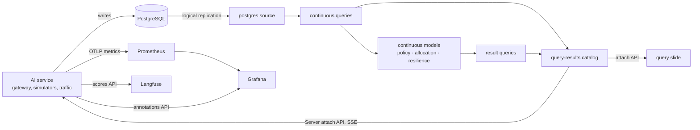

# What Drasi does in the Ignite demo

A maintainer's guide to the demo's Drasi graph: what each part of the talk relies
on, every component and its configuration, and what is real versus built for the
stage. All paths are under `demo/` unless noted.

The graph is one Drasi Server instance (`ignite`) with 25 components, generated by
`ops/config/src/main.rs` into `.native/server.json`. See
[presentation/diagrams/drasi-graph.svg](presentation/diagrams/drasi-graph.svg).

## 1. Drasi's role in the story

The AI service (the `ignite-workloads` process) keeps all state in PostgreSQL.
Drasi follows that database through one logical replication slot, maintains query
results and model outputs, and exposes them through Server's result API. The AI
service subscribes to 15 of those results (snapshot first, then changes) and turns
them into Grafana metrics, Grafana annotations and Langfuse scores. It also uses
them to approve and apply plans and to confirm recovery. Drasi never writes back
to the database or calls Grafana directly.

| Part of the talk | What Drasi does | Components |
|---|---|---|
| **Healthy service** | Keeps the current model (deployments, capacity, routes, policy) joined to fresh health reports. Policy, allocation and resilience produce a *fresh* policy result, a *feasible* plan equal to the current routes, and *safe if one fails*. The bottom row of the Operations dashboard is these results, republished as metrics. | `decision-context` → `policy` → `allocation`, `resilience`; `endpoint-freshness`; `overdue-tasks` |
| **Failure** | EU-A's health reports turn `failed`. Policy re-evaluates, and allocation emits a new feasible plan (support → EU-B, summaries → US-C) within seconds, before Grafana's error alert (evaluated every 10 s over a 30 s window) fires. As each waiting support request passes its 15-second deadline, `trueLater` adds it to `overdue-tasks` with no new change on the row. | `decision-context`, `policy`, `allocation`, `overdue-tasks`, `endpoint-freshness` |
| **Who is affected** | The query slide attaches directly to `overdue-tasks` and lists the late requests. The late-request view looks up the oldest one in the AI service's database; it doesn't come from Drasi. | `overdue-tasks` |
| **Recovery** | Policy shows support denied on US-C (Rego). The presenter approves the plan. The AI service applies it only if the plan's `basis` and `candidate_id` still match Drasi's current allocation result. `recovery-results` decides *confirmed* from two upstream queries: the support queue that predates the change has cleared, at least 3 support requests have completed at the applied revision, the last success is under 15 seconds old, at least 5 seconds have passed since applying, and the new deployment reports `ok`. | `allocation-results`, `recovery-task-context`, `recovery-observation-context`, `recovery-results` |
| **Policy change** (optional) | A policy edit is a model update. Policy and allocation recompute to *infeasible* with a new basis, so the earlier selection's basis no longer matches and the AI service rejects the approval. Restoring the policy brings a feasible plan back. | `decision-context`, `policy`, `allocation` |
| **Healthy but fragile** | A capacity change (EU-A at 50k) recomputes resilience. For each healthy deployment it re-runs allocation without that deployment; losing EU-B leaves no complete assignment, so the result is infeasible with `failure: EU-B`. Restoring EU-A flips it back. | `decision-context`, `policy`, `resilience` |

What Drasi enables here:

- per-item, time-aware results (deadlines and report expiry) without a schedule
- plans recomputed from a joined view of health, capacity and policy on every change
- a fingerprint (`basis`) that makes stale approvals detectable
- outcome verification expressed as a continuous query over other queries' results

## 2. Components

### Sources

| Component | Implementation | Purpose | Configuration |
|---|---|---|---|
| `postgres` | `drasi.postgres/shared-changes` | Every change to the 8 demo tables | `127.0.0.1:15432/ignite`, user `ignite`, password `env:IGNITE_POSTGRES_PASSWORD` (secret reference). Publication and slot `ignite_native`, `slotOwnership: external` (created by `ops/native-runtime.py init`). `persistent: false`. Limits: 4096 changes, 8 MB and 30 s per transaction, 8 MB protocol frames, 10 s I/O timeout, 1 s feedback, 60 s reconnect budget. Consumer progress for every subscriber is tracked in the `pg-consumers` checkpoint resource. |
| `grafana-input` | `drasi.http` source | Turns Grafana alert webhooks into `GrafanaAlert` nodes (an `update` mapping keyed on `groupKey`) | `127.0.0.1:18422`, route `POST /alerts/grafana`, `errorBehavior: reject`. **Not used in the talk:** only the integration probe posts to it, and only when `DRASI_ALERT_URL` is set (empty by default). Grafana's real alerts go to the AI service's webhook, which writes `ignite_alerts`; `alert-context` reads that table. |

Tables in the publication (all `REPLICA IDENTITY FULL`): `ignite_endpoints`,
`ignite_model`, `ignite_tasks`, `ignite_attempts`, `ignite_reports`,
`ignite_breaches`, `ignite_alerts`, `ignite_commands`. `ignite_model` holds one row
(`active`) whose `payload` is the whole scenario as JSON (deployments, workloads,
routes, policy), with `run_epoch` and `revision`.

**Bootstrap.** Each query attached to `postgres` has its own
`drasi.postgres/shared-row-bootstrap` resource and `sourceProgress` checkpoint,
sharing the source's settings, so it starts from a consistent snapshot of the same
slot. Shared resources: `memoryIndexes` (`indexes`), `queryCatalog` (`catalog`) and
the `configuration` secret store.

### Continuous queries

All queries are Cypher, run by `drasi_computation_transformer_query`, with
`outbox_capacity: 128` and memory indexes. Most join a table to the single
`ignite_model` row through a synthetic join on `run_epoch` (`TASK_MODEL`,
`ATTEMPT_MODEL`, `REPORT_MODEL`, `MODEL_COMMAND`). This scopes results to the
current scenario run and makes the model's revision available. A reset starts a
new `run_epoch`, so old rows drop out.

| Query | Reads | Time-aware | Result | Used by |
|---|---|---|---|---|
| `overdue-tasks` | tasks ⋈ model | `trueLater(deadline_ms)` | Unanswered tasks past their deadline | Overdue tile and alert (via metrics); query slide (direct attach) |
| `endpoint-freshness` | reports ⋈ model | `trueLater(expires_ms)` → `unknown` | Each deployment's status; `unknown` 8 s after its last report | Deployment status tile |
| `decision-context` | reports ⋈ model | as above | Report status plus the model `payload`, `revision` | Input to `policy` |
| `recovery-task-context` | tasks ⋈ model (support only) | no | One aggregate row: outstanding, successes and last success at the current revision, oldest pending `created_ms`. Result label `RecoveryTasks` | Input to `recovery-results` |
| `recovery-observation-context` | reports ⋈ model ⋈ commands | no | The applied command, its revision and time, and the support deployment's report status and expiry. Result label `RecoveryObservation` | Input to `recovery-results` |
| `recovery-results` | the two above, joined on `run_epoch` (`RECOVERY_SUMMARY`) | several `trueLater` | `confirmed`, `unconfirmed` or `unknown` per applied command | Recovery tile; the AI service confirms recovery from it |
| `model-context` | model | no | The model row | AI service coherence check (results only count when they match the current epoch and revision) |
| `deadline-history` | tasks | `trueLater(deadline_ms)` | Every task that ever went late | The AI service persists rows into `ignite_breaches` |
| `breach-history` | breaches | no | Persisted breaches | Private diagnostics page only |
| `task-context`, `attempt-context`, `alert-context` | tasks, attempts, alerts | no | Current rows | Private diagnostics page only |
| `endpoint-context` | `ignite_endpoints` | no | Deployment rows | Input to `capacity`. **Static:** this table is only written by `database/reset.sql` |
| `policy-results`, `allocation-results`, `resilience-results` | the models' `Decision` nodes | no | The one `active` decision, flattened (`decision-results.cypher`) | AI service, desk, dashboards; `policy-results` feeds `allocation` and `resilience` |
| `capacity-results` | `CapacityAssessment` nodes | no | Spare capacity per deployment | Catalog only; **not used in the talk** |
| `grafana-alerts` | `GrafanaAlert` nodes | no | Alert state | Catalog only; **not used in the talk** |

**Workaround.** `recovery-results` should be a
`drasi.experimental/volatile-query` bootstrapped from its two upstreams'
snapshots, but that query type can't yet bind a result catalog. It runs as an
ordinary query fed by both upstream outputs, so its state is rebuilt only when the
whole graph starts. Restart all of Server, never just this query.

### Continuous models (transformers)

Native plugins built from this repository, loaded from the plugin directory.

| Component | Plugin / implementation | Input | Output |
|---|---|---|---|
| `capacity` | `drasi_computation_ignite_capacity` | `endpoint-context` | `CapacityAssessment` nodes (budget, reserved, spare, status). Static in the talk, as above |
| `policy` | `drasi_computation_ignite_decisions`, `ignite/policy` | `decision-context` | One `Decision` node (`active`) |
| `allocation` | `ignite/allocation` | `policy-results` | One `Decision` node |
| `resilience` | `ignite/resilience` | `policy-results` | One `Decision` node |

Shared behaviour (`plugins/decisions/src/lib.rs`):

- **Lifecycle.** The transformers are volatile (`GraphProducerIdentity::volatile`). On start each reads its upstream's snapshot through a `nativeOutputSnapshots` resource (`policy-snapshot`, `allocation-snapshot`, `resilience-snapshot`), then applies changes after that cursor; envelopes at or before it are ignored.
- **Inputs.** One upstream. Edges into the models use `ActivationCoupling::RequiresRunning`.
- **Output.** A single element `active` labelled `Decision`, carrying `run_epoch`, `revision`, `policy_revision`, `basis`, `state`, `reason`, `candidate_id`, `valid` and the full decision as `payload`. The plugin emits an insert or replace only when the output changes.

Logic (`domain/src/decision.rs`, `policies/placement.rego`):

- **policy** decodes the model and the three reports. It marks the result `unknown` if they disagree on epoch or revision, a report is missing, or any status is `unknown`. Otherwise it evaluates `placement.rego` (with `regorus`) for every workload × deployment pair. `basis` is a SHA-256 hash of epoch, revision, policy, the report statuses and coherence.
- **allocation** enumerates every complete assignment (at most 3²). A candidate is valid only if the deployment is healthy (`ok`), allowed by policy, and within capacity for the full reservations. It picks the fewest moves, then sorts by identity, and never sheds a workload. `candidate_id` hashes basis and assignments, so approvals bind to both.
- **resilience** runs allocation once per healthy deployment, removing that deployment. It reports the first loss with no complete assignment (`infeasible`, `failure: <id>`), or `feasible` if every loss is survivable. It is never a valid plan to approve.

### Outputs and consumers

There are **no reaction components** in this graph. All results are bound to a
`QueryResultsOutlet` (`query-results`) backed by the `catalog` resource, and
consumers use Server's attach API
(`GET /api/v1/instances/ignite/queries/{name}/attach`, SSE: a `snapshot` event,
then `change` events, with keepalives every 15 s). The talk calls this delivery
"reactions".

| Consumer | Attaches to | Does |
|---|---|---|
| AI service observer (`workloads/src/observer.rs`) | 15 queries | Keeps an in-memory copy of each, rebuilt from a new snapshot on every reconnect. It is only "ready" when every stream is attached, which drives the desk's READY banner. |
| Query slide (`presentation/QuerySlide.tsx`, through the web app's `/server` proxy) | `overdue-tasks` | Lists late requests while the slide is shown |

What the AI service (demo code) does with the results:

- **Metrics.** `workloads/src/dashboard.rs` projects results into the gauge `ignite_drasi_dashboard{view, workload, endpoint}`, with `ignite_drasi_valid_until_seconds{view}` so Grafana shows Unknown when a result goes stale. Views: `overdue`, `endpoint`, `policy`, `configured`, `proposed`, `candidate`, `approval`, `resilience`, `recovery`, `last_approval`, `context`. `last_approval` comes from the database, not Drasi.
- **Approvals** (`decisions.rs`). An approval is accepted only if it matches the current `allocation-results` `basis` and `candidate_id`, and the database still matches the decision's epoch, revision, policy, model and unexpired reports. It is applied (the routes in `ignite_model` change, with a new revision) only after rechecking the same conditions.
- **Recovery.** When `recovery-results` says `confirmed`, the AI service rechecks the same conditions in SQL before marking the command `recovery_confirmed`.
- **Annotations and scores.** Decision events, and the `drasi_recovery` and `drasi_task_completed` scores, are queued in `ignite_publications` and delivered to the Grafana annotations API and Langfuse's scores API. Plan and what-if annotations are written only if the result is unchanged 2 s later.
- **Breaches.** `deadline-history` rows are persisted into `ignite_breaches`, which comes back through the source as `breach-history`.

## 3. Real and demo-ware

| Area | Real | Built for the demo, simulated or shortened |
|---|---|---|
| Drasi | Server, Core, the PostgreSQL source and bootstrap, every query, the native model plugins, `trueLater` scheduling and the result API. Everything shown is computed live | The policy, allocation and resilience logic is demo code, run as Drasi models. The capacity branch and the HTTP source run but nothing in the talk uses them |
| Data | PostgreSQL, logical replication and every row change | The scenario is one JSON `payload` row edited by the desk. Only 2 workloads and 3 deployments are allowed |
| Deployments | HTTP calls from the gateway to each deployment | Three in-process HTTP stubs (`:18531–18533`). `failed` returns 503 and `throttled` returns 429. Answers are canned (`workloads/src/content.rs`). Regions are labels |
| Capacity | The checks: the gateway and allocation refuse plans whose reservations exceed a deployment's budget | Budgets and reservations are numbers in the model; nothing actually rate-limits tokens |
| Health | Reports are real rows with real expiry | The AI service polls each stub's `/health` every second and writes `ignite_reports` (expiry 8 s). That's a scheduled probe; Drasi only reacts to its results |
| Traffic | Real HTTP requests, retries and timings | One support and one summary request every 5 s, for 90 minutes. Retries are unbounded |
| Policy | Rego, evaluated in the `policy` model and again by the gateway before every send | Two rules; the desk edits the summaries rule |
| Approvals | Basis and candidate checks, idempotent commands, audit trail | The presenter desk stands in for a change-approval tool |
| Observability | OpenTelemetry, Prometheus, Grafana, Langfuse, and the alert rules on errors and on Drasi's overdue answer | The "Grafana alerts firing" tile recomputes the two rules' conditions in PromQL, so it can be coloured. The Langfuse score `drasi_policy_allowed` records the gateway's Rego check, not Drasi |
| Timing | — | The 15 s deadline, 8 s report expiry and 5 s plus 3 answers for recovery are all shortened for the stage |
| Talk extras | — | The late-request view reads the AI service's `/tasks/{id}`, not Langfuse. The "What Drasi just did" visuals are static slides. The fallback recordings are captured from the live demo |

## 4. Worth knowing

- **Reactions:** the slides present "reactions" as a Drasi stage, but this graph uses the result API instead of reaction components. A reaction (for example an HTTP or gRPC reaction to the AI service) would make that literal.
- **What "without polling" means here:** the results are change- and time-driven, but the health probe, the Prometheus scrape and Grafana's refresh all run on schedules.
- **Policy runs in two places:** Drasi's `policy` model computes eligibility continuously, and the gateway evaluates the same Rego file at send time as enforcement.
- **Unused branch:** `capacity` / `capacity-results` and `grafana-input` / `grafana-alerts` are exercised by integration tests, not the talk.
- **Known issues:** see [DEVELOPERS.md › Known issues](DEVELOPERS.md#known-issues): the `recovery-results` workaround, unbounded retries, and Server UI issues.
