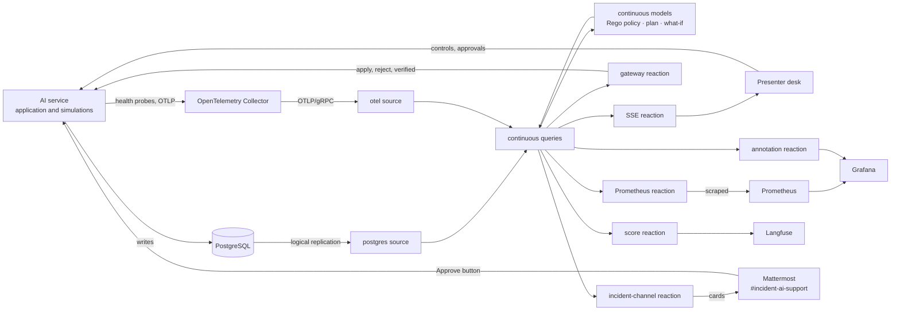

# What Drasi does in the Ignite demo

A maintainer's guide to the demo's Drasi graph: what each part of the talk relies
on, every component and its configuration, and what is simulated. All paths are
under `demo/` unless noted.

The graph is one Drasi Server instance (`ignite`) with 58 components, generated by
`ops/config/src/main.rs` into `.native/server.json`. See
[presentation/diagrams/drasi-graph.svg](presentation/diagrams/drasi-graph.svg).

## 1. Drasi's role in the story

The AI service keeps its state in PostgreSQL and reads none of Drasi's results.
Drasi follows that database through one logical replication slot, and the AI
service's health probes through its OpenTelemetry source. It keeps 46
continuous queries current, and runs three continuous models: a Rego policy, and
an optimizer that produces the plan and the what-if. Six reactions deliver every
answer: a Prometheus endpoint for Grafana's tiles and alert, calls to the
gateway configuration API that apply or reject approvals and record verified
recovery, Grafana annotations, Langfuse scores, a live stream for the
presenter desk, and the incident cards in Mattermost's #incident-ai-support.

| Part of the talk | What Drasi does | Components |
|---|---|---|
| **Healthy service** | Context queries feed the scenario rows and each deployment's latest health probe to the models. The policy allows support on EU-A and EU-B, the plan equals the current routes (0 moves), and the what-if is *safe*. One tile query per Grafana tile turns these into the metrics on the bottom row. | `policy-*`, `plan-*` → `policy`, `plan`, `resilience` → `*-results` → `tile-*` → `metrics` |
| **Failure** | EU-A's health probes turn `failed`: nobody tells Drasi, it derives the status from the probe metrics (`deployment-health`). `plan-bins` changes, and the plan becomes support → EU-B, summaries → US-C (2 moves) within seconds, before Grafana's error alert rule (evaluated every 10 s over 30 s) fires, about 20 s after the failure. As each waiting support request passes its 15-second deadline, `drasi.trueLater` adds it to `overdue-tasks` and `tile-overdue` with no new change on the row. `plan-events` posts "Drasi proposes a plan" to Grafana once the plan has held for 2 s. | `plan-bins`, `plan`, `overdue-tasks`, `tile-*`, `plan-events` → `grafana-annotations` |
| **Who is affected** | The query slide shows `overdue-tasks` live through the desk stream. The late-request view reads the request's history from the AI service, not from Drasi. | `overdue-tasks` → `desk-stream` |
| **Recovery** | The policy denies support on US-C. The desk sends the plan's `candidate_id`, `basis` and `revision` to the approval tool, which only records it. `approval-valid` matches the pending approval to Drasi's current plan, and `gateway-reaction` calls `POST /routes/apply`. `recovery-results` then decides *confirmed*: the support queue that predates the change has cleared, at least 3 support requests have succeeded at the applied revision, the last success is under 15 s old, at least 5 s have passed since applying, and the new deployment's probes read `ok`. `recovery-verified` records it; `recovery-scores` scores the answered requests in Langfuse. | `approval-valid` → `gateway-reaction`; `recovery-*` → `gateway-reaction`, `langfuse-scores` |
| **Policy change** (optional) | The desk removes US-C from summaries' allowed destinations (a data change). The policy denies it, the plan becomes *infeasible*, and `approval-stale` matches the earlier approval to the changed plan; `gateway-reaction` rejects it with Drasi's reason. Restoring the row brings a feasible plan back. | `policy-destinations`, `policy`, `plan`, `approval-stale` → `gateway-reaction` |
| **Healthy but fragile** | EU-A's capacity drops to 50k. `resilience` re-solves the plan once per healthy deployment with that deployment removed; losing EU-B leaves no plan, so the result is `at_risk` with first failure EU-B. Restoring 100k makes it *safe* again. | `plan-bins`, `resilience`, `tile-resilience`, `tile-action` |
| **Incident channel** | Seven event queries turn these changes into cards that `incident-channel` posts to #incident-ai-support: the failure (failed for 3 s), support overdue (3 s), the proposed change with Approve and Reject buttons (the plan unchanged for 5 s), Out of date when the facts change under a posted proposal (2 s), the outcome of an approval in the approved card's thread (applied, verified, or rejected by Drasi), failover at risk and failover restored (3 s). Pressing Approve records the same approval the desk used to send; Drasi then decides as above. | `incident-*` → `incident-channel` |

What Drasi enables here:

- per-item, time-aware results (deadlines and probe expiry) without a schedule
- policy and plans recomputed from health, capacity and policy rows on every change
- a fingerprint (`basis`) that makes stale approvals detectable, and a reaction that acts on it
- outcome verification expressed as a continuous query over other queries' results

## 2. Components

| Kind | Count | Components |
|---|---|---|
| Source | 2 | `postgres`, `otel` |
| Bootstrap provider | 1 | `postgres-bootstrap` |
| Continuous queries | 46 | [2.2](#22-continuous-queries) |
| Continuous models | 3 | `policy`, `plan`, `resilience` |
| Reactions | 6 | `metrics`, `desk-stream`, `gateway-reaction`, `grafana-annotations`, `langfuse-scores`, `incident-channel` |
| Result outlet | 1 | `query-results`: every query through Server's query API |

### 2.1 Sources

| Component | Implementation | Purpose | Configuration |
|---|---|---|---|
| `postgres` | `drasi.postgres/shared-changes` | Every change to the published tables except `ignite_reports` | `127.0.0.1:$IGNITE_POSTGRES_PORT/ignite`, user `ignite`, password `env:IGNITE_POSTGRES_PASSWORD` (secret reference). Publication and slot `$IGNITE_PG_PUBLICATION`/`$IGNITE_PG_SLOT`, `slotOwnership: external` (created by `ops/native-runtime.py init`). `persistent: false`. Limits: 4096 changes, 8 MB and 30 s per transaction, 8 MB protocol frames, 10 s I/O timeout, 1 s feedback, 60 s reconnect budget. Consumer progress for every subscriber is tracked in the `pg-consumers` checkpoint resource |
| `otel` | `drasi.network/otel-source` | The AI service's health probes, from the OpenTelemetry Collector | OTLP/gRPC on `127.0.0.1:$IGNITE_DRASI_OTLP_PORT`. Allowlist `ignite_probe_status`; identity attributes `deployment`, `run_epoch` (one `Metric` per deployment and run, under `(:Service {name: 'ignite-workload'})-[:REPORTS]->`); `maxMetrics` 1,000,000; no dependencies. No bootstrap: its state is volatile and the probes arrive every second |

Published tables (all `REPLICA IDENTITY FULL`): `ignite_scenario` (one row:
`run_epoch`, `revision`), `ignite_workloads`, `ignite_deployments`,
`ignite_routes`, `ignite_policy_destinations`, `ignite_approvals`,
`ignite_tasks`, `ignite_attempts` and `ignite_reports`. The source reads every
published table except `ignite_reports`: with `IGNITE_HEALTH_SOURCE=otel`
(`ports.env`) health does not reach Drasi through PostgreSQL, and Drasi derives
it from the health monitor's probe metrics. The simulation state
(`ignite_simulation`) is not published.

**Bootstrap.** `postgres-bootstrap` is a graph component with the
`BootstrapProvider` role, using `drasi.postgres/shared-row-bootstrap` with the
source's settings. Its `snapshot` output feeds `postgres`'s `bootstrap` input,
and `postgres`'s `snapshot` output feeds the `bootstrap` input of each of the 32
queries that read it. Each query starts from its own consistent snapshot of the
same slot, recorded in its own `sourceProgress` checkpoint. The queries take
their snapshots one after another, so startup time grows with the size of the
tables; `ops/native-runtime.py run` deletes earlier runs' rows before starting
Server, and the instance's `activationTimeoutSecs` is 1200. Shared resources:
`memoryIndexes` (`indexes`), `queryCatalog` (`catalog`) and the `configuration`
secret store.

### 2.2 Continuous queries

All 45 are Cypher files in `drasi/`, run by `drasi_computation_transformer_query`
with `outbox_capacity: 128` and memory indexes. Queries over tables join
`ignite_scenario` on `run_epoch` through synthetic relationships (`JOINS` in
`main.rs`), so a reset, which starts a new `run_epoch`, drops old rows. Queries
over model output read the models' elements (`PolicyDecision`, `Plan`,
`Assignment`, `Resilience`, `LossScenario`) or another query's result label.

| Group | Queries | Reads | Feeds |
|---|---|---|---|
| Health | `deployment-health` (label `DeploymentHealth`) | `otel`: each deployment's latest `ignite_probe_status` for the run: `ok`, `throttled` or `failed`, expiring 8 s after the probe. The deployment and run come from the Metric's id | `plan-bins`, `tile-deployments`, `tile-capacity`, `incident-deployments`, `incident-failed`, `recovery-observation-context` |
| Model inputs | `policy-input` | One row per workload × deployment: the pair's properties and whether it is an allowed destination | `policy` (`in`) |
| | `plan-items` | Workloads ⋈ routes, with the scenario `revision` | `plan`, `resilience` (`items`) |
| | `plan-bins` | Deployments ⋈ latest probe (`DeploymentHealth`); `unknown` once it expires (`trueLater(expires_ms)`) | `plan`, `resilience` (`bins`) |
| Model results | `policy-results` | `PolicyDecision` | `plan`, `resilience` (`eligibility`); `tile-policy`, `tile-running` |
| | `plan-results`, `assignment-results` | `Plan`, `Assignment` | Tiles, approval queries, `plan-events`, desk |
| | `resilience-results`, `loss-results` | `Resilience`, `LossScenario` | `tile-action`, `tile-resilience`; `loss-results` only the result outlet |
| Requests | `overdue-tasks` | Unanswered tasks past their deadline (`trueLater(deadline_ms)`) | Query slide and desk (`desk-stream`) |
| | `task-context`, `attempt-context`, `deadline-history` | Tasks, attempts, every task that ever went late | Result outlet only (tests) |
| Recovery | `recovery-task-context` (label `RecoveryTasks`) | One aggregate row of support tasks at the current revision | `recovery-results` |
| | `recovery-observation-context` (label `RecoveryObservation`) | The applied approval, its route's `applied_ms` and the support deployment's latest probe | `recovery-results` |
| | `recovery-results` (label `RecoveryResult`) | The two above (`RECOVERY_SUMMARY`), with several `trueLater` | `tile-recovery`, `recovery-verified` |
| Tiles | `tile-overdue`, `tile-deployments`, `tile-change`, `tile-action`, `tile-resilience` (Grafana's Decision Support row); `tile-capacity`, `tile-demand`, `tile-recovery`, `tile-running`, `tile-proposed`, `tile-policy`, `tile-last-approval` (the desk and tests) | One query per tile, returning exactly the value shown; `tile-action` and `tile-resilience` also return the answer's wording as `text` ([contracts.md › Operations dashboard](plan/contracts.md#16-operations-dashboard)) | `metrics`; five also `desk-stream` |
| Reaction drivers | `approval-valid` | A pending approval whose `candidate_id`, `basis` and `revision` match a feasible `Plan` | `gateway-reaction` (`approve`) |
| | `approval-stale` | A pending approval that doesn't match the current `Plan`, with the reason | `gateway-reaction` (`reject`) |
| | `recovery-verified` | A `confirmed` recovery result | `gateway-reaction` (`verified`) |
| | `approval-events` | An approval's status for 30 s after it changes | `grafana-annotations` |
| | `plan-events` | A feasible plan with moves, held for 2 s (`trueFor`) | `grafana-annotations` |
| | `recovery-scores` | Support tasks answered at the revision of a verified approval | `langfuse-scores` |
| Incident card facts | `incident-overdue-count` (label `SupportOverdue`) | Support requests overdue now (`trueLater(deadline_ms)`) and the next deadline | `incident-overdue` |
| | `incident-deployments` (label `DeploymentFacts`) | Deployments ⋈ latest probe: "EU-A is down", and healthy capacity "EU-B 100k, US-C 100k" (sorted) | `incident-proposal` |
| | `incident-policy` (label `PolicyFacts`) | `PolicyResult` ⋈ workloads: allowed destinations per workload with its rule, and demand | `incident-proposal` |
| Incident cards | `incident-failed`, `incident-overdue`, `incident-proposal`, `incident-superseded`, `incident-outcome`, `incident-at-risk`, `incident-restored` | One row per card, from the event to its card text ([contracts.md › Incident cards](plan/contracts.md#15-incident-cards)) | `incident-channel` |

Every query also feeds `query-results`, so all of them can be read through
Server's API.

### 2.3 Continuous models

Native plugins loaded from the plugin directory: Drasi's standard Rego policy
(`drasi.standard/policy`) and this demo's optimizer (`plugins/`). Each is volatile: on start it reads its upstream outputs' snapshots
through a `nativeOutputSnapshots` resource, then applies later changes. It emits
only changed elements, and emits `unknown` rather than a guess when an input is
missing, inconsistent or times out.

| Component | Implementation | Inputs | Output |
|---|---|---|---|
| `policy` | Drasi's `drasi.standard/policy` (`drasi_computation_transformer_policy`, `regorus`) | `in` ← `policy-input` | One `PolicyDecision` per `policy-input` row: `allowed`, `reason`, `policy_status`, `policy_hash`, `policy_input_fingerprint`; `policy-results` maps them to `state` (`allowed`, `denied`, `unknown`) |
| `plan` | Drasi's `drasi.standard/optimization` (`drasi_computation_transformer_optimization`, `good_lp` with `microlp`) | `in` ← `plan-context`, `plan-items`, `plan-bins`, `plan-candidates`, `policy-results` | One `PlanStatus` (`status`, `signature`, `solutionSignature`, `objectives`, `summaries`, `scenarios.loss`, `setSizes`, `provenance`), one `Assignment` per workload while optimal, and one `LossScenario` per healthy deployment; `plan-results`, `assignment-results`, `resilience-results` and `loss-results` read them |

Configuration:

- **Policy.** Drasi's standard Rego component. The demo supplies only the rules (`drasi/policy/ignite.rego`, inlined by the config generator) and a query, `policy-input`, that says what to decide: one row per workload × deployment. The rule `data.ignite.assessment` runs for each row with the workload, the deployment and its allowed destination. A pair is allowed when the deployment is an allowed destination, the region matches the workload's requirement (`EU` or `any`) and the model matches. Changing the allowed destinations (the talk's policy edit) is a data change, and only that pair's decision changes. Changing the module is an in-place configuration update. Each evaluation is bounded to 250 ms (`drasi/policy/policy.json`). The component starts from `policy-input`'s snapshot. Anything except a clear yes or no reads as `unknown`, never allowed.
- **Optimizer.** Drasi's standard optimization component. The demo supplies only a declarative model (`drasi/optimization/optimization.json`) and the queries that feed it.
  - **Model:** one yes/no `assign` per workload × deployment that is allowed, healthy and has room (`plan-candidates` joins demand, current route and capacity; `policy-results` says allowed). Each workload is placed exactly once (nothing is shed), within capacity. Objectives: fewest moves, then the lowest peak use.
  - **What-if:** the `loss` scenario re-solves without each healthy deployment and lists the losses that leave no plan.
  - **Preconditions:** if health or policy is unknown, a decision is missing, or the inputs belong to another revision, the answer is `unknown`, never a guess.
  - **Timing:** changes within 100 ms are solved together in the background, with a 2 s limit.
  - **Identities:** `basis` is the signature of exactly what was solved, and `candidate_id` that of the published plan, so an approval binds to both.
  - **Startup:** the component starts from its input queries' snapshots.

### 2.4 Reactions

| Component | Implementation | Inputs | Delivers |
|---|---|---|---|
| `metrics` | `ignite/prometheus-exporter` (`drasi_computation_ignite_prometheus`, written for this demo) | The 12 tile queries | Each row as a gauge on `127.0.0.1:$IGNITE_DRASI_METRICS_PORT/metrics` (mapping in `plugins/prometheus/examples/ignite.json`), plus `drasi_reaction_input_ready{output}`. Prometheus scrapes it every 2 s; an input that isn't loaded exports no series, which Grafana shows as Unknown |
| `desk-stream` | `drasi.network/sse-sink` | `overdue-tasks`, `plan-results` and five tiles | `GET /events` on `127.0.0.1:$IGNITE_DRASI_SSE_PORT` (heartbeat every 10 s) and `GET /snapshot/{query}`. The desk and projector read it through the web app's `/drasi-stream` proxy |
| `gateway-reaction` | `drasi.network/http-sink` | `approval-valid`, `approval-stale`, `recovery-verified` | `POST /routes/apply`, `/approvals/{id}/reject` and `/approvals/{id}/verified` on the AI service's gateway configuration API. `onPermanentFailure: stall`, 10 retries within 30 s |
| `grafana-annotations` | `drasi.network/http-sink` | `approval-events`, `plan-events` | `POST /api/annotations` (tag `ignite-decision`) with the `env:IGNITE_GRAFANA_TOKEN` service-account token. `onPermanentFailure: skip`, 3 retries |
| `langfuse-scores` | `drasi.network/http-sink` | `recovery-scores` | `POST /api/public/scores` (`drasi_recovery`) with `env-json:IGNITE_LANGFUSE_HEADERS`. `onPermanentFailure: skip`, 3 retries |
| `incident-channel` | `drasi.network/http-sink` | The seven `incident-*` card queries | `POST /api/v4/posts` on Mattermost (`127.0.0.1:$IGNITE_MATTERMOST_PORT`) as the `drasi` bot (`env:IGNITE_MATTERMOST_BOT_TOKEN`), into the channel named in `.native/mattermost.json`. Success is `201`; `onPermanentFailure: skip`, 3 retries, 5 s timeout. The proposal's buttons call `http://host.containers.internal:$IGNITE_WORKLOAD_PORT/mattermost/actions` |

The HTTP reactions post only additions (and updates, for approval annotations):
`unroutedChanges: ignore`, an option added on this branch of drasi-core, drops
other changes. Every request carries `x-drasi-delivery-id`; the gateway
configuration API is idempotent on it and on the approval's status, and applies
routes only if the scenario revision still equals the plan's.

**Incident cards.** Each card query returns one row per card, and the reaction
posts it when the row is added. The queries write every string; the templates
only place them. Three rules keep the channel honest:

- **Debounced.** A row appears only once its state has held: `drasi.trueFor`
  (failed, overdue, at risk, restored) or `drasi.trueLater` on the plan's
  `solved_ms` (proposal 5 s, Out of date 2 s) or the approval's `decided_ms`
  (outcome 1 s). The failure card therefore comes before the proposal, and an
  Out of date card before the proposal that replaces it.
- **Once.** The row leaves when its state ends and no later than 60 s after its
  event, so it is never posted twice. Updates to a posted row (a health probe
  every second) post nothing.
- **Only what Drasi saw happen.** `drasi.previousDistinctValue` keeps the state
  before the current one: a failure card needs a healthy probe before it, an
  overdue card a clear queue, a proposal or at-risk card a known earlier plan or
  state of the same run. After a Server restart, or a reset, a standing state is
  therefore not posted again. Outcomes carry `decided_ms` from the database, so
  the 60 s window holds across restarts too.

Out of date is posted only for a proposal that stood 5 s (so its card was
posted) and that was replaced for another reason than being applied (applied:
the new plan has no moves and the same assignments). Outcomes reply in the
thread of the card that was approved (`ignite_approvals.post_id`); everything
else is a new post.

`query-results` is Server's result outlet: the Drasi Server UI, the private
diagnostics page (`/inspect`) and the integration tests read queries through
`GET /api/v1/instances/ignite/queries/{name}/attach`.

## 3. What is simulated

Drasi Server, Core, every component above and everything the talk attributes to
Drasi run for real. These parts are simulated or shortened for the stage:

| Area | Simulated or shortened |
|---|---|
| Model deployments | Three in-process HTTP stubs in the AI service. `failed` returns 503, `throttled` 429. Answers are canned (`workloads/src/content.rs`); regions are labels |
| Capacity | Numbers in `ignite_deployments` and `ignite_workloads`. Nothing actually rate-limits tokens |
| Health monitor | The AI service probes each stub's `/health` every second and exports the result as OpenTelemetry metrics (`ignite_probe_*`); the Collector forwards them to Drasi. The desk's faults set the stubs' mode |
| Traffic | One support and one summary request every 5 s, for 90 minutes. Retries are unbounded |
| Change-approval tool | `POST /approvals` in the AI service: records what the desk sends, nothing else |
| Gateway configuration API | `POST /routes/apply`, `/approvals/{id}/reject`, `/approvals/{id}/verified` in the AI service, called only by `gateway-reaction` |
| Scenario size | 2 workloads and 3 deployments |
| Timing | The 15 s deadline, 8 s probe expiry, and 5 s plus 3 answers for recovery are shortened for the stage |
| Talk extras | Reset deletes the previous run's Grafana annotations (a demo control). The late-request view reads the AI service's `/tasks/{id}`. The "What Drasi just did" visual (after Healthy but fragile) is a static slide. The fallback recordings are captured from the live demo |

## 4. Worth knowing

- **The AI service reads nothing from Drasi.** Routes change only when
  `gateway-reaction` calls the gateway configuration API. Its compare-and-set on
  the scenario revision is ordinary optimistic concurrency, not a second policy
  check: the gateway never evaluates policy or plans.
- **Three plugins are this demo's own:** the Rego policy, the optimizer and the
  Prometheus reaction (`plugins/`). They are generic: the rules, the items and
  capacities, and the metric mapping are configuration.
- **What "without polling" means here:** no answer is recomputed on a schedule;
  results change with each change and each deadline. The health monitor,
  Prometheus's scrape of the reaction (every 2 s) and Grafana's refresh (every
  5 s) still run on schedules.
- **Drasi detects failure from telemetry.** No component tells Drasi a
  deployment is down. The health monitor's probes are ordinary OpenTelemetry
  metrics; Drasi's OpenTelemetry source turns them into a live graph, and
  continuous queries turn that into Healthy, Over quota or Failed, and into
  Unknown when a deployment goes quiet for 8 seconds (`drasi.trueLater`).
  `IGNITE_HEALTH_SOURCE=postgres` (`ports.env`) restores the earlier path,
  where the monitor writes `ignite_reports`.
- **Grafana's alerts stay in Grafana.** Its two rules (model-call errors, and
  Drasi's overdue count) fire in Grafana; nothing sends alerts to Drasi.
- **Server's reaction list is empty.** `GET /api/v1/instances/ignite/reactions`
  returns none of the six native sinks, so the Server UI shows no reactions;
  they appear only in `.native/server.json`.
- **Known issues:** see [DEVELOPERS.md › Known issues](DEVELOPERS.md#known-issues),
  including the query-to-query bootstrap gap behind `recovery-results` and
  `tile-capacity`.
