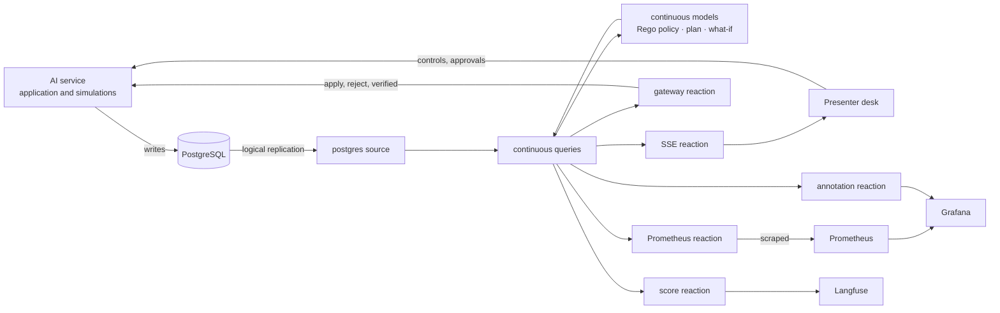

# What Drasi does in the Ignite demo

A maintainer's guide to the demo's Drasi graph: what each part of the talk relies
on, every component and its configuration, and what is simulated. All paths are
under `demo/` unless noted.

The graph is one Drasi Server instance (`ignite`) with 45 components, generated by
`ops/config/src/main.rs` into `.native/server.json`. See
[presentation/diagrams/drasi-graph.svg](presentation/diagrams/drasi-graph.svg).

## 1. Drasi's role in the story

The AI service keeps its state in PostgreSQL and reads none of Drasi's results.
Drasi follows that database through one logical replication slot, keeps 35
continuous queries current, and runs three continuous models: a Rego policy, and
an optimizer that produces the plan and the what-if. Five reactions deliver every
answer: a Prometheus endpoint for Grafana's tiles and alert, calls to the
gateway configuration API that apply or reject approvals and record verified
recovery, Grafana annotations, Langfuse scores, and a live stream for the
presenter desk.

| Part of the talk | What Drasi does | Components |
|---|---|---|
| **Healthy service** | Context queries feed the scenario rows and each deployment's latest health report to the models. The policy allows support on EU-A and EU-B, the plan equals the current routes (0 moves), and the what-if is *safe*. One tile query per Grafana tile turns these into the metrics on the bottom row. | `policy-*`, `plan-*` → `policy`, `plan`, `resilience` → `*-results` → `tile-*` → `metrics` |
| **Failure** | EU-A's health reports turn `failed`. `plan-bins` changes, and the plan becomes support → EU-B, summaries → US-C (2 moves) within seconds, before Grafana's error alert rule (evaluated every 10 s over 30 s) fires, about 20 s after the failure. As each waiting support request passes its 15-second deadline, `drasi.trueLater` adds it to `overdue-tasks` and `tile-overdue` with no new change on the row. `plan-events` posts "Drasi proposes a plan" to Grafana once the plan has held for 2 s. | `plan-bins`, `plan`, `overdue-tasks`, `tile-*`, `plan-events` → `grafana-annotations` |
| **Who is affected** | The query slide shows `overdue-tasks` live through the desk stream. The late-request view reads the request's history from the AI service, not from Drasi. | `overdue-tasks` → `desk-stream` |
| **Recovery** | The policy denies support on US-C. The desk sends the plan's `candidate_id`, `basis` and `revision` to the approval tool, which only records it. `approval-valid` matches the pending approval to Drasi's current plan, and `gateway-reaction` calls `POST /routes/apply`. `recovery-results` then decides *confirmed*: the support queue that predates the change has cleared, at least 3 support requests have succeeded at the applied revision, the last success is under 15 s old, at least 5 s have passed since applying, and the new deployment reports `ok`. `recovery-verified` records it; `recovery-scores` scores the answered requests in Langfuse. | `approval-valid` → `gateway-reaction`; `recovery-*` → `gateway-reaction`, `langfuse-scores` |
| **Policy change** (optional) | The desk removes US-C from summaries' allowed destinations (a data change). The policy denies it, the plan becomes *infeasible*, and `approval-stale` matches the earlier approval to the changed plan; `gateway-reaction` rejects it with Drasi's reason. Restoring the row brings a feasible plan back. | `policy-destinations`, `policy`, `plan`, `approval-stale` → `gateway-reaction` |
| **Healthy but fragile** | EU-A's capacity drops to 50k. `resilience` re-solves the plan once per healthy deployment with that deployment removed; losing EU-B leaves no plan, so the result is `at_risk` with first failure EU-B. Restoring 100k makes it *safe* again. | `plan-bins`, `resilience`, `tile-resilience`, `tile-action` |

What Drasi enables here:

- per-item, time-aware results (deadlines and report expiry) without a schedule
- policy and plans recomputed from health, capacity and policy rows on every change
- a fingerprint (`basis`) that makes stale approvals detectable, and a reaction that acts on it
- outcome verification expressed as a continuous query over other queries' results

## 2. Components

| Kind | Count | Components |
|---|---|---|
| Source | 1 | `postgres` |
| Bootstrap provider | 1 | `postgres-bootstrap` |
| Continuous queries | 34 | [2.2](#22-continuous-queries) |
| Continuous models | 3 | `policy`, `plan`, `resilience` |
| Reactions | 5 | `metrics`, `desk-stream`, `gateway-reaction`, `grafana-annotations`, `langfuse-scores` |
| Result outlet | 1 | `query-results`: every query through Server's query API |

### 2.1 Sources

| Component | Implementation | Purpose | Configuration |
|---|---|---|---|
| `postgres` | `drasi.postgres/shared-changes` | Every change to the 9 published tables | `127.0.0.1:$IGNITE_POSTGRES_PORT/ignite`, user `ignite`, password `env:IGNITE_POSTGRES_PASSWORD` (secret reference). Publication and slot `$IGNITE_PG_PUBLICATION`/`$IGNITE_PG_SLOT`, `slotOwnership: external` (created by `ops/native-runtime.py init`). `persistent: false`. Limits: 4096 changes, 8 MB and 30 s per transaction, 8 MB protocol frames, 10 s I/O timeout, 1 s feedback, 60 s reconnect budget. Consumer progress for every subscriber is tracked in the `pg-consumers` checkpoint resource |

Published tables (all `REPLICA IDENTITY FULL`): `ignite_scenario` (one row:
`run_epoch`, `revision`), `ignite_workloads`, `ignite_deployments`,
`ignite_routes`, `ignite_policy_destinations`, `ignite_approvals`,
`ignite_tasks`, `ignite_attempts` and `ignite_reports`. The simulation state (`ignite_simulation`) is not published:
Drasi sees health only through reports.

**Bootstrap.** `postgres-bootstrap` is a graph component with the
`BootstrapProvider` role, using `drasi.postgres/shared-row-bootstrap` with the
source's settings. Its `snapshot` output feeds `postgres`'s `bootstrap` input,
and `postgres`'s `snapshot` output feeds the `bootstrap` input of each of the 21
queries that read it. Each query starts from its own consistent snapshot of the
same slot, recorded in its own `sourceProgress` checkpoint. The queries take
their snapshots one after another, so startup time grows with the size of the
tables; `ops/native-runtime.py run` deletes earlier runs' rows before starting
Server, and the instance's `activationTimeoutSecs` is 1200. Shared resources:
`memoryIndexes` (`indexes`), `queryCatalog` (`catalog`) and the `configuration`
secret store.

### 2.2 Continuous queries

All 34 are Cypher files in `drasi/`, run by `drasi_computation_transformer_query`
with `outbox_capacity: 128` and memory indexes. Queries over tables join
`ignite_scenario` on `run_epoch` through synthetic relationships (`JOINS` in
`main.rs`), so a reset, which starts a new `run_epoch`, drops old rows. Queries
over model output read the models' elements (`PolicyDecision`, `Plan`,
`Assignment`, `Resilience`, `LossScenario`) or another query's result label.

| Group | Queries | Reads | Feeds |
|---|---|---|---|
| Model inputs | `policy-workloads`, `policy-deployments`, `policy-destinations` | Workloads, deployments, allowed destinations | `policy` (`subjects`, `targets`, `parameters`) |
| | `plan-items` | Workloads ⋈ routes, with the scenario `revision` | `plan`, `resilience` (`items`) |
| | `plan-bins` | Deployments ⋈ latest report; `unknown` once the report expires (`trueLater(expires_ms)`) | `plan`, `resilience` (`bins`) |
| Model results | `policy-results` | `PolicyDecision` | `plan`, `resilience` (`eligibility`); `tile-policy`, `tile-running` |
| | `plan-results`, `assignment-results` | `Plan`, `Assignment` | Tiles, approval queries, `plan-events`, desk |
| | `resilience-results`, `loss-results` | `Resilience`, `LossScenario` | `tile-action`, `tile-resilience`; `loss-results` only the result outlet |
| Requests | `overdue-tasks` | Unanswered tasks past their deadline (`trueLater(deadline_ms)`) | Query slide and desk (`desk-stream`) |
| | `task-context`, `attempt-context`, `deadline-history` | Tasks, attempts, every task that ever went late | Result outlet only (tests) |
| Recovery | `recovery-task-context` (label `RecoveryTasks`) | One aggregate row of support tasks at the current revision | `recovery-results` |
| | `recovery-observation-context` (label `RecoveryObservation`) | The applied approval, its route's `applied_ms` and the support deployment's latest report | `recovery-results` |
| | `recovery-results` (label `RecoveryResult`) | The two above (`RECOVERY_SUMMARY`), with several `trueLater` | `tile-recovery`, `recovery-verified` |
| Tiles | `tile-overdue`, `tile-deployments`, `tile-change`, `tile-action`, `tile-resilience` (Grafana's Decision Support row); `tile-capacity`, `tile-demand`, `tile-recovery`, `tile-running`, `tile-proposed`, `tile-policy`, `tile-last-approval` (the desk and tests) | One query per tile, returning exactly the value shown; `tile-action` and `tile-resilience` also return the answer's wording as `text` ([contracts.md › Operations dashboard](plan/contracts.md#16-operations-dashboard)) | `metrics`; five also `desk-stream` |
| Reaction drivers | `approval-valid` | A pending approval whose `candidate_id`, `basis` and `revision` match a feasible `Plan` | `gateway-reaction` (`approve`) |
| | `approval-stale` | A pending approval that doesn't match the current `Plan`, with the reason | `gateway-reaction` (`reject`) |
| | `recovery-verified` | A `confirmed` recovery result | `gateway-reaction` (`verified`) |
| | `approval-events` | An approval's status for 30 s after it changes | `grafana-annotations` |
| | `plan-events` | A feasible plan with moves, held for 2 s (`trueFor`) | `grafana-annotations` |
| | `recovery-scores` | Support tasks answered at the revision of a verified approval | `langfuse-scores` |

Every query also feeds `query-results`, so all of them can be read through
Server's API.

### 2.3 Continuous models

Native plugins in `plugins/`, written for this demo and loaded from the plugin
directory. Each is volatile: on start it reads its upstream outputs' snapshots
through a `nativeOutputSnapshots` resource, then applies later changes. It emits
only changed elements, and emits `unknown` rather than a guess when an input is
missing, inconsistent or times out.

| Component | Implementation | Inputs | Output |
|---|---|---|---|
| `policy` | `ignite/rego-policy` (`drasi_computation_ignite_policy`, `regorus`) | `subjects` ← `policy-workloads`, `targets` ← `policy-deployments`, `parameters` ← `policy-destinations` | One `PolicyDecision` per workload × deployment: `state` (`allowed`, `denied`, `unknown`), `reason`, `policy_hash`, `basis` |
| `plan` | `ignite/assignment-plan` (`drasi_computation_ignite_optimizer`, `good_lp` with `microlp`) | `items` ← `plan-items`, `bins` ← `plan-bins`, `eligibility` ← `policy-results` | One `Plan` (`state`, `candidate_id`, `basis`, `revision`, `assignments`, `moves`, `reason`) and one `Assignment` per workload while feasible |
| `resilience` | `ignite/assignment-resilience` (same plugin) | As `plan` | One `Resilience` (`state` `safe`, `at_risk` or `unknown`, `first_failure`, `unhealthy_bins`) and one `LossScenario` per healthy deployment |

Configuration:

- **Policy.** The rules are the component's configuration: `plugins/policy/ignite.rego`, inlined by the config generator, evaluated as `data.ignite.assessment` for each pair with the workload, the deployment and that workload's allowed-destination rows. A pair is allowed when the deployment is an allowed destination, the region matches the workload's requirement (`EU` or `any`) and the model matches. Changing the allowed destinations (the talk's policy edit) is a data change; changing the module is a configuration update. Each evaluation is bounded to 250 ms (`plugins/policy/examples/ignite.json`).
- **Optimizer.** `plugins/optimizer/examples/ignite.json` names the input properties (demand, current deployment, capacity, health, eligibility), the constraints (`assignEachItemOnce`: nothing is shed; `binCapacity`) and the objective (`fewestMoves`, then `lowestPeakUtilisation`; ties broken by sorted keys). Only deployments whose health is `ok` receive work. Changes within 100 ms are solved together on one worker thread, with a 2 s time limit; a result for superseded inputs is discarded. `basis` hashes exactly what was solved and `candidate_id` hashes `basis` and the assignments, so an approval binds to both. `resilience` removes each healthy deployment in turn and reports the first whose loss leaves no plan.

### 2.4 Reactions

| Component | Implementation | Inputs | Delivers |
|---|---|---|---|
| `metrics` | `ignite/prometheus-exporter` (`drasi_computation_ignite_prometheus`, written for this demo) | The 12 tile queries | Each row as a gauge on `127.0.0.1:$IGNITE_DRASI_METRICS_PORT/metrics` (mapping in `plugins/prometheus/examples/ignite.json`), plus `drasi_reaction_input_ready{output}`. Prometheus scrapes it every 2 s; an input that isn't loaded exports no series, which Grafana shows as Unknown |
| `desk-stream` | `drasi.network/sse-sink` | `overdue-tasks`, `plan-results` and five tiles | `GET /events` on `127.0.0.1:$IGNITE_DRASI_SSE_PORT` (heartbeat every 10 s) and `GET /snapshot/{query}`. The desk and projector read it through the web app's `/drasi-stream` proxy |
| `gateway-reaction` | `drasi.network/http-sink` | `approval-valid`, `approval-stale`, `recovery-verified` | `POST /routes/apply`, `/approvals/{id}/reject` and `/approvals/{id}/verified` on the AI service's gateway configuration API. `failurePolicy: strict`, 10 retries within 30 s |
| `grafana-annotations` | `drasi.network/http-sink` | `approval-events`, `plan-events` | `POST /api/annotations` (tag `ignite-decision`) with the `env:IGNITE_GRAFANA_TOKEN` service-account token. `failurePolicy: skip`, 3 retries |
| `langfuse-scores` | `drasi.network/http-sink` | `recovery-scores` | `POST /api/public/scores` (`drasi_recovery`) with `env-json:IGNITE_LANGFUSE_HEADERS`. `failurePolicy: skip`, 3 retries |

The HTTP reactions post only additions (and updates, for approval annotations):
`unroutedChanges: ignore`, an option added on this branch of drasi-core, drops
other changes. Every request carries `x-drasi-delivery-id`; the gateway
configuration API is idempotent on it and on the approval's status, and applies
routes only if the scenario revision still equals the plan's.

`query-results` is Server's result outlet: the Drasi Server UI, the private
diagnostics page (`/inspect`) and the integration tests read queries through
`GET /api/v1/instances/ignite/queries/{name}/attach`.

## 3. What is simulated

Drasi Server, Core, every component above and everything the talk attributes to
Drasi run for real. These parts are simulated or shortened for the stage:

| Area | Simulated or shortened |
|---|---|
| Model deployments | Three in-process HTTP stubs in the AI service. `failed` returns 503, `throttled` 429. Answers are canned (`workloads/src/content.rs`); regions are labels |
| Capacity | Numbers in `ignite_deployments` and `ignite_workloads`. Nothing actually rate-limits tokens |
| Health monitor | The AI service checks each stub every second and writes `ignite_reports` (expiry 8 s); the desk's faults set the stubs' mode |
| Traffic | One support and one summary request every 5 s, for 90 minutes. Retries are unbounded |
| Change-approval tool | `POST /approvals` in the AI service: records what the desk sends, nothing else |
| Gateway configuration API | `POST /routes/apply`, `/approvals/{id}/reject`, `/approvals/{id}/verified` in the AI service, called only by `gateway-reaction` |
| Scenario size | 2 workloads and 3 deployments |
| Timing | The 15 s deadline, 8 s report expiry, and 5 s plus 3 answers for recovery are shortened for the stage |
| Talk extras | Reset deletes the previous run's Grafana annotations (a demo control). The late-request view reads the AI service's `/tasks/{id}`. The "What Drasi just did" visuals are static slides. The fallback recordings are captured from the live demo |

## 4. Worth knowing

- **The AI service reads nothing from Drasi.** Routes change only when
  `gateway-reaction` calls the gateway configuration API. Its compare-and-set on
  the scenario revision is ordinary optimistic concurrency, not a second policy
  check: the gateway never evaluates policy or plans.
- **Three plugins are this demo's own:** the Rego policy, the optimizer and the
  Prometheus reaction (`plugins/`). They are generic: the rules, the items and
  capacities, and the metric mapping are configuration.
- **What "without polling" means here:** no answer is recomputed on a schedule;
  results change with each change and each deadline. The health monitor,
  Prometheus's scrape of the reaction (every 2 s) and Grafana's refresh (every
  5 s) still run on schedules.
- **Grafana's alerts stay in Grafana.** Its two rules (model-call errors, and
  Drasi's overdue count) fire in Grafana; nothing sends alerts to Drasi.
- **Server's reaction list is empty.** `GET /api/v1/instances/ignite/reactions`
  returns none of the five native sinks, so the Server UI shows no reactions;
  they appear only in `.native/server.json`.
- **Known issues:** see [DEVELOPERS.md › Known issues](DEVELOPERS.md#known-issues),
  including the query-to-query bootstrap gap behind `recovery-results` and
  `tile-capacity`.
