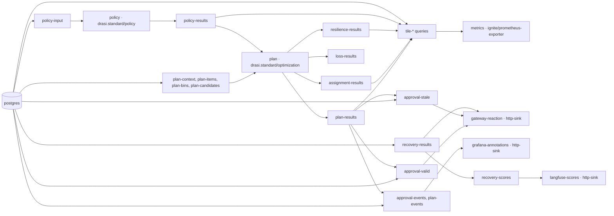

# Contracts: Drasi does the real work

Phase 0 of [drasi-native-plan.md](drasi-native-plan.md). Every workstream builds
against this file. Where it names a file, that file is the source of truth and
already exists in this branch.

## Summary

| Contract | One line | Source of truth |
|---|---|---|
| [Settings](#1-settings) | Every port, the compose project, the publication and slot and the storage key come from `demo/ports.env`; this copy uses +1000 ports and project `ignite-native` | `demo/ports.env`, `demo/ports.default.env` |
| [Build and test](#2-build-and-test) | One crate at a time, shared `ignite-native/.cargo-target`, at most 4 jobs | `demo/.cargo/config.toml` |
| [Schema](#3-schema) | The JSON model becomes `ai_workloads`, `model_deployments`, `workload_routes`, `data_residency_policy`, `change_approvals`; `routing_config` holds `run_epoch` and `revision` | this file |
| [Graph](#4-graph) | Context queries → Drasi's Rego policy → `policy-results` → Drasi's optimization (plan) → result queries → tile queries → Prometheus reaction; approvals and events → HTTP reactions | this file |
| [Element contracts](#5-element-contracts) | `PolicyInput`, `PolicyDecision`, the plan result queries, and the rows each plugin reads | this file |
| [Rego policy](#6-rego-policy) | Drasi's `drasi.standard/policy` decides each `policy-input` row; the Rego module is configuration, allowed destinations are data | `drasi/policy` |
| [Optimizer](#7-optimizer) | Drasi's `drasi.standard/optimization`: the placement model, its single-loss what-if and its preconditions are configuration | `drasi/optimization` |
| [Prometheus reaction](#8-prometheus-reaction) | `ignite/prometheus-exporter`: current rows of each tile query as gauges on `/metrics` | `plugins/prometheus` |
| [Metric contract](#9-metric-contract) | One metric per Grafana tile, `-1` or no series means Unknown | `plugins/prometheus/examples/ignite.json` |
| [Reaction contract](#10-reaction-contract) | Drasi HTTP sinks call the gateway configuration API, Grafana annotations and Langfuse scores; idempotent on `x-drasi-delivery-id` and approval state, compare-and-set on revision | this file |
| [Drasi API check](#11-drasi-api-check) | Every API the plugins need exists in this drasi-core checkout; no gap blocks workstreams 1–7 | this file |
| [Mattermost](#13-mattermost) | Local Mattermost on `IGNITE_MATTERMOST_PORT` (19065), bootstrapped by `ops/mattermost.py`; team `ai-platform`, channel `incident-ai-support`, bot `drasi`, user `oncall`; secrets in `.env`, IDs in `.native/mattermost.json` | [incident-channel-plan.md](incident-channel-plan.md) |
| [Approvals from Mattermost](#14-approvals-from-mattermost) | `POST /mattermost/actions` turns a card's button into the existing approval (`id` = `mm-{post_id}`); `POST /mattermost/approve-latest` presses the newest proposal's button for the desk | this file |
| [Incident cards](#15-incident-cards) | Seven Drasi event queries → `incident-channel` HTTP reaction → Mattermost REST; outcomes reply in the approved card's thread | this file |
| [Operations dashboard](#16-operations-dashboard) | One dashboard `ai-operations`, rows AI Deployments and Decision Support, stable panel `key`s; Workload status, Recommended action (with the change's progress), Failover readiness; Grafana's alert list | this file |
| [Projected Mattermost view](#17-projected-mattermost-view) | Stage view `incident`, framed from the web app origin, signed in through `/mattermost/sign-in` | this file |
| [Desk](#18-desk) | One backup button, `approve-change`, calls `approve-latest`; `select-plan` and `approve-plan` go | this file |
| [Working rules](#19-working-rules-for-the-incident-channel-work) | File ownership for workstreams A–D; one rule for restarting the live stack; no resets without notice | this file |

## 1. Settings

`demo/ports.env` is the only place that names a port, the compose project, the
PostgreSQL publication and slot, or the browser storage key. An exported variable
of the same name overrides a line; `IGNITE_SETTINGS=<file>` selects another file;
`ports.default.env` has the original demo's values (never run those beside it).
The file holds no secrets: the web app receives all of it.

| Setting | This copy | Original |
|---|---|---|
| `IGNITE_PROJECT` | `ignite-native` | `ignite-observability` |
| `IGNITE_PG_PUBLICATION` / `IGNITE_PG_SLOT` | `ignite_rework` | `ignite_native` |
| `IGNITE_STORAGE_KEY` | `ignite-native-stage-v1` | `ignite-presentation-stage-v3` |
| `IGNITE_DRASI_API_PORT` | 19421 | 18421 |
| `IGNITE_DRASI_METRICS_PORT` (Prometheus reaction) | 19423 | 18423 |
| `IGNITE_WORKLOAD_PORT` | 19500 | 18500 |
| `IGNITE_DEPLOYMENT_EU_A/EU_B/US_C_PORT` | 19531–19533 | 18531–18533 |
| `IGNITE_UI_PORT` / `_UI_TEST_PORT` / `_UI_FIXTURE_PORT` | 19580 / 19581 / 19582 | 18580 / 18581 / 18582 |
| `IGNITE_GRAFANA_PORT` / `IGNITE_LANGFUSE_PORT` | 14000 / 14001 | 13000 / 13001 |
| `IGNITE_OTLP_PORT` / `IGNITE_PROMETHEUS_PORT` | 15318 / 20090 | 14318 / 19090 |
| `IGNITE_POSTGRES_PORT` / `IGNITE_PROBE_PORT` | 16432 / 19888 | 15432 / 18888 |

Readers (use these, never a literal):

| Consumer | Reader |
|---|---|
| Rust (AI service, config generator, plugins' tests) | crate `ignite-settings`: `ignite_settings::get().port("WORKLOAD")`, `.url(..)`, `.deployment_port("EU-A")`, `.get("IGNITE_PG_SLOT")` |
| Python (`ops/`, `tests/`) | `ops/settings.py`: `settings.port`, `settings.url`, `settings.container("postgres")`, `settings.PUBLICATION`, `SLOT`, `PROJECT`, `TARGET` |
| Shell, compose | `eval "$(python3 ops/settings.py)"`; `ops/observability-stack.sh` does this, passes `--project-name "$IGNITE_PROJECT"`, and writes the Prometheus scrape target for the reaction to `.native/prometheus-targets/drasi.json` |
| SQL | `ops/native-runtime.py` passes `-v publication=… -v slot=…` to psql; the SQL uses `:'publication'` and `:"publication"` |
| Vite, Playwright, Node scripts | `demo/ui/settings.mjs` (`settings`, `port`, `url`) |
| Browser code | `demo/ui/src/settings.ts` (`settings.storageKey`, `.grafana`, `.langfuse`, `.server`); Vite defines the values |
| Probe container | `LANGFUSE_PUBLIC_URL` (compose) |
| Grafana dashboard JSON | Generated by `observability/grafana/dashboards.py`, which reads the Langfuse port |

`demo/.env` (secrets) is generated per copy by `ops/observability-stack.sh env`
and its `DATABASE_URL` carries the PostgreSQL port at generation time.

## 2. Build and test

One Cargo build folder for the copy: `ignite-native/.cargo-target`, set by
`demo/.cargo/config.toml` (and by `ops/native-build.sh` for drasi-core and
Server crates), at most 4 jobs. Build and test one crate at a time; never
`--workspace` in drasi-core or drasi-server and never their full suites. Plugins
depend only on `drasi-computation-plugin-sdk`, `drasi-computation-contracts`
(and `drasi-core-types` for element types in the two transformers). Each plugin
keeps its logic in plain modules with host-free tests and has one SDK-level test
in `lib.rs`. Run from `demo/`:

| Workstream | Build | Test |
|---|---|---|
| 1. Data model and AI service | `cargo build --locked -p ignite-workloads` | `cargo test --locked -p ignite-workloads`, `cargo test --locked -p ignite-settings --lib`; database tests against this copy's PostgreSQL (`python3 ops/native-runtime.py sql`) |
| 2. Rego policy | `drasi-computation-transformer-policy` from drasi-core, built by `ops/native-build.sh` | `cargo test --locked -p drasi-computation-transformer-policy` in drasi-core; the demo's rule and queries: `plan/spikes/official-policy-plugin` in the `community` checkout |
| 3. Optimizer | `drasi-computation-transformer-optimization` from drasi-core, built by `ops/native-build.sh` | `cargo test --locked -p drasi-computation-transformer-optimization` in drasi-core (`placement_*` are this demo's outcomes); the result queries: `cargo test --locked -p ignite-config` |
| 4. Prometheus reaction | `cargo build --locked -p ignite-prometheus --lib --features ignite-prometheus/dynamic-plugin` | `cargo test --locked -p ignite-prometheus --lib` |
| 5. Grafana | `python3 observability/grafana/dashboards.py` | `python3 observability/grafana/fixture.py [state]` serves fixture `/metrics` on 19423 (which Prometheus already scrapes; only while Drasi Server is not running); `POST /state/<state>` switches state |
| 6. Desk and projector | `cd ui && npx tsc --noEmit` | `cd ui && npm test` (fixture server on `IGNITE_UI_FIXTURE_PORT`) |
| 7. Graph integration | `cargo check --locked -p ignite-config`; `ops/native-build.sh` (the only workstream that builds Drasi Server and drasi-core plugins, including `drasi-computation-sink-http`) | `tests/native-integration.py` and the live demo |

`cargo test` also runs the crate's doc tests; `--lib` skips them. A drasi-core
crate outside `native-build.sh` is built with
`CARGO_TARGET_DIR=$PWD/../../../../.cargo-target cargo build --locked --manifest-path ../../../../drasi-core/Cargo.toml -p <crate> --lib`.

## 3. Schema

`database/schema.sql` and `workload.sql` (workstream 1). Every row a query reads
carries `run_epoch`. `revision` is the scenario revision: it increases by one on
every change to routes, policy destinations, workloads or deployments, never for
health reports, tasks or approvals.

| Table | Columns | Written by | Published to Drasi |
|---|---|---|---|
| `routing_config` | `singleton` PK, `run_epoch`, `revision` | reset, every scenario change | yes |
| `ai_workloads` | `id` PK (`support`, `batch`), `run_epoch`, `data_class` (`restricted`, `public`), `region_requirement` (`EU`, `any`), `model`, `demand_tpm` | reset, desk controls | yes |
| `model_deployments` | `id` PK (`EU-A`, `EU-B`, `US-C`), `run_epoch`, `region`, `model`, `capacity_tpm` | reset, desk controls | yes |
| `workload_routes` | `workload` PK, `run_epoch`, `deployment`, `approval` (nullable), `applied_ms` | reset, `POST /routes/apply` only | yes |
| `data_residency_policy` | `id` PK (`{workload}/{deployment}`), `run_epoch`, `workload`, `deployment` | reset, the desk's Summaries: Europe + US and Summaries: Europe only (the talk's compliance change) | yes |
| `change_approvals` | `id` PK, `run_epoch`, `candidate_id`, `basis`, `revision` (plan's scenario revision), `status` (`pending`, `applied`, `rejected`, `verified`), `reason`, `latest` (bool), `requested_ms`, `decided_ms`, `applied_revision`, `verified_ms` | approval tool (insert), gateway configuration API (status) | yes |
| `gateway_deliveries` | `id` PK (`x-drasi-delivery-id`), `received_ms`, `result` | gateway configuration API | no |
| `simulated_deployment_faults` | `deployment` PK, `mode` (`ok`, `failed`, `throttled`), `reporting` | demo controls; read only by the simulated deployments and health monitor | **no**: Drasi sees health only through reports |
| `deployment_health_reports`, `ai_requests`, `model_call_attempts` | unchanged | AI service (health monitor, gateway) | yes |
| `model_responses` | unchanged | gateway | no |

Removed: `ignite_model` (payload), `ignite_endpoints`, `ignite_commands`,
`ignite_publications`, `ignite_audit`, `ignite_alerts` and `ignite_breaches`
(`native-runtime.py migrate` drops it). Grafana's alerts stay in Grafana.

Seed (`reset.sql`): workloads `support` (restricted, EU, `support-model`,
60 000) and `batch` (public, any, `support-model`, 80 000); deployments EU-A
and EU-B (EU) and US-C (US), all `support-model`, 100 000; routes support → EU-A,
batch → EU-B; destinations support: EU-A, EU-B; batch: EU-A, EU-B (both Europe-only, so failover starts
at risk until the desk's Summaries: Europe + US adds batch: US-C);
`revision` 1; all simulation modes `ok`.

The monotonic trigger moves from `ignite_model` to `routing_config` (revision
+1 per change). `latest` is set on the inserted approval and cleared on the
others in the same transaction.

## 4. Graph

Component names are fixed here; the config generator (workstream 7) maps them to
component IDs. Context queries filter to the current run by joining
`routing_config` on `run_epoch`.



Plugins read query outputs only (a query between every two plugins), bootstrap
from their upstream outputs' snapshots (`output_snapshots` dependency on a
`nativeOutputSnapshots` resource that lists every upstream output), and are
volatile: a restart rebuilds them from those snapshots.

Implementation notes (workstream 7, `ops/config/src/main.rs`, `drasi/`):

- **Joins** are synthetic relationships declared per query in `JOINS` and
  written as directed patterns (`(a)-[:NAME]->(b)`, first label to second);
  an undirected pattern matches each join twice and duplicates rows.
- **Result labels** for query-to-query edges: `PolicyInput` (read by the
  policy), `PolicyResult`, `PlanResult`,
  `AssignmentResult`, `ResilienceResult`, `RecoveryTasks`,
  `RecoveryObservation`, `RecoveryResult`. A downstream query receives only its
  upstream query's changes, not its bootstrap rows, so tiles over static rows
  read PostgreSQL directly (see DEVELOPERS.md, Known issues).
- **Extra result queries:** `assignment-results` (`Assignment`), `loss-results`
  (`LossScenario`, `id` = lost bin); `plan-results` and `resilience-results` use
  `id` = `plan` and `resilience`. `tile-last-approval` also returns `status` and
  `reason`; `recovery-results` also returns `approval`.
- **`recovery-verified`** sends `verified_ms` = the latest support answer that
  confirmed recovery (`last_success_ms`).
- **HTTP reactions** set `unroutedChanges: ignore` (drasi-core sink option), so
  only the listed operations call out: gateway `added`, annotations `added` and
  `updated` (an approval's row changes as its status changes), scores `added`.
  `plan-events` sends no `time` (Grafana uses the post time). Langfuse accepts
  the non-UUID score IDs.
- **Secrets** for Server's environment: `IGNITE_GRAFANA_TOKEN` (from `.env`) and
  `IGNITE_LANGFUSE_HEADERS` = `{"authorization":"Basic $LANGFUSE_AUTH_BASE64"}`
  (an `env-json:` reference for the sink's `secretHeaders`).
- **SSE reaction** `desk-stream` (`drasi.network/sse-sink`) on
  `127.0.0.1:$IGNITE_DRASI_SSE_PORT` (19424 here, 18424 originally), CORS for
  the UI origin: `GET /events` carries every output on one stream, one frame per
  input `{"output":{"alias",…},"sequence","publishedAt","changes":[{operation,
  identity,element,before?,after?,effectiveFrom}]}` plus heartbeats
  `{"type":"heartbeat","ts"}` every 10 s; `GET /snapshot/{alias}` returns the
  output's current rows as change records (`after`) with headers
  `x-drasi-output-epoch` and `x-drasi-output-position`. Aliases are the query
  names: `overdue-tasks`, `plan-results`, `tile-action`, `tile-recovery`,
  `tile-resilience`, `tile-running`, `tile-last-approval`.

## 5. Element contracts

Rows are query result rows (`QueryChangeCodec::decode_row`); elements are graph
nodes a plugin emits, keyed by `id` in the plugin's own stream. All IDs and
lists are emitted in sorted order; all hashes are lowercase hex SHA-256 of
canonical JSON (sorted keys, no whitespace).

### Rows the plugins read

| Query | Port | Columns |
|---|---|---|
| `policy-input` (label `PolicyInput`) | policy `in` | `id` (`{workload}/{deployment}`), `run_epoch`, `workload`, `data_class`, `region_requirement`, `workload_model`, `deployment`, `region`, `deployment_model`, `destinations` (`[deployment]` when the pair's `data_residency_policy` row exists, else `[]`) |
| `plan-context` (label `PlanContext`) | plan `in` | `run_epoch`, `revision` (the one `routing_config` row) |
| `plan-items` (label `PlanItem`) | plan `in` | `id` (workload), `run_epoch`, `revision` (scenario), `demand_tpm`, `deployment` (current route) |
| `plan-bins` (label `PlanBin`) | plan `in` | `id`, `run_epoch`, `capacity_tpm`, `health` (`healthy` for `ok`; `unhealthy` for `failed` or `throttled`; `unknown` otherwise or once the latest report expires, via `drasi.trueLater`) |
| `plan-candidates` (label `PlanCandidate`) | plan `in` | one row per workload × deployment in the current run: `subject`, `target`, `run_epoch`, `demand_tpm`, `current` (route), `capacity_tpm` |
| `policy-results` (label `PolicyResult`) | plan `in` | `id`, `subject`, `target`, `state`, `allowed`, `reason`, `policy_hash`, `basis`, `run_epoch` |

### `PolicyDecision` (Drasi's Rego policy)

One node per `policy-input` row (one per workload × deployment). Its identity
is the row's; `id` = `{subject}/{target}`.

| Property | Meaning |
|---|---|
| `id`, `subject`, `target`, `run_epoch` | From the `policy-input` row |
| `allowed`, `reason` | The rule's `assessment`; absent unless the rule decided |
| `policy_status` | `decided`, `undefined` (no result) or `error` |
| `policy_error` | Only for errors |
| `policy_hash` | `sha256:` hash of the Rego version, module, query and data |
| `policy_input_fingerprint` | `sha256:` hash of the Rego input |

Emitted only when one of these properties changes; retracted when its row is
deleted.

`policy-results` (label `PolicyResult`) maps these onto the columns the
optimizer, tiles and cards read. `state` is `allowed` or `denied` only for a
decided boolean `allowed`, otherwise `unknown`. `allowed` is `true` only for
`allowed`. `reason` is the rule's, or why the result is unknown. `basis` is
`policy_input_fingerprint`.

### Plan results (queries over Drasi's optimization)

The `plan` component publishes a status row (`PlanStatus`), one `Assignment`
per placed workload while optimal, and one `LossScenario` per healthy
deployment (section 7). The result queries keep the columns below.

`plan-results` (label `PlanResult`), one row, `id` = `plan`:

| Column | Meaning |
|---|---|
| `state` | `feasible` (status `optimal`), `infeasible`, or `unknown` (a precondition does not hold, or a time limit or error) |
| `candidate_id` | This plan for these facts: the `solutionSignature` (16-hex FNV-1a over the published Assignment rows) followed by `basis`. Every new set of facts yields a new candidate, even for the same routes. `""` unless feasible |
| `basis` | The status `signature`: 16-hex FNV-1a over the configuration and every input set member solved |
| `revision`, `run_epoch` | From the `plan-context` row (`provenance`) |
| `assignments` | JSON text `{workload: deployment}` from `summaries.assignments`; `"{}"` unless feasible |
| `moves`, `peak_utilisation` | `objectives.moves`, `objectives.peak` (0–1) |
| `reason` | Plain English, built from `summaries.moved` and the status `detail` |
| `solved_ms` | The status row's change time (`drasi.changeDateTime`) |

`assignment-results` (label `AssignmentResult`), one row per placed workload
while feasible: `id` = `item` (workload), `bin`, `current`, `moved`,
`demand_tpm`, `run_epoch`.

`loss-results`, one row per healthy deployment, `id` = `lost`: `state`
(`feasible`, `infeasible`, `unknown`), `reason` (the scenario's `detail`),
`basis` (= the plan's), `run_epoch`.

`resilience-results` (label `ResilienceResult`), one row, `id` = `resilience`:

| Column | Meaning |
|---|---|
| `state` | `safe` (every single loss leaves a plan), `at_risk` (some loss, or the baseline, leaves none), `unknown` |
| `first_failure` | Lowest-sorted deployment whose loss leaves no plan (`head(scenarios.loss.failures)`); `""` if none |
| `baseline` | The plan's state |
| `unhealthy_bins` | `setSizes.unhealthy` |
| `reason`, `basis`, `revision`, `run_epoch` | As for the plan |

### Unknown, never a guess

The optimization does not solve, and reports `unknown` with no Assignment or
LossScenario rows, when one of its preconditions does not hold:

- an input has not loaded;
- a deployment's health is `unknown`;
- a policy decision is not `allowed`/`denied`, or a candidate pair has no decision;
- workloads or deployments belong to another revision or run.

A solve that exceeds its time limit is `unknown` too.

## 6. Rego policy

Drasi's native Rego transformer, `drasi.standard/policy`
(`drasi-computation-transformer-policy`, drasi-core). It evaluates the rule once
for each `policy-input` row. Configuration: `drasi/policy/policy.json`. The
config generator inlines `drasi/policy/placement.rego` and sets `stream` to
`{component id}/out`.

- **Input:** `policy-input` produces one row per workload × deployment in the
  current run. It collects the pair's own destination row, so each row lists at
  most one value and its content never changes order. It filters out empty
  groups (`count(d) … WHERE matches > 0`), so a reset retracts the previous
  run's pairs.
- **Rule:** `data.placement.assessment` returns `{allowed, reason}` from
  `input.subject` (workload), `input.target` (deployment) and
  `input.destinations`. Support may use EU-A and EU-B, never US-C (restricted
  data stays in the EU). Batch may use all three. Removing EU-B from support's
  destinations denies it.
- **The talk's compliance change** (summaries allowed in the US) is a data change to `data_residency_policy`.
  Only that pair's decision is emitted. Demand and capacity edits emit nothing.
  A rule change is a managed in-place update: retained inputs are
  re-evaluated, and only changed decisions are emitted, with a new
  `policy_hash`.
- **Unknown** is never allowed. An undefined rule, a runtime error, a timeout
  (`timeout_ms` 250) or a result without a boolean `allowed` all read as
  `state = unknown` in `policy-results`.
- **Startup:** the policy binds `output_snapshots` to `policy-input`, reads
  that snapshot at start and emits its decisions through the startup
  continuation. A query never sends its own bootstrap rows downstream. It
  skips live envelopes the snapshot covers and re-reads `policy-input` when
  that query restarts. Its `out` snapshot serves `policy-results`.

Evidence: `plan/official-policy-plugin.md` (in the `community` checkout)
compares every pair with the earlier `ignite/rego-policy` decisions.

## 7. Optimizer

Drasi's native optimization transformer, `drasi.standard/optimization`
(`drasi-computation-transformer-optimization`, drasi-core). It is a declarative
mixed-integer model over its input rows, solved with `good_lp`/`microlp`.
Configuration: `drasi/optimization/optimization.json`. The config generator
sets `stream` to `{component id}/out`.

- **Inputs:** `plan-context`, `plan-items`, `plan-bins`, `plan-candidates` and
  `policy-results` → port `in`. Sets select rows by result label.
- **Model:**
  - binary `assign` over candidates that are allowed, on a healthy deployment,
    with `capacity_tpm ≥ demand_tpm`;
  - each workload exactly once (nothing is shed), and capacity per healthy
    deployment;
  - lexicographic objectives: fewest moves from the current route, then the
    lowest peak utilisation. Ties are deterministic (sets are in key order).
- **What-if:** scenario `loss` re-solves without each healthy deployment. The
  status row's `scenarios.loss.failures` lists every loss that leaves no plan,
  in deployment order.
- **Preconditions:** see "Unknown, never a guess" above.
- **Timing:** `debounceMs` 100, `maxDelayMs` 1000, `timeLimitMs` 2000. Solving
  runs on a background thread. The previous answer stays published until the
  new solve completes, and the loss roll-up stays until the next analysis.
- **Startup:** the plan binds `output_snapshots` to its five input queries. At
  start it reads their snapshots, solves and publishes before any live input.
  It skips live envelopes the snapshots cover, and re-reads an input query that
  restarts.

Required outcomes, shown by SDK-harness tests in drasi-core
(`placement_*`), by `ignite-config`'s
`plan_and_resilience_results_from_the_optimization_status`, and on a
throwaway Server (seed, failure, policy edit, recovery, expired report,
capacity beat, Server restart):

| Inputs | Plan | Resilience |
|---|---|---|
| Seed, all healthy (both workloads Europe-only) | feasible, 0 moves | at_risk, first failure EU-A (no valid plan) |
| Seed with batch also allowed on US-C | feasible, 0 moves | safe |
| EU-A failed | support → EU-B, batch → US-C (2 moves) | at_risk, first failure EU-B |
| EU-A failed, then EU-B removed from support's destinations | infeasible | at_risk |
| Healthy, support on EU-B, batch on US-C, EU-A capacity 50 000 | feasible | at_risk, first failure EU-B (support) |
| US-C failed | feasible | at_risk, first failure EU-A |
| A report expired | unknown | unknown |

Evidence: `plan/official-optimization-plugin.md`.

## 8. Prometheus reaction

Factory `ignite/prometheus-exporter` (`plugins/prometheus`), sink, one input
port `in` with any number of edges, `SinkCompletion::Accepted`, `binds_inputs`,
output snapshots (like Drasi's SSE sink). Configuration
(`plugins/prometheus/examples/ignite.json`):

| Field | Meaning |
|---|---|
| `listen` | `127.0.0.1:{IGNITE_DRASI_METRICS_PORT}` (the generator sets it) |
| `path` | Default `/metrics` |
| `outputs` | Alias → `{component, port}`, as in Drasi's HTTP and SSE sinks |
| `metrics` | Alias → list of `{metric, help, value, labels, constLabels}`: each row of that output becomes one series per entry; `value` names a numeric or boolean property; `labels` maps label → property |

Behaviour: on start, read each output's snapshot, then apply inserts, updates
and deletes; serve the Prometheus text format (`text::render`, done). Always
export `drasi_reaction_input_ready{output="<alias>"}` (1 after the snapshot
loaded, 0 before or after the input fails). A row whose value is null or
missing produces no series. Metric names follow Prometheus rules; one HELP per
name. Prometheus scrapes it every 2 s as job `drasi` at
`host.containers.internal:{IGNITE_DRASI_METRICS_PORT}` (already in
`observability/prometheus.yaml` through `file_sd`; no further edit needed).

## 9. Metric contract

> **Superseded in part by [section 16](#16-operations-dashboard):** Recovery,
> Action needed and Safe if one fails? become Recommended action (which also
> shows the change's progress) and Failover readiness, Workload status is added,
> and the Recovery plan dashboard goes. The other rows stand.

All gauges, from `plugins/prometheus/examples/ignite.json`. **Unknown** is
either value `-1` (Drasi answered "unknown") or no series. For counts and
"nothing yet" states a missing series means the stated value only while
`drasi_reaction_input_ready{output=…} == 1`; Grafana writes it as
`<expr> or on() ((drasi_reaction_input_ready{output="<alias>"} == 1) * 0 + <value>)`.
Workload labels stay `support` and `batch`; Grafana relabels `batch` as
"summaries". Values in tokens per minute are raw; Grafana divides by 1000.

| Tile (dashboard) | Metric | Labels | Values | Missing while ready | Query (alias) |
|---|---|---|---|---|---|
| Support overdue; Support requests waiting (overdue line); alert "Support requests overdue (Drasi)" (Operations) | `drasi_requests_overdue` | `workload` | count | 0 | `tile-overdue` (`overdue`) |
| Deployment status (Operations); Deployments (Recovery plan) | `drasi_deployment_health_status` | `deployment` | 0 healthy, 1 throttled ("Over quota"), 2 failed, -1 unknown | — | `tile-deployments` (`deployments`) |
| Deployments (Recovery plan) | `drasi_deployment_capacity_tpm` | `deployment` | capacity | — | `tile-deployments` |
| Capacity · tokens/min (Recovery plan) | `drasi_capacity_tpm` | `kind` = `total`, `healthy`, `needed` | sum | — | `tile-capacity` (`capacity`: total, healthy), `tile-demand` (`demand`: needed) |
| Recovery (both) | `drasi_recovery_state` | — | 0 awaiting evidence, 1 verified, 2 nothing to verify, -1 unknown | 2 | `tile-recovery` (`recovery`) |
| Action needed (both) | `drasi_action_needed` | — | 0 none, 1 approve proposed plan, 2 no valid plan, 3 at risk, -1 unknown | — | `tile-action` (`action`) |
| Safe if one fails? (both) | `drasi_safe_if_one_fails` | `lost` | 1 yes, 0 no (`lost` = first failure), 2 already one down, -1 unknown | — | `tile-resilience` (`resilience`) |
| Running now (Recovery plan) | `drasi_workload_running_tpm` | `workload`, `deployment` | demand; negative = not allowed (policy denies its route; the gateway still sends there until a plan is applied) | — | `tile-running` (`running`) |
| Proposed plan (Recovery plan) | `drasi_workload_proposed_tpm` | `workload`, `deployment` | demand on the planned deployment | no plan | `tile-proposed` (`proposed`) |
| Customer support / Document summaries may run on (Recovery plan) | `drasi_placement_allowed` | `workload`, `deployment` | 1 allowed, 0 not allowed, -1 unknown | — | `tile-policy` (`policy`) |
| Last approval (Recovery plan) | `drasi_last_approval_state` | `approval` | 1 approved, applying; 2 applied, awaiting evidence; 3 applied and verified; 4 rejected; -1 unknown | 0 none yet | `tile-last-approval` (`last-approval`) |

The ordinary-monitoring tiles (model calls, errors, answer time, support queue)
stay on the AI service's OpenTelemetry metrics. `drasi_dashboard`,
`drasi_valid_until_seconds`, `drasi_projection_timestamp_seconds`
and `ignite_workload_capacity_tpm` go away; Grafana's "valid until" checks become
the readiness rule above.

How Grafana applies this (workstream 5, `observability/grafana`):

- Every Drasi expression is gated with `and on() (drasi_reaction_input_ready{output=…} == 1)`, so a value that outlives its input's readiness is not shown. The `Missing while ready` defaults are wrapped in `max(…)` so a chart keeps one series.
- "Safe if one fails?" and "Action needed" no longer re-derive "already one down" in PromQL; `tile-resilience` and `tile-action` do.
- Deployments (Recovery plan) shows capacity unless the status is 2 (Failed). Throttled and unknown health show capacity (today throttled showed "Failed"); unknown health shows on Deployment status.
- The application's freshness gate (`drasi_projection_timestamp_seconds`) goes too: Support queue relies on the collector's 10 s expiry, and the "Model calls failing" alert requires `count(ai_gateway_queue_depth)` (the AI service is reporting).
- "Support requests overdue (Drasi)": Unknown is NoData, which is Normal; it fires only on a count above 0.
- Grafana's alerts go to the probe's webhook and, for the AI service's two rules, to #incident-ai-support ([section 16](#16-operations-dashboard)); Grafana's environment drops `IGNITE_WORKLOAD_PORT`.
- `IGNITE_GRAFANA_TOKEN`: `.env` gets an empty line; `ops/observability-stack.sh up` (when it starts Grafana) runs `ops/observability-env.py grafana-token`, which keeps a token that still has `annotations:write`, or creates the `drasi-annotations` service account (Editor) and a new token. Grafana stores only token hashes, so it cannot be generated before Grafana runs. This is the one edit to `observability-stack.sh`, outside workstream 5's list.
- Grafana's file provisioning does not notice regenerated dashboards through the podman mount; restart Grafana (`ops/observability-stack.sh restart grafana`) after `dashboards.py`.

Tile queries (sketches; workstream 7 owns the final text). `S` is
`routing_config` joined on `run_epoch`, which keeps each tile to the current
run:

| Query | Returns |
|---|---|
| `tile-overdue` | Tasks of the current run not completed or cancelled with `drasi.trueLater(true, t.deadline_ms)`: `workload`, `count(t) AS value` |
| `tile-deployments` | Deployments with their latest report: `deployment`, `capacity_tpm`, `status` = 0/1/2 from `ok`/`throttled`/`failed`, -1 once `drasi.trueLater(true, r.expires_ms)` |
| `tile-capacity` | One row: `sum(capacity_tpm) AS total_tpm`, `sum(CASE status 'ok' …) AS healthy_tpm` |
| `tile-demand` | One row: `sum(w.demand_tpm) AS needed_tpm` |
| `tile-recovery` | Recovery result for the latest applied approval at the current revision: 1 confirmed, 0 otherwise, -1 when its evidence expired |
| `tile-action` | `Plan` with `Resilience`: -1 if either unknown; 2 infeasible; 1 feasible with `moves > 0`; 3 `moves = 0` and resilience `at_risk` and `unhealthy_bins = 0`; else 0 |
| `tile-resilience` | `Resilience`: 2 if `unhealthy_bins > 0`; 1 safe; 0 at_risk with `lost` = `first_failure`; -1 unknown |
| `tile-running` | Routes ⨝ workloads ⨝ `PolicyDecision` of that route: `demand_tpm`, negated when `allowed = false` (not allowed); shown positive while policy is unknown |
| `tile-proposed` | `Assignment` where `Plan.state = 'feasible'`: `workload`, `deployment` (= bin), `demand_tpm` |
| `tile-policy` | `PolicyDecision`: 1/0/-1 from `state` |
| `tile-last-approval` | The approval with `latest = true`: `approval`, `value` (`pending` 1, `applied` 2, `verified` 3, `rejected` 4), and also `status` and `reason` (the desk shows Drasi's rejection reason; the exporter ignores them) |

## 10. Reaction contract

### HTTP reactions (native `drasi.network/http-sink`)

All use `successStatusCodes: [200]`. Every request carries
`x-drasi-component`, `x-drasi-port` and `x-drasi-delivery-id`
(`{component}/{port}/{sequence}.{ordinal}`; stable across retries of one producer
run, new after a Server restart, because the queries are volatile). Secrets are
host references (`env:…` on the `configuration` resource), exported by
`ops/native-runtime.py run` from `.env`.

| Reaction | Outputs (alias ← query) | Request | Policy |
|---|---|---|---|
| `gateway-reaction` | `approve` ← `approval-valid` (added) | `POST {workload}/routes/apply`, body `{"approval":"{{after.approval}}","candidate_id":…,"basis":…,"expected_revision":{{after.expected_revision}},"assignments":{{{after.assignments}}}}` | `onPermanentFailure: stall`, `maxRetries: 10`, `retryBudgetMs: 30000`, `timeoutMs: 5000` |
| | `reject` ← `approval-stale` (added) | `POST {workload}/approvals/{{after.approval}}/reject`, body `{"reason": {{json after.reason}}}` | same |
| | `verified` ← `recovery-verified` (added) | `POST {workload}/approvals/{{after.approval}}/verified`, body `{"verified_ms": {{after.verified_ms}}}` | same |
| `grafana-annotations` | `events` ← `approval-events`, `plan-events` (added) | `POST {grafana}/api/annotations`, `token` = `env:IGNITE_GRAFANA_TOKEN` (service account, workstream 5), body `{"time":{{after.at_ms}},"tags":["drasi-decision","{{after.id}}"],"text":{{json after.text}}}` | `onPermanentFailure: skip`, `maxRetries: 3` |
| `langfuse-scores` | `scores` ← `recovery-scores` (added) | `POST {langfuse}/api/public/scores`, `secretHeaders.authorization` = `env:IGNITE_LANGFUSE_AUTHORIZATION` (`Basic …`), body `{"id":"{{after.id}}","traceId":"{{after.trace_id}}","name":"drasi_recovery","value":1,"dataType":"NUMERIC","comment":{{json after.comment}}}` | `onPermanentFailure: skip`, `maxRetries: 3` |

Driving queries:

| Query | Row | When |
|---|---|---|
| `approval-valid` | `approval`, `candidate_id`, `basis`, `expected_revision` (= approval's `revision`), `assignments` | Approval `pending` and `Plan` `feasible` with the same `candidate_id`, `basis` and `revision` |
| `approval-stale` | `approval`, `reason` (e.g. "The plan changed since it was approved") | Approval `pending` and the `Plan` differs or is not feasible |
| `recovery-verified` | `approval`, `verified_ms` | Recovery result `confirmed` for an `applied` approval (today's `recovery-results` rule) |
| `approval-events` | `id` = `{approval}-{status}`, `at_ms`, `text` ("Approved: the proposed plan", "Applied by Drasi: routes changed", "Rejected by Drasi: {reason}", "Recovery verified by Drasi"; no approval IDs) | Approval status changed within the last 30 s (`NOT drasi.trueLater(true, decided_ms + 30000)`) |
| `plan-events` | `id` = `plan-{candidate_id}`, `at_ms`, `text` ("Drasi proposes a plan: {reason}", with `batch` written as "summaries") | `Plan` feasible with `moves > 0`, stable for 2 s (`drasi.trueFor`) |
| `recovery-scores` | `id` = `{task}-recovery-{approval}`, `trace_id`, `comment` | Support tasks completed at the applied revision of a verified approval |

### AI service APIs (stand-ins for external systems)

| API | Caller | Request | Effect and response |
|---|---|---|---|
| `POST /approvals` (approval tool) | Desk | `{"id"?: string, "candidate_id", "basis", "revision"}` | Inserts a `pending` approval (the ID is generated unless given; a repeated ID is a no-op) and makes it `latest`. No validation of the plan. `200 {"id"}` |
| `POST /routes/apply` (gateway configuration) | `gateway-reaction` only | as above, header `x-drasi-delivery-id` | In one transaction: a delivery ID already in `gateway_deliveries` returns its recorded result; an approval not `pending` → `200 {"result":"duplicate"}`; `routing_config.revision ≠ expected_revision` → approval `rejected` with reason "Scenario changed since the plan (revision N, plan revision M)" and `200 {"result":"conflict"}`; otherwise routes are written, revision +1, approval `applied` with `applied_revision` → `200 {"result":"applied","revision":N+1}` |
| `POST /approvals/{id}/reject` | `gateway-reaction` only | `{"reason"}` | `pending` → `rejected` with Drasi's reason; any other status is a no-op. `200` |
| `POST /approvals/{id}/verified` | `gateway-reaction` only | `{"verified_ms"}` | `applied` → `verified`; any other status is a no-op. `200` |

Rules: compare-and-set on `revision` is ordinary optimistic concurrency, not a
policy check: the gateway never re-evaluates policy, plans or approvals. Every
terminal outcome (applied, duplicate, conflict, no-op) answers 200 so the sink
does not retry it; malformed requests answer 400 (permanent); a database outage
answers 503 (the sink retries). Idempotency holds across Server restarts because
it is keyed on the approval's state as well as the delivery ID.

Implementation details (workstream 1, `workloads/src/external.rs`):

- **Responses.** Apply answers `{"result":"applied","revision":N}`,
  `{"result":"duplicate","status":…}` or `{"result":"conflict","reason":…}`;
  reject and verified answer `{"result":"rejected"|"verified"}` or
  `{"result":"no-op","status":…}`.
- **Permanent errors.** 400 for a missing `x-drasi-delivery-id`, a body that
  does not parse, a `candidate_id`/`basis` that differs from the stored approval,
  or `assignments` that do not name every workload once with a known deployment
  (a structural check; any route is accepted, policy is never consulted). 404
  for an unknown approval ID.
- **Earlier run.** A pending approval from before a reset is rejected by apply
  with "The demo was reset after this approval" (`conflict`).
- **Routes.** Apply updates only routes whose deployment changes, setting their
  `approval` and `applied_ms`, then raises the revision once.
- **`decided_ms`** is the time of the approval's latest status change
  (applied, rejected or verified), so `approval-events` sees each change.
- **Revision.** Desk configuration (capacity, destinations) and apply each raise
  `routing_config.revision` by one per transaction that changes a row;
  simulation controls never do.
- **Prune.** `ops/native-runtime.py run` also deletes earlier-run approvals and
  all `gateway_deliveries` before Server starts (a restart issues new delivery IDs).

Demo controls stay demo controls: reset may delete the previous run's Grafana
annotations (tag `drasi-decision`) as today; that is the demo driver, not
Drasi.

### Demo controls (desk → AI service)

Agreed between workstreams 1 and 6; the desk and its test fixture
(`ui/tests/fixture-server.mjs`) use exactly these.

| API | Request | Response |
|---|---|---|
| `GET /health` | | `{run_epoch, revision, pending, task_target_seconds, report_expiry_seconds, traffic: {running, submitted, ends_ms, error, interval_seconds}, deployments: [{id, region, model, capacity_tpm, mode, reporting}], workloads: [{id, data_class, region_requirement, model, demand_tpm, deployment}], destinations: {workload: [deployment]}}`. `mode`/`reporting` are the simulation (`simulated_deployment_faults`); `deployment` is the current route. No Drasi answers and no readiness of Drasi |
| `POST /control` | `{run_epoch, deployment, action}`, action `fail`, `throttle`, `restore`, `pause-reports`, `resume-reports` | `200 {run_epoch, revision}`; simulation only, the revision is unchanged |
| `POST /configuration` | `{run_epoch, revision, capacity?: {deployment: tpm}, destinations?: {workload: [deployment]}}` | `200 {run_epoch, revision}` (unchanged revision when nothing changed); `409 {"error"}` when `run_epoch`/`revision` are stale. The desk's "EU-A to 50k/100k" buttons send `POST /control` `restore` for EU-A first when it isn't healthy and reporting |
| `POST /approvals` | `{id, candidate_id, basis, revision}`; the desk always sends its own UUID `id` and the `Plan`'s `candidate_id`, `basis` and `revision` | `200 {id}` (above) |
| `POST /reset`, `POST /traffic`, `POST /tasks`, `GET /tasks/{id}` | unchanged | unchanged |

### What the desk and projector read from Drasi

Every answer comes from the `desk-stream` SSE reaction (section 4), proxied by
the web app as `/drasi-stream` (same origin; the test build points it at the
fixture). Each window opens one `GET /drasi-stream/events` and nothing polls Drasi:

1. Open `/events` and buffer its frames.
2. Read `/snapshot/{alias}` for each output the window needs. The desk needs all
   seven aliases; the projector needs only `overdue-tasks` (the oldest late request).
3. Apply each snapshot, then the buffered frames whose `sequence` is after that
   output's `x-drasi-output-position`, and continue live. Rows are keyed by
   `identity` (`namespace`/`id`); `ADD`/`REPLACE` set `after`, `PATCH` merges
   `after` and drops `removedProperties`, and `DELETE` removes the row.
4. On disconnect, an error, or 35 s without bytes, start again from step 1.

READY means the stream is connected, a heartbeat arrived within 25 s, and every
alias has loaded its snapshot; otherwise each answer shows Unknown.

| Alias | Used for |
|---|---|
| `overdue-tasks` | Support overdue and the oldest late request |
| `plan-results` | The proposed plan, shown under Routes, and whether **Approve the proposed change** is enabled (`id` = `plan`, section 5 properties; `assignments` is JSON text) |
| `tile-action`, `tile-recovery`, `tile-resilience`, `tile-running`, `tile-last-approval` | The four answers (the values Grafana shows), Running now, and the approval outcome with Drasi's `reason` |

Only the private diagnostics page (`/inspect`) still attaches to other queries
through Server's `/server/…/queries/{name}/attach`.

Known limits: Grafana's annotation API has no idempotency key, so a retried
POST whose response was lost, or a Server restart within 30 s of an event,
can duplicate an annotation (tagged with the same event ID). Langfuse scores
upsert on `id`; workstream 7 confirms Langfuse accepts these non-UUID IDs and
otherwise derives a UUID-shaped ID in the query.

## 11. Drasi API check

Checked in this checkout (drasi-core `ef341573`, drasi-server `16777e5`) by
reading the SDK and host and compiling the three plugin skeletons against them.

| Need | Status | Evidence |
|---|---|---|
| Transformer with several named input ports | Supported | Ports are declared per factory (the query transformer has `in` and `bootstrap`); the host passes every incoming edge to `bind_inputs` with its `input_port`, `output` and `stream` (`lib/src/computation/v1/graph.rs`, `snapshot_input_bindings`). Only restriction: one producer output may not feed two input ports of one component, which this graph never does |
| Many edges into one input port | Supported | GPU lab `policy` and `gpu-demo-ui` |
| Bootstrap from several upstream snapshots | Supported | `nativeOutputSnapshots` takes a list of outputs; `NativeOutputSnapshots::snapshot(endpoint, schema)` per binding |
| Native sink with output snapshots and its own listener | Supported | `drasi.network/sse-sink` (`supports_output_snapshots`, `binds_inputs`, `SinkOutputs`); the export allows output snapshots for `Sink` and `Transformer`, but not together with consumer progress, so the Prometheus reaction is volatile |
| HTTP reactions with templates, secret headers and delivery IDs | Supported | `drasi-computation-sink-http` (`CONFIGURATION.md`): routes per alias, Handlebars `url`/`template`, `token`, `secretHeaders`, `x-drasi-delivery-id`, `onPermanentFailure` |
| `drasi.trueFor`, `drasi.trueLater` | Supported | `core/src/evaluation/functions/future` |
| `good_lp` 1.15 + `microlp`, `regorus` 0.12 | Available offline | Plugin unit tests pass |

No gap blocks workstreams 1–7. To watch:

1. **Volatile query bootstrapped from upstream snapshots** (removing today's
   `recovery-results` workaround) was not supported when today's demo was built
   ("cannot bind a result catalog"); it is unverified here. Workstream 7 keeps
   the workaround if it still fails.
2. **Named input ports on a native plugin** are allowed by the host but no
   existing native plugin uses them. Workstream 7 runs `drasi-server validate`
   on the new graph first; the fallback is one `in` port per plugin, routing by
   `InputBinding.stream`.
3. **HTTP sink replays after restart**: it has no snapshot handling, and new
   producer identities after a restart change delivery IDs; the APIs above are
   idempotent on approval state for this reason.
4. **`OPTIONAL MATCH`** parses but is not relied on; counts use the readiness
   rule in [section 9](#9-metric-contract).

## 12. What each workstream changes

| Workstream | Owns | Must not edit |
|---|---|---|
| 1 | `database/`, `workloads/`, `domain/` (remove `decision.rs` when unused), `ops/workload.py`, `ops/native-runtime.py` | `ports.env`, root `Cargo.toml` |
| 2 | `drasi/policy`, `drasi/policy-input.cypher`, `drasi/policy-results.cypher` | shared files |
| 3 | `drasi/optimization`, `drasi/plan-*.cypher`, `drasi/assignment-results.cypher`, `drasi/resilience-results.cypher`, `drasi/loss-results.cypher` | shared files |
| 4 | `plugins/prometheus` | shared files, `observability/prometheus.yaml` (done) |
| 5 | `observability/grafana`, `ops/observability-env.py` (service-account token) | `compose.yaml` except Grafana's environment |
| 6 | `../presentation`, `ui/` | `ui/settings.mjs` |
| 7 | `ops/config`, `drasi/`, `ops/native-build.sh`, root `Cargo.toml` (removing `plugins/capacity` and `plugins/decisions`) | — |

---

Sections 13–19: the incident channel and Decision Support
([incident-channel-plan.md](incident-channel-plan.md)). Workstreams A
(Mattermost platform), B (Drasi event queries and HTTP reaction), C (Grafana),
D (desk and projector) build against these.

## 13. Mattermost

### Settings (`ports.env`, no secrets)

| Setting | This copy | Original (`ports.default.env`) |
|---|---|---|
| `IGNITE_MATTERMOST_PORT` | 19065 | 18065 |

Fixed names (not settings): team `ai-platform` (display "AI Platform"), channel
`incident-ai-support` (display "incident-ai-support", public), bot `drasi`
(display "Drasi"), user `oncall` (display "On-call engineer"; the presenter
acts as this user), admin `admin` (bootstrap and maintenance only). The
channel's URL is `http://localhost:{IGNITE_MATTERMOST_PORT}/ai-platform/channels/incident-ai-support`.

Readers: `ops/settings.py` (`settings.port("MATTERMOST")`), Rust
`ignite_settings::get().port("MATTERMOST")`, browser `settings.mattermost`
(`http://localhost:19065`) and `settings.mattermostSignIn`
(`http://localhost:19500/mattermost/sign-in`) in `demo/ui/src/settings.ts`.

### Container (`compose.yaml` service `mattermost`, workstream A)

- Image `localhost/ignite-native-mattermost:12.1.0`, built by compose from
  `observability/mattermost/Containerfile`: Mattermost Team Edition 12.1.0's
  official linux-arm64 release archive (checked by SHA-256) on Debian
  bookworm-slim. Mattermost publishes container images for amd64 only, and
  this Podman VM has no Rosetta. `127.0.0.1:${IGNITE_MATTERMOST_PORT}:8065`,
  volume `mattermost-data`, about 250 MB of memory.
- Database `mattermost` in the existing `postgres` container, created by
  `ops/mattermost.py database` before Mattermost starts (an init script would
  change the PostgreSQL container's definition and make compose recreate it),
  user `ignite`, `sslmode=disable`.
- Configuration by `MM_*` environment variables: site URL
  `http://localhost:${IGNITE_MATTERMOST_PORT}`; incoming webhooks, bot accounts,
  personal access tokens, post username and icon overrides on; open server off;
  plugins off; telemetry, diagnostics and update checks off;
  `AllowedUntrustedInternalConnections` = `host.containers.internal` (the
  buttons call the AI service on the host); `FrameAncestors` = the web app's
  origins (`http://localhost:${IGNITE_UI_PORT}`, `http://127.0.0.1:${IGNITE_UI_PORT}`
  and the UI test port). Verified: Mattermost sends `Content-Security-Policy:
  frame-ancestors 'self' <these>` with `X-Frame-Options: SAMEORIGIN`;
  browsers follow the CSP, and Chromium frames the channel from
  `localhost:19580`.
- Preview-mode banner off; names shown as full names ("Drasi", "On-call
  engineer"); `mmctl --local` enabled for the bootstrap.
- Grafana gets one new environment line, `MATTERMOST_ALERT_WEBHOOK_URL`
  (section 16), with a placeholder until the bootstrap has made the webhook.

### Bootstrap (`ops/mattermost.py bootstrap`)

Run by `./ops/observability-stack.sh up` when it starts `mattermost`, and on its
own. Idempotent: it finds by name and creates only what is missing, keeps
tokens that still work, and never prints a secret. Steps (`mmctl --local`
inside the container; the bot through the REST API with the admin token,
since local mode can't create bots): wait for `/api/v4/system/ping` → users
`admin` and `oncall` → team → admin token → bot `drasi` → all three in the team
and channel → oncall and bot tokens → incoming webhook ("Grafana alerts",
locked to the channel) → `.env` and `.native/mattermost.json`. Exit status 3
means the webhook URL changed; `observability-stack.sh up` then recreates
Grafana. `ops/mattermost.py clear` deletes every post in the channel.

`.env` keys (private, mode 600, created if missing; never printed or committed):

| Key | Used by |
|---|---|
| `MATTERMOST_ADMIN_PASSWORD` | Bootstrap only |
| `MATTERMOST_ADMIN_TOKEN` | AI service (reads the original card for an update; clears the channel on reset), tests |
| `MATTERMOST_ONCALL_PASSWORD` | `/mattermost/sign-in` |
| `MATTERMOST_ONCALL_TOKEN` | AI service (`approve-latest` presses the button as `oncall`), tests |
| `IGNITE_MATTERMOST_BOT_TOKEN` | Drasi Server: `incident-channel` reaction `token` (`env:IGNITE_MATTERMOST_BOT_TOKEN`, exported by `native-runtime.py run`) |
| `MATTERMOST_ALERT_WEBHOOK_URL` | Grafana's contact point: `http://mattermost:8065/hooks/<id>` (container network) |

`.native/mattermost.json` (not secret, git-ignored), read by the config
generator and the AI service:
`{"team_id","channel_id","bot_user_id","oncall_user_id","team":"ai-platform","channel":"incident-ai-support"}`.
`ops/native-runtime.py stamp` includes it, so a channel that was recreated
(new volume) makes `run` ask for `ops/native-build.sh`.

## 14. Approvals from Mattermost

### Schema change (workstream A, `database/`)

`change_approvals` gains nullable `requested_by` (`@oncall`), `post_id` (the
Mattermost card that was approved) and `change` (the card's change text);
`status` gains `declined` (a person pressed Reject). `POST /approvals` is
unchanged and leaves the new columns null. Drasi's existing queries ignore
`declined` (they filter on `pending`).

### `POST /mattermost/actions` (AI service, `IGNITE_WORKLOAD_PORT`)

Mattermost calls it from its container as
`http://host.containers.internal:{IGNITE_WORKLOAD_PORT}/mattermost/actions`
when a button is pressed. Request (Mattermost's integration request):

```json
{"user_id":"…","user_name":"oncall","channel_id":"…","channel_name":"incident-ai-support",
 "team_id":"…","team_domain":"ai-platform","post_id":"<card post id>","trigger_id":"…",
 "type":"","data_source":"",
 "context":{"action":"approve","candidate_id":"…","basis":"…","revision":7,
            "run_epoch":"…","change":"Move summaries to US-C and support to EU-B"}}
```

| `context.action` | Effect (one transaction) |
|---|---|
| `approve` | Exactly `POST /approvals` with `{"id":"mm-{post_id}","candidate_id","basis","revision"}` plus `requested_by` = `@{user_name}`, `post_id`, `change`. A repeated press is a no-op (same ID). Drasi then decides, as today: `approval-valid` → `gateway-reaction` applies, or `approval-stale` → rejected with Drasi's reason |
| `decline` | Inserts approval `mm-{post_id}` with `status` `declined`, `decided_ms` now, `reason` "Rejected by @oncall", `latest` true. Nothing else happens |
| context `run_epoch` ≠ current run | No row; only `ephemeral_text` "This card is from an earlier run of the demo." |

Response `200`:

```json
{"update":{"props":{…the card's props, every action removed, and the field
   {"title":"Decision","value":"Approved by @oncall. Drasi checks it still matches its current plan before anything changes.","short":false}
   (or "Rejected by @oncall. Nothing will change.")…}},
 "ephemeral_text":"Sent to the change-approval tool.", "approval":"mm-{post_id}"}
```

The endpoint reads the card with `MATTERMOST_ADMIN_TOKEN`
(`GET /api/v4/posts/{post_id}`) to rebuild its props; if that fails it answers
with `ephemeral_text` only. Malformed context → `400`; database down → `503`.
No authentication beyond the local bind, as for `POST /approvals`.

### `POST /mattermost/approve-latest` (desk backup)

Request `{"run_epoch"}`. Finds the newest post in the channel
(`GET /api/v4/channels/{channel_id}/posts`, admin token) with
`props.incident_card` = `proposal`, `props.incident_run_epoch` = `run_epoch` and an
`approve` action still on it, then presses it as `oncall`
(`POST /api/v4/posts/{post_id}/actions/approve`, oncall token). Mattermost then
calls `/mattermost/actions` exactly as for a click.
`200 {"post_id","approval":"mm-{post_id}"}`; `404 {"error":"No proposed change to approve in #incident-ai-support"}`;
`502 {"error"}` if Mattermost does not answer.

### `GET /mattermost/sign-in` (projector)

Opened in the presenter's browser as `http://localhost:{IGNITE_WORKLOAD_PORT}/mattermost/sign-in`:
signs `oncall` in server-side and answers `302` to the channel URL with
Mattermost's session cookies (cookies are per host, not per port, so they apply
to `localhost:{IGNITE_MATTERMOST_PORT}`). No password is shown. Verified in
Chromium: after it, an iframe on `localhost:19580` shows the channel signed in
(Mattermost's single-channel layout below 768 px wide).

### Reset

`POST /reset` (the desk's Reset, a demo control) also deletes every post in
`#incident-ai-support` (admin token), as it deletes Grafana's decision
annotations. Best effort: a Mattermost outage doesn't fail the reset.

## 15. Incident cards

### Reaction `incident-channel` (workstream B, `ops/config`)

`drasi.network/http-sink`, `baseUrl` `http://127.0.0.1:{IGNITE_MATTERMOST_PORT}`,
`token` = `env:IGNITE_MATTERMOST_BOT_TOKEN`, `successStatusCodes: [201]`
(Mattermost answers 201 to a new post), `onPermanentFailure: skip`, `maxRetries: 3`,
`timeoutMs: 5000`, `unroutedChanges: ignore`. Every route is
`added` → `POST /api/v4/posts`. The generator takes `channel_id` from
`.native/mattermost.json` and the button URL from `IGNITE_WORKLOAD_PORT`.

Body envelope (every card; the queries build every string, templates only use
`{{json …}}`):

```json
{"channel_id":"<channel_id>","root_id":{{json after.root_id}},"message":"",
 "props":{"incident_card":"<card>","incident_card_id":{{json after.id}},"incident_run_epoch":{{json after.run_epoch}},
  "attachments":[{"fallback":{{json after.title}},"color":"<colour>","title":{{json after.title}},
    "text":{{json after.text}},"fields":[<fields>],"footer":"Drasi · <query>"<, "actions":[…]>}]}}
```

`root_id` is `""` except for outcomes. Fields are
`{"title":"<title>","value":{{json after.<column>}},"short":true|false}`.
Colours: red `#d44a3a`, orange `#f2a33a`, blue `#3d8bd9`, green `#2fa66a`,
grey `#9aa4b0`. Workloads are written `support` and `summaries` (`batch` →
`summaries`); capacities in thousands, e.g. `100k`.

### The cards

Every query keeps to the current run (`routing_config` on `run_epoch`),
returns `id`, `run_epoch`, `at_ms` and the columns below, and emits a row only
within 60 s of its event (`NOT drasi.trueLater(true, at_ms + 60000)`), so a
Server restart reposts nothing older. Texts with `{…}` are filled by the query;
the examples are the talk's values.

| # | Card (`incident_card`) | Alias ← query | Trigger and debounce | Thread |
|---|---|---|---|---|
| 1 | `failed` | `failed` ← `incident-failed` | A deployment's latest report is `failed` for 3 s (`drasi.trueFor(…, 3000)`); one card per failure; `id` = `failed-{deployment}-{at_ms}` | top level |
| 2 | `overdue` | `overdue` ← `incident-overdue` | Support's overdue count > 0 for 3 s; one card per episode (until it returns to 0) | top level |
| 3 | `proposal` | `proposal` ← `incident-proposal` | `Plan` feasible with `moves > 0`, unchanged for 2 s; one card per `candidate_id` (`id` = `proposal-{candidate_id}`) | top level |
| 4 | `superseded` | `superseded` ← `incident-superseded` | The proposal of card 3 is replaced (new `candidate_id`, or the plan is infeasible) for 2 s, and not because it was applied (no `applied`/`verified` approval for that candidate). Uses `drasi.previousDistinctValue` on the plan's `candidate_id` | top level |
| 5 | `outcome` | `outcome` ← `incident-outcome` | An approval of the current run turns `applied`, `verified` or `rejected` (not `pending`, not `declined`: the card itself shows those); `id` = `{approval}-{status}` | `root_id` = the approval's `post_id` (`""` if null) |
| 6 | `at-risk` | `at-risk` ← `incident-at-risk` | `Resilience` `at_risk` with `unhealthy_bins = 0` for 3 s (healthy, but losing one deployment leaves no plan) | top level |
| 7 | `restored` | `restored` ← `incident-restored` | `Resilience` `safe` for 3 s after having been `at_risk` in this run | top level |

Card contents (title, colour, text, fields; `—` = none):

1. **failed**, red. Title `Deployment failed: {deployment}` ("Deployment failed: EU-A").
   Text "{deployment} has reported Failed for 3 seconds. {runs}" where runs is
   "Support runs there, so its requests are failing." / "Support and summaries
   run there…" / "Nothing runs there now." Fields (short): Region `EU`;
   Capacity `100k tokens/min`; Runs here `support` (or `nothing`).
2. **overdue**, red. Title `Support requests overdue`. Text "{n} customer-support
   requests are past their 15-second deadline. More follow until support can
   run somewhere." Fields: Overdue when posted `3`; Deadline `15 s`; Dashboard
   `[Operations › Support overdue](http://localhost:{IGNITE_GRAFANA_PORT}/d/ai-operations)`
   (the generator writes the port into the template; not a query column).
3. **proposal**, orange. Title `Proposed change: {change}` ("Proposed change:
   Move summaries to US-C and support to EU-B"; `change` = the plan's `reason`
   up to " (", `batch` → `summaries`). Text "Drasi's plan for the current
   facts: every workload on a healthy deployment its policy allows, within
   capacity, with the fewest moves. Approve to apply it through the gateway's
   configuration API." Fields: Why (short) `EU-A is down` (unhealthy deployments;
   "Capacity changed" if none); Peak use after (short) `80%`; Policy (long)
   `support: EU-A, EU-B (restricted data, EU only) · summaries: EU-A, EU-B, US-C`;
   Capacity (long) `healthy: EU-B 100k, US-C 100k · needed: support 60k, summaries 80k`;
   Based on (short) `revision {revision} · plan {first 8 of candidate_id}`.
   Actions:
   ```json
   [{"id":"approve","name":"Approve","type":"button","style":"primary",
     "integration":{"url":"http://host.containers.internal:{IGNITE_WORKLOAD_PORT}/mattermost/actions",
       "context":{"action":"approve","candidate_id":{{json after.candidate_id}},"basis":{{json after.basis}},
                  "revision":{{json after.revision}},"run_epoch":{{json after.run_epoch}},"change":{{json after.change}}}}},
    {"id":"decline","name":"Reject","type":"button","style":"danger",
     "integration":{"url":"…same…","context":{"action":"decline", …same keys…}}}]
   ```
   If Cypher can't build Policy or Capacity reliably, B may drop that field
   (and notes it here); title, Why, Based on and the actions are fixed.
4. **superseded**, grey. Title `Out of date: the facts changed`. Text "The
   proposed change \"{previous change}\" no longer matches Drasi's plan, so
   Drasi would reject an approval of it. {now}" where now is "Drasi's new
   proposal follows." or "No change fits policy and capacity now: {plan reason}."
   Fields: Was (long) `{previous change}`; Now (long) `{current change}` or
   `No valid plan`.
5. **outcome**, by status:
   - `applied`, blue. Title `Applied: {change}`. Text "Drasi applied the
     approved change through the gateway's configuration API. It calls it fixed
     only when the backlog has cleared and new support requests are answered on
     the new route." Fields: Approved by `{requested_by}` (or `desk`); Routes
     `support → EU-B · summaries → US-C`.
   - `verified`, green. Title `Verified: support has recovered`. Text "The
     backlog from before the change has cleared and new support requests are
     answered on the new route." Fields: Approved by; Change `{change}`.
   - `rejected`, orange. Title `Rejected by Drasi: nothing was changed`. Text
     "{reason}." (Drasi's reason from `approval-stale` or the gateway's
     conflict). Fields: Approved by; Change `{change}`.
6. **at-risk**, orange. Title `Failover at risk: losing {lost} leaves {workload} nowhere to run`
   (`workload` from the resilience reason: `support`, `summaries`, or
   "no valid plan" wording when neither is named). Text "Everything is healthy,
   but if {lost} failed, {workload} would have nowhere allowed to run.
   {resilience reason}." Fields: Would fail (short) `EU-B`; Affects (short) `support`.
7. **restored**, green. Title `Failover restored`. Text "Losing any one
   deployment now still leaves a valid plan for every workload." Fields: —.

The approval itself (pressing Approve or Reject) is shown by the AI service
updating the card in place (section 14), not by a Drasi post.
`approval-events` (Grafana annotations) adds the text "Rejected by {requested_by}"
for `declined`.

Known limits: Mattermost assigns post IDs and the sink ignores responses, so
Drasi can reply in a thread only where an approval recorded the card's post ID;
a retried post whose response was lost, or a Server restart within 60 s of an
event, can post a card twice.

### As implemented (workstream B)

Verified on the live stack with the real Mattermost (`tests/incident-channel-integration.py`)
and in `cargo test --locked -p ignite-config` (templates, and every card query run
through drasi-core with a test clock). Where it differs from the above:

| Item | Implemented |
|---|---|
| Card rows | Each card query is non-aggregating and returns one row per card; the reaction posts on `added`. Aggregates reach sinks as updates, so the three facts the cards need come from helper queries with result labels: `incident-overdue-count` (`SupportOverdue`), `incident-deployments` (`DeploymentFacts`: Why and healthy capacity), `incident-policy` (`PolicyFacts`: Policy and demand) |
| Restarts and resets | Besides the 60 s window, a card needs the state before it, seen by this Server (`drasi.previousDistinctValue`): a healthy report before a failure, a clear queue before overdue, a known plan or resilience state of the same run before a proposal, Out of date, at risk or restored; for at risk, `unknown` counts, so a run that starts at risk (the seed, summaries Europe-only) posts its card after a reset. A state standing at a Server restart is not posted |
| `at_ms` | failed: the last healthy report; overdue: the deadline that started the episode; proposal, Out of date, at risk, restored: the plan's `solved_ms`; outcome: `decided_ms`. At risk and restored close 60 s after the state began (`trueFor(…, 63000)`) |
| Proposal debounce | 5 s, not 2 s, so the failure card (3 s after the first failed report) comes first and an Out of date card (2 s) precedes the proposal that replaces it. Out of date is posted only for a proposal that stood 5 s (its card was posted), and not after an apply (new plan with no moves and the same assignments) |
| Outcome | Posted 1 s after the status change. Colour, and the second field (`Routes` for applied, `Change` otherwise), come from the query; Approved by is `requested_by` or `desk` |
| Out of date text | A third case: "No change is needed now: {plan reason}." (Now: `No change needed`) when the facts recover before an approval |
| Policy and Capacity | Kept. Lists are sorted; the queries name the workloads `support` and `batch` (at most three items per list) |
| Apostrophes | Texts use ’ (Drasi's Cypher has no escaped quote) |
| `approval-events` | `declined` → "Rejected by {requested_by}" |

## 16. Operations dashboard

### Panels (workstream C, `dashboards.py`)

One dashboard, uid `ai-operations`, title "AI service · Operations";
`decisions.json` (Recovery plan, uid `ignite-decisions`) and its links are
removed. Every panel has a `description` (the (i) icon) and a top-level
`"key"`; the projector's highlight addresses `ai-operations.<key>`. The panel
header (title, (i) and menu) must stay visible and steady in kiosk view; C
fixes the current flicker of the menu.

| Key | Id | Type | Title | Description |
|---|---|---|---|---|
| `ai-deployments` | 100 | row | AI Deployments | — |
| `model-calls` | 1 | stat | Model calls | Calls to the AI model per second, both workloads, over the last 30 seconds. |
| `support-errors` | 2 | stat | Support errors | Share of customer-support model calls that failed in the last 30 seconds. |
| `answer-time` | 3 | stat | Answer time p95 | 95th percentile time from a customer's question to its answer, over the last minute. The target is 15 seconds. |
| `support-queue` | 4 | stat | Support queue | Customer-support requests waiting for an answer. One or two in flight is normal. |
| `alerts-firing` | 10 | alertlist | Alerts firing | Grafana's alert rules that are firing now: Model calls failing, and Support requests overdue (an alert on Drasi's answer). Each also posts to #incident-ai-support. |
| `model-calls-chart` | 5 | timeseries | Model calls by workload | Model calls per second, by workload and whether they succeeded. Failed calls are retried. |
| `support-waiting` | 6 | timeseries | Support requests waiting | Support requests waiting for an answer, and how many are past their 15-second deadline according to Drasi. |
| `decision-support` | 101 | row | Decision Support | — |
| `support-overdue` | 7 | stat | Support overdue | Customer-support requests past their 15-second deadline, from a Drasi continuous query. A request becomes overdue as time passes, with no new event. |
| `deployment-status` | 8 | stat | Deployment status | Each deployment's health as Drasi derives it from its health-probe telemetry. Unknown means no probe for 8 seconds: Drasi notices silence as time passes. |
| `workload-status` | 9 | stat | Workload status | Each workload where it runs now, from a Drasi continuous query over its route, the placement policy and its deployment's health: Healthy, Over quota or Failing as its deployment is; Not allowed when policy no longer allows it there; Unknown when its deployment has been silent for 8 seconds. |
| `recommended-action` | 11 | stat | Recommended action | Drasi's recommended change for the current facts, and where it is: Approve (waiting for approval on its card in #incident-ai-support), Applying, then Verifying, Verified once the backlog has cleared and support is answered on the new route; No change fits; Add capacity. |
| `failover-readiness` | 15 | stat | Failover readiness | Drasi's what-if: if any one deployment failed, would every workload still have somewhere allowed to run? |

Layout, colours and sizes are C's (18-row grid as today). As built: AI Deployments
y 0–10: four stats w 6 h 4, then Model calls by workload (w 10), Support requests
waiting (w 8) and Alerts firing (w 6), each h 6; Decision Support y 11–17: Support
overdue, Deployment status (one row per deployment) and Workload status (one row per
workload, Support first) w 4 h 6, then Recommended action over Failover readiness,
each w 12 h 3, so the long answers stay large. Colours are the Ignite template's: green `#8DE971`, yellow `#FFE399` (needs
action or waiting), red `#FFB3BB`, grey `#9AA4B0`; chart series blue `#8DC8E8` and
purple `#C5B4E3`.

**Panel menus.** Grafana 13.3 shows a panel's ⋮ menu only while the pointer is on
that panel (CSS, no dashboard setting). A transparent HTML text panel, key
`panel-menus`, id 200, listed **first** in the JSON (so `panels.ts` counts it in no
row) and placed at y 18 below the last row, carries a `<style>` that keeps every
panel's menu visible. Grafana renders it only with `GF_PANELS_DISABLE_SANITIZE_HTML=true`
(compose, A); without it the style is stripped and the menus are hover-only again.

### Metrics (contract § 9 rows that change)

| Tile | Metric | Labels | Values (text, colour) | Missing while ready | Query (alias) |
|---|---|---|---|---|---|
| Recommended action | `drasi_recommended_action` (replaces `drasi_action_needed`) | `text` | 0 `None`, 1 the change, e.g. `Move summaries to US-C and support to EU-B`, 2 `No change fits policy and capacity`, 3 `Add capacity: losing EU-B leaves support nowhere to run`, -1 Unknown | — | `tile-action` (`action`) |
| Recommended action (the change's progress) | `drasi_change_status` | `text` (the approved change) | 0 none in progress, 1 awaiting approval, 2 approved, applying, 3 applied, verifying, 4 verified, 5 rejected, -1 unknown | no row before this run's first approval | `tile-change` (`change`) |
| Workload status | `drasi_workload_status` | `workload`, `name` (`Support`, `Summaries`), `deployment` | 0 Healthy (green), 1 Over quota (yellow), 2 Failing (red), 3 Not allowed (red), -1 Unknown | — | `tile-workloads` (`workloads`) |
| Failover readiness | `drasi_failover_readiness` (replaces `drasi_safe_if_one_fails`) | `text`, `lost`, `workload` | 1 `Survives losing any one deployment` (green), 0 `At risk: losing EU-B leaves support nowhere to run` (orange), 2 `Already degraded: EU-A down` (grey; Grafana writes the names from `drasi_deployment_health_status >= 1`, since the query knows only the count), -1 Unknown | — | `tile-resilience` (`resilience`) |

Grafana shows the `text` label (legend `{{text}}`, text mode name) coloured by
value. As built: `tile-resilience` returns `text` "Already degraded" for 2 (Grafana
writes "Already degraded: EU-A down" from the one deployment with status ≥ 1, or
"Already degraded: more than one deployment down", falling back to the query's text);
with no series at all, both text tiles show an explicit "Unknown" series (text mode
hides Grafana's no-value text), "At risk: no valid plan even now" when the baseline is
infeasible, and an empty `workload` (no label) unless at risk; `tile-action` returns
"Add capacity: no valid plan even now" for 3 without a first failure. The workload
is taken from the `Resilience` reason (`support`, or `batch` written `summaries`). The SSE aliases `tile-action` and `tile-resilience` keep their `value`
meanings (the desk reads them); the new columns are additive.

**The change's progress** (`tile-change`, inputs `postgres` and `plan-results`,
joins `APPROVAL_PLAN` and `APPROVAL_CONFIG`), first match wins: plan `unknown` →
-1; latest approval `applied` → 3; `pending` → 2; plan feasible with `moves > 0` →
1; latest approval `rejected` → 5; `verified` → 4; otherwise 0 (`declined` falls
through). `text` is the approval's `change`. It returns a row only when a latest
approval exists: Drasi's Cypher has no optional match, so it can't share a query
with `tile-action`.

**Recommended action** shows the first of these that applies, text and colour:
-1 → `Unknown` (grey); change 2 → `Applying: <change>` (yellow); change 3 →
`Verifying: <change>` (yellow); action 1 → `Approve: <change>` (yellow); action 2 →
`No change fits policy and capacity` (red); action 3 → `Add capacity: …` (yellow);
change 4 with action 0 → `Verified: <change>` (green); action 0 → `None` (green).
It is shown only while both inputs (`action`, `change`) are ready.

**Workload status** (`tile-workloads`, inputs `postgres` and `policy-results`;
with `IGNITE_HEALTH_SOURCE=otel` also `deployment-health`): each workload's route ⋈
its `PolicyResult` for that deployment ⋈ the deployment's latest health, first
match wins: policy `unknown` or health expired → -1; policy `denied` → 3; health
`ok` → 0, `throttled` → 1, `failed` → 2.

**Link to the proposal.** Recommended action has a panel link and a data link,
"Open in #incident-ai-support", to
`http://localhost:{IGNITE_MATTERMOST_PORT}/ai-platform/channels/incident-ai-support`
(the newest proposal card is at the bottom; a permalink would need the post ID,
which Drasi doesn't have).

**Removed from Grafana:** Recovery, Running now, Proposed plan, the two policy
grids, Capacity, Deployments, Last approval, Decision events. Their metrics may
stay in the exporter (no consumer); their facts are on the cards.

### Alerts to Mattermost

Contact point `incident-channel`, type `slack`, `url`
`${MATTERMOST_ALERT_WEBHOOK_URL}`, username `Grafana`, added beside the probe's
webhook (both alert rules, firing and resolved). The alert text names the rule
and links to the dashboard. As built (`provisioning/alerting/`): the notification
policy routes `component=workload` (except Grafana's `DatasourceNoData` and
`DatasourceError`) to `incident-channel` with `continue`, then everything to the
probe's webhook; title "Alert firing: {rule}" or "Resolved: {rule}", text the rule's
summary and "[Open AI service · Operations](…/d/ai-operations?from=now-5m&to=now&refresh=5s)".
Each rule carries `__dashboardUid__` `ai-operations` and its panel. The
**Alerts firing** panel is Grafana's alert list, showing firing (and error) rules
labelled `component=workload`, without instances.

## 17. Projected Mattermost view

| | |
|---|---|
| Stage view id | `incident` |
| Label (`viewLabel`) | `Mattermost · #incident-ai-support` |
| URL | `${settings.mattermost}/ai-platform/channels/incident-ai-support` |
| How | An iframe beside the Grafana iframe in `Audience.tsx`, kept loaded once shown, hidden with `visibility` like the dashboards; it ends at the caption line. Mattermost allows framing from the web app origin (`FrameAncestors`, section 13). D may narrow it (Mattermost switches to its single-channel layout below 768 px) and scale it up to read from the back of the room |
| Signed in | The presenter opens `http://localhost:{IGNITE_WORKLOAD_PORT}/mattermost/sign-in` once in the browser that runs the projector (the desk links to it); the iframe shares its cookies |
| Highlight | `incident` views have no panel keys |

The `plan` view goes; beats that showed it show `ops` or `incident`.

## 18. Desk

| Action id | Label | Enabled | Press |
|---|---|---|---|
| `approve-change` | Approve the proposed change | The SSE `plan-results` row is feasible with `moves > 0`, or the beat expects a rejection (`expect: "rejected"`) | `POST /mattermost/approve-latest {"run_epoch"}`: exactly what pressing Approve on the newest proposal card does |
| `start-traffic`, `stop-traffic` | Start demo traffic, Stop demo traffic | Traffic stopped, running | `POST /traffic {"run_epoch", "running"}` |
| `summaries-anywhere`, `summaries-europe` | Summaries: Europe + US, Summaries: Europe only | US-C not allowed for `batch`, allowed | `POST /configuration` with `destinations.batch` = `EU-A, EU-B, US-C` or `EU-A, EU-B` (the talk's compliance change uses Europe + US) |
| `fail-eu-a`, `restore-eu-a` | Fail EU-A, Restore EU-A | EU-A `ok`, not `ok` | `POST /control {"run_epoch", "deployment": "EU-A", "action": "fail" \| "restore"}` |
| `eu-a-half`, `eu-a-full` | EU-A back at 50k, EU-A back to 100k | Always (All demo controls only; no beat uses them) | Restore EU-A if needed, then `POST /configuration` with `capacity.EU-A` 50 000 or 100 000 |

`select-plan` and `approve-plan` (and the desk's plan selection state) are
removed. The outcome comes from Drasi as today (`tile-last-approval`, approval
`mm-{post_id}`): applying, applied, verified, or rejected with Drasi's reason.
The desk tells the presenter to press Approve on the projected card and keeps
this button as the backup. Tests and the fixture server gain `approve-latest`.

## 19. Working rules for the incident-channel work

### File ownership

| Workstream | Owns | Shared, targeted edits only |
|---|---|---|
| A. Mattermost platform | `compose.yaml` (`mattermost` service, Grafana's webhook variable, volume), `observability/mattermost/`, `ops/mattermost.py`, `ops/observability-stack.sh`, `ops/observability-env.py`, `ops/native-runtime.py`, `ops/workload.py`, `ports.env`, `ports.default.env`, `ui/settings.mjs`, `ui/src/settings.ts`, `database/`, `workloads/`, `tests/mattermost-*.py` | SETUP.md, DEVELOPERS.md, architecture diagram |
| B. Drasi event queries and HTTP reaction | `drasi/incident-*.cypher`, `drasi/approval-*.cypher`, `drasi/recovery-*.cypher`, `ops/config/`, `ops/native-build.sh`, `tests/incident-*.py`, `tests/drasi_outputs.py`, `tests/decision-integration.py`, `tests/native-integration.py` | DRASI.md, DEVELOPERS.md |
| C. Grafana | `observability/grafana/`, `drasi/tile-*.cypher`, `plugins/prometheus/examples/ignite.json`, sections 9 and 16 of this file, `tests/observability-*.py` | README.md, DRASI.md |
| D. Desk and projector | `presentation/Presenter.tsx`, `notes.ts` sections `failure`, `who`, `recovery`, `resilience` and the action ids, `ui/tests/`, `ui/src/` except `settings.ts`, `PRESENTER.md` (generated), STORY.md | `Audience.tsx` (the `incident` iframe only), `scenes.ts` (`StageView`, `viewLabel`, `dashboards` only); the slides session owns the rest of both, `Explanation.tsx`, `slides.css` and the other `notes.ts` sections |

New tile query names are fixed here (`tile-change`, alias `change`; `tile-workloads`, alias `workloads`), so B wires
them in `ops/config` while C writes them. Anyone who changes a contract section
says so in their commit and to the delivery session. Commit only your own paths
(`git add <paths>`, never `git add -A`); on `index.lock`, wait and retry.
Docs: say what is implemented, not narration; remove completed items from
`work-remaining.md`.

### The live stack

The user reviews the deck on the running stack (containers, Drasi Server on
19421, AI service on 19500, `vite preview` on 19580). One rule:

1. **Restart only with the documented commands, briefly.** Containers:
   `./ops/observability-stack.sh up -d <service>` or `restart <service>`. Drasi
   Server and the AI service: stop the process by PID, then start
   `python3 ops/native-runtime.py run` / `python3 ops/workload.py run` with
   `.env` loaded, detached, appending to `demo/.native/server.log` /
   `demo/.native/workload.log`; check the desk says READY afterwards. The web app: `npm run
   build` (preview serves the new build; no restart).
2. **Who restarts what:** A: `mattermost`, Grafana once (when the webhook
   variable first appears), the AI service. B: Drasi Server (after
   `ops/native-build.sh`). C: `grafana`. D: nothing (builds only). Before
   restarting Drasi Server or the AI service, send the delivery session a
   one-line notice.
3. **Announce it in the commit message:** `Live stack: restarted <what>`.
4. **No data resets.** No `/reset`, `workload.py reset`, `native-runtime.py
   reset`, volume removal or `compose down`. Integration tests reset the
   scenario: run them only after telling the delivery session and hearing back.
5. **Keep the bundle stamped.** Rebuilding `ignite-workloads` or anything in
   `.native/` changes the digests `run` checks: finish with `ops/native-build.sh`
   (or `python3 ops/native-runtime.py stamp` after a single-crate build).
