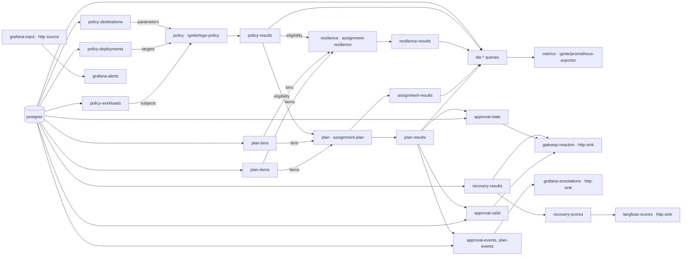

# Contracts: Drasi does the real work

Phase 0 of [drasi-native-plan.md](drasi-native-plan.md). Every workstream builds
against this file. Where it names a file, that file is the source of truth and
already exists in this branch.

## Summary

| Contract | One line | Source of truth |
|---|---|---|
| [Settings](#1-settings) | Every port, the compose project, the publication and slot and the storage key come from `demo/ports.env`; this copy uses +1000 ports and project `ignite-native` | `demo/ports.env`, `demo/ports.default.env` |
| [Build and test](#2-build-and-test) | One crate at a time, shared `ignite-native/.cargo-target`, at most 4 jobs | `demo/.cargo/config.toml` |
| [Schema](#3-schema) | The JSON model becomes `ignite_workloads`, `ignite_deployments`, `ignite_routes`, `ignite_policy_destinations`, `ignite_approvals`; `ignite_scenario` holds `run_epoch` and `revision` | this file |
| [Graph](#4-graph) | Context queries → Rego plugin → `policy-results` → optimizer (plan, resilience) → result queries → tile queries → Prometheus reaction; approvals and events → HTTP reactions | this file |
| [Element contracts](#5-element-contracts) | `PolicyDecision`, `Assignment`, `Plan`, `LossScenario`, `Resilience`, and the rows each plugin reads | this file |
| [Rego policy plugin](#6-rego-policy-plugin) | `ignite/rego-policy`; the Rego module is configuration, allowed destinations are data | `plugins/policy` |
| [Optimizer plugin](#7-optimizer-plugin) | `ignite/assignment-plan` and `ignite/assignment-resilience` over `good_lp` (microlp) | `plugins/optimizer` |
| [Prometheus reaction](#8-prometheus-reaction) | `ignite/prometheus-exporter`: current rows of each tile query as gauges on `/metrics` | `plugins/prometheus` |
| [Metric contract](#9-metric-contract) | One metric per Grafana tile, `-1` or no series means Unknown | `plugins/prometheus/examples/ignite.json` |
| [Reaction contract](#10-reaction-contract) | Drasi HTTP sinks call the gateway configuration API, Grafana annotations and Langfuse scores; idempotent on `x-drasi-delivery-id` and approval state, compare-and-set on revision | this file |
| [Drasi API check](#11-drasi-api-check) | Every API the plugins need exists in this drasi-core checkout; no gap blocks workstreams 1–7 | this file |

## 1. Settings

`demo/ports.env` is the only place that names a port, the compose project, the
PostgreSQL publication and slot, or the browser storage key. An exported variable
of the same name overrides a line; `IGNITE_SETTINGS=<file>` selects another file;
`ports.default.env` has the original demo's values (never run those beside it).
The file holds no secrets: the web app receives all of it.

| Setting | This copy | Original |
|---|---|---|
| `IGNITE_PROJECT` | `ignite-native` | `ignite-observability` |
| `IGNITE_PG_PUBLICATION` / `IGNITE_PG_SLOT` | `ignite_rework` | `ignite_native` |
| `IGNITE_STORAGE_KEY` | `ignite-native-stage-v1` | `ignite-presentation-stage-v3` |
| `IGNITE_DRASI_API_PORT` | 19421 | 18421 |
| `IGNITE_DRASI_ALERT_PORT` (HTTP source) | 19422 | 18422 |
| `IGNITE_DRASI_METRICS_PORT` (Prometheus reaction) | 19423 | 18423 |
| `IGNITE_WORKLOAD_PORT` | 19500 | 18500 |
| `IGNITE_DEPLOYMENT_EU_A/EU_B/US_C_PORT` | 19531–19533 | 18531–18533 |
| `IGNITE_UI_PORT` / `_UI_TEST_PORT` / `_UI_FIXTURE_PORT` | 19580 / 19581 / 19582 | 18580 / 18581 / 18582 |
| `IGNITE_GRAFANA_PORT` / `IGNITE_LANGFUSE_PORT` | 14000 / 14001 | 13000 / 13001 |
| `IGNITE_OTLP_PORT` / `IGNITE_PROMETHEUS_PORT` | 15318 / 20090 | 14318 / 19090 |
| `IGNITE_POSTGRES_PORT` / `IGNITE_PROBE_PORT` | 16432 / 19888 | 15432 / 18888 |

Readers (use these, never a literal):

| Consumer | Reader |
|---|---|
| Rust (AI service, config generator, plugins' tests) | crate `ignite-settings`: `ignite_settings::get().port("WORKLOAD")`, `.url(..)`, `.deployment_port("EU-A")`, `.get("IGNITE_PG_SLOT")` |
| Python (`ops/`, `tests/`) | `ops/settings.py`: `settings.port`, `settings.url`, `settings.container("postgres")`, `settings.PUBLICATION`, `SLOT`, `PROJECT`, `TARGET` |
| Shell, compose | `eval "$(python3 ops/settings.py)"`; `ops/observability-stack.sh` does this, passes `--project-name "$IGNITE_PROJECT"`, and writes the Prometheus scrape target for the reaction to `.native/prometheus-targets/drasi.json` |
| SQL | `ops/native-runtime.py` passes `-v publication=… -v slot=…` to psql; the SQL uses `:'publication'` and `:"publication"` |
| Vite, Playwright, Node scripts | `demo/ui/settings.mjs` (`settings`, `port`, `url`) |
| Browser code | `demo/ui/src/settings.ts` (`settings.storageKey`, `.grafana`, `.langfuse`, `.server`); Vite defines the values |
| Grafana provisioning | `$IGNITE_WORKLOAD_PORT`, `$IGNITE_DRASI_ALERT_PORT` from the container environment (compose) |
| Probe container | `LANGFUSE_PUBLIC_URL` (compose) |
| Grafana dashboard JSON | Generated by `observability/grafana/dashboards.py`, which reads the Langfuse port |

`demo/.env` (secrets) is generated per copy by `ops/observability-stack.sh env`
and its `DATABASE_URL` carries the PostgreSQL port at generation time.

## 2. Build and test

One Cargo build folder for the copy: `ignite-native/.cargo-target`, set by
`demo/.cargo/config.toml` (and by `ops/native-build.sh` for drasi-core and
Server crates), at most 4 jobs. Build and test one crate at a time; never
`--workspace` in drasi-core or drasi-server and never their full suites. Plugins
depend only on `drasi-computation-plugin-sdk`, `drasi-computation-contracts`
(and `drasi-core-types` for element types in the two transformers). Each plugin
keeps its logic in plain modules with host-free tests and has one SDK-level test
in `lib.rs`. Run from `demo/`:

| Workstream | Build | Test |
|---|---|---|
| 1. Data model and AI service | `cargo build --locked -p ignite-workloads` | `cargo test --locked -p ignite-workloads`, `cargo test --locked -p ignite-settings --lib`; database tests against this copy's PostgreSQL (`python3 ops/native-runtime.py sql`) |
| 2. Rego policy plugin | `cargo build --locked -p ignite-policy --lib --features ignite-policy/dynamic-plugin` | `cargo test --locked -p ignite-policy --lib` |
| 3. Optimizer plugin | `cargo build --locked -p ignite-optimizer --lib --features ignite-optimizer/dynamic-plugin` | `cargo test --locked -p ignite-optimizer --lib` |
| 4. Prometheus reaction | `cargo build --locked -p ignite-prometheus --lib --features ignite-prometheus/dynamic-plugin` | `cargo test --locked -p ignite-prometheus --lib` |
| 5. Grafana | `python3 observability/grafana/dashboards.py` | against a fixture `/metrics` file served on a spare port (not 19423) |
| 6. Desk and projector | `cd ui && npx tsc --noEmit` | `cd ui && npm test` (fixture server on `IGNITE_UI_FIXTURE_PORT`) |
| 7. Graph integration | `cargo check --locked -p ignite-config`; `ops/native-build.sh` (the only workstream that builds Drasi Server and drasi-core plugins, including `drasi-computation-sink-http`) | `tests/native-integration.py` and the live demo |

`cargo test` also runs the crate's doc tests; `--lib` skips them. A drasi-core
crate outside `native-build.sh` is built with
`CARGO_TARGET_DIR=$PWD/../../../../.cargo-target cargo build --locked --manifest-path ../../../../drasi-core/Cargo.toml -p <crate> --lib`.

## 3. Schema

`database/schema.sql` and `workload.sql` (workstream 1). Every row a query reads
carries `run_epoch`. `revision` is the scenario revision: it increases by one on
every change to routes, policy destinations, workloads or deployments, never for
health reports, tasks or approvals.

| Table | Columns | Written by | Published to Drasi |
|---|---|---|---|
| `ignite_scenario` | `singleton` PK, `run_epoch`, `revision` | reset, every scenario change | yes |
| `ignite_workloads` | `id` PK (`support`, `batch`), `run_epoch`, `data_class` (`restricted`, `public`), `region_requirement` (`EU`, `any`), `model`, `demand_tpm` | reset, desk controls | yes |
| `ignite_deployments` | `id` PK (`EU-A`, `EU-B`, `US-C`), `run_epoch`, `region`, `model`, `capacity_tpm` | reset, desk controls | yes |
| `ignite_routes` | `workload` PK, `run_epoch`, `deployment`, `approval` (nullable), `applied_ms` | reset, `POST /routes/apply` only | yes |
| `ignite_policy_destinations` | `id` PK (`{workload}/{deployment}`), `run_epoch`, `workload`, `deployment` | reset, desk policy edit (the talk's policy change) | yes |
| `ignite_approvals` | `id` PK, `run_epoch`, `candidate_id`, `basis`, `revision` (plan's scenario revision), `status` (`pending`, `applied`, `rejected`, `verified`), `reason`, `latest` (bool), `requested_ms`, `decided_ms`, `applied_revision`, `verified_ms` | approval tool (insert), gateway configuration API (status) | yes |
| `ignite_deliveries` | `id` PK (`x-drasi-delivery-id`), `received_ms`, `result` | gateway configuration API | no |
| `ignite_simulation` | `deployment` PK, `mode` (`ok`, `failed`, `throttled`), `reporting` | demo controls; read only by the simulated deployments and health monitor | **no**: Drasi sees health only through reports |
| `ignite_reports`, `ignite_tasks`, `ignite_attempts`, `ignite_breaches` | unchanged | AI service (health monitor, gateway) | yes |
| `ignite_receipts` | unchanged | gateway | no |

Removed: `ignite_model` (payload), `ignite_endpoints`, `ignite_commands`,
`ignite_publications`, `ignite_audit`, `ignite_alerts` (Grafana alerts arrive
through the Drasi HTTP source as `GrafanaAlert` nodes).

Seed (`reset.sql`): workloads `support` (restricted, EU, `support-model`,
60 000) and `batch` (public, any, `support-model`, 80 000); deployments EU-A
and EU-B (EU) and US-C (US), all `support-model`, 100 000; routes support → EU-A,
batch → EU-B; destinations support: EU-A, EU-B; batch: EU-A, EU-B, US-C;
`revision` 1; all simulation modes `ok`.

The monotonic trigger moves from `ignite_model` to `ignite_scenario` (revision
+1 per change). `latest` is set on the inserted approval and cleared on the
others in the same transaction.

## 4. Graph

Component names are fixed here; the config generator (workstream 7) maps them to
component IDs. Context queries filter to the current run by joining
`ignite_scenario` on `run_epoch`.

Plugins read query outputs only (a query between every two plugins), bootstrap
from their upstream outputs' snapshots (`output_snapshots` dependency on a
`nativeOutputSnapshots` resource that lists every upstream output), and are
volatile: a restart rebuilds them from those snapshots.

## 5. Element contracts

Rows are query result rows (`QueryChangeCodec::decode_row`); elements are graph
nodes a plugin emits, keyed by `id` in the plugin's own stream. All IDs and
lists are emitted in sorted order; all hashes are lowercase hex SHA-256 of
canonical JSON (sorted keys, no whitespace).

### Rows the plugins read

| Query | Port | Columns |
|---|---|---|
| `policy-workloads` | policy `subjects` | `id`, `run_epoch`, `data_class`, `region_requirement`, `model`, `demand_tpm` |
| `policy-deployments` | policy `targets` | `id`, `run_epoch`, `region`, `model`, `capacity_tpm` |
| `policy-destinations` | policy `parameters` | `id`, `run_epoch`, `workload`, `deployment` |
| `plan-items` | optimizer `items` | `id` (workload), `run_epoch`, `revision` (scenario), `demand_tpm`, `deployment` (current route) |
| `plan-bins` | optimizer `bins` | `id`, `run_epoch`, `capacity_tpm`, `status` (`ok`, `failed`, `throttled`, or `unknown` once the latest report expires, via `drasi.trueLater`) |
| `policy-results` | optimizer `eligibility` | `id`, `subject`, `target`, `state`, `allowed`, `reason`, `policy_hash`, `basis`, `run_epoch` |

### `PolicyDecision` (Rego plugin)

One node per subject × target, `id` = `{subject}/{target}`.

| Property | Meaning |
|---|---|
| `subject`, `target` | Keys of the pair |
| `state` | `allowed`, `denied` or `unknown` |
| `allowed` | `true` only when `state` = `allowed`; otherwise `false` |
| `reason` | The rule's reason, or why the result is unknown |
| `policy_hash` | SHA-256 of rule and module |
| `basis` | SHA-256 of `policy_hash`, the subject row, the target row and the subject's parameter rows |
| `run_epoch` | Copied from the subject row |

Emitted only when one of these properties changes; deleted when its subject or
target row is deleted. Nothing is emitted until all three ports have loaded their
snapshots.

### `Plan` and `Assignment` (plan factory)

`Plan`, one node, `id` = `plan`:

| Property | Meaning |
|---|---|
| `state` | `feasible`, `infeasible` or `unknown` |
| `candidate_id` | SHA-256 of `basis` and `assignments`; `""` unless feasible |
| `basis` | SHA-256 of the exact items, bins (with health) and eligibility solved |
| `revision` | The items' scenario revision (all items must agree, else `unknown`) |
| `assignments` | JSON text object `{item: bin}`; `"{}"` unless feasible |
| `moves` | Items whose bin differs from `current` |
| `peak_utilisation` | Largest assigned demand / capacity over bins used (0–1) |
| `reason` | Plain-English explanation |
| `run_epoch`, `solved_ms` | Run; solve time |

`Assignment`, one node per item while the plan is feasible (deleted otherwise),
`id` = item key: `item`, `bin`, `current`, `moved` (bool), `demand_tpm`,
`candidate_id`, `run_epoch`.

### `LossScenario` and `Resilience` (resilience factory)

`LossScenario`, one per healthy bin, `id` = the lost bin: `lost`, `state`
(`feasible`, `infeasible`, `unknown`), `assignments` (JSON text), `reason`,
`basis`, `run_epoch`.

`Resilience`, one node, `id` = `resilience`:

| Property | Meaning |
|---|---|
| `state` | `safe` (every single loss leaves a feasible plan), `at_risk` (some loss or the baseline is infeasible), `unknown` |
| `first_failure` | Lowest-sorted bin whose loss leaves no plan; `""` if none |
| `baseline` | Plan state with no loss |
| `unhealthy_bins` | Bins whose health is unhealthy now |
| `basis`, `run_epoch` | As for `Plan` |

### Unknown, never a guess

A plugin emits `unknown` (and no `Assignment`) when an input has not loaded,
a bin's health is outside the configured healthy and unhealthy values, an
(item, bin) pair has no eligibility or eligibility `unknown`, items disagree on
`revision` or `run_epoch`, or evaluation or solving errors or exceeds its time
limit.

## 6. Rego policy plugin

Factory `ignite/rego-policy` (`plugins/policy`), transformer, ports
`subjects`, `targets`, `parameters` (inputs) and `out`. Configuration
(`plugins/policy/examples/ignite.json`):

| Field | Type | Meaning |
|---|---|---|
| `module` | string, required | Rego source. The config generator inlines `plugins/policy/ignite.rego`. Changing it is a configuration update |
| `rule` | string, required | Rule evaluated per pair, e.g. `data.ignite.assessment`; must return `{"allowed": bool, "reason": string}` |
| `subjects.key` | string, required | Key property of subject rows |
| `targets.key` | string, required | Key property of target rows |
| `parameters.subjectKey`, `.targetKey` | string, required | Properties of a parameter row naming its subject and target |
| `epochProperty` | string, default `run_epoch` | Copied from the subject |
| `timeoutMs` | integer 1–10000, default 250 | Bound on one evaluation |

Rego input per pair: `{"subject": row, "target": row, "parameters": [the
subject's parameter rows]}`. The example module reproduces today's
`placement.rego` (the unit test `evaluate::tests` proves the four cases):
support may use EU-A and EU-B, never US-C (restricted data stays in the EU);
batch may use all three; removing EU-B from support's destinations denies it.
The talk's policy edit is a data change to `ignite_policy_destinations`; a rule
change is a component configuration update.

Implementation (workstream 2, done): `evaluate` (Rego, host-free), `decide`
(pairs, basis, unknown rules, changed-only diff, host-free) and the component
in `lib.rs`. Behaviour beyond the table above:

- **Ports and edges:** each port takes any number of edges; rows are keyed by
  edge and record identity. A port with no edge, or an edge whose snapshot has
  not loaded, means nothing is emitted. An edge added after start is read from
  its snapshot at once; a removed edge drops its rows.
- **Upstream restart:** an envelope from a new producer epoch makes the plugin
  re-read that edge's snapshot (no component failure).
- **Unknown** (and `allowed = false`) also when: a row has no key property or
  cannot be decoded (every pair); distinct rows share a subject or target key;
  subject, target or parameter rows carry different `run_epoch` values; the
  rule's result is undefined or not `{allowed: bool, reason: string}`.
- **Time bound:** regorus's execution timer (`timeoutMs`) stops iteration; a
  single long builtin call runs to completion and is then reported as unknown.
- **Invalid module** (does not compile) fails construction, so a bad rule
  update is rejected rather than turning every decision unknown.
- **Output:** stream and element namespace `{component id}/out`; changes are
  `Insert`/`Replace`/`Delete` nodes in sorted `id` order, one envelope per
  input envelope. The plugin also serves an output snapshot on `out`
  (`output_snapshots: [out]`), ready once all three ports have loaded, so a
  downstream query can bootstrap from it.
- **Basis** hashes canonical JSON of `{policy_hash, subject, target,
  parameters}` with parameter rows sorted and de-duplicated, so row order never
  changes it. A settled decision is reused while its basis is unchanged.

## 7. Optimizer plugin

Factories `ignite/assignment-plan` and `ignite/assignment-resilience`
(`plugins/optimizer`), transformers, ports `items`, `bins`, `eligibility` and
`out`, using `good_lp` 1.15 with `microlp`. Configuration
(`plugins/optimizer/examples/ignite.json`):

| Field | Meaning |
|---|---|
| `items` | `key`, `demand` (integer ≥ 0), `current` (bin now), `revision` |
| `bins` | `key`, `capacity` (integer ≥ 0), `health.property`, `health.healthy` (values that are usable), `health.unhealthy` |
| `eligibility` | `itemKey`, `binKey`, `state`, `allowed` |
| `constraints` | Must include `assignEachItemOnce` (nothing is shed) and `binCapacity` |
| `objective` | Lexicographic: `fewestMoves`, then `lowestPeakUtilisation`; remaining ties broken by sorted item and bin keys, so results are deterministic |
| `epochProperty` | Default `run_epoch` |
| `coalesceMs` | Default 100; changes inside the window are solved together |
| `timeLimitMs` | Default 2000; then `unknown` |

Solving runs off the async runtime on one bounded worker per plugin; a result
for superseded inputs is discarded. Only healthy bins receive items; resilience
removes each healthy bin in turn.

Required outcomes (unit tests in `solve.rs`, from today's `domain/src/decision.rs` tests; the talk's capacity beat, "not if … fails", must also match the walkthrough):

| Inputs | Plan | Resilience |
|---|---|---|
| Seed, all healthy | feasible, 0 moves | safe |
| EU-A failed | support → EU-B, batch → US-C (2 moves) | at_risk, first failure EU-B |
| EU-A failed, then EU-B removed from support's destinations | infeasible | at_risk |
| Healthy, batch on US-C, EU-B capacity 50 000 | feasible | at_risk, first failure EU-A |
| US-C failed | feasible | at_risk, first failure EU-A |
| A report expired | unknown | unknown |

## 8. Prometheus reaction

Factory `ignite/prometheus-exporter` (`plugins/prometheus`), sink, one input
port `in` with any number of edges, `SinkCompletion::Accepted`, `binds_inputs`,
output snapshots (like Drasi's SSE sink). Configuration
(`plugins/prometheus/examples/ignite.json`):

| Field | Meaning |
|---|---|
| `listen` | `127.0.0.1:{IGNITE_DRASI_METRICS_PORT}` (the generator sets it) |
| `path` | Default `/metrics` |
| `outputs` | Alias → `{component, port}`, as in Drasi's HTTP and SSE sinks |
| `metrics` | Alias → list of `{metric, help, value, labels, constLabels}`: each row of that output becomes one series per entry; `value` names a numeric or boolean property; `labels` maps label → property |

Behaviour: on start, read each output's snapshot, then apply inserts, updates
and deletes; serve the Prometheus text format (`text::render`, done). Always
export `drasi_reaction_input_ready{output="<alias>"}` (1 after the snapshot
loaded, 0 before or after the input fails). A row whose value is null or
missing produces no series. Metric names follow Prometheus rules; one HELP per
name. Prometheus scrapes it every 2 s as job `drasi` at
`host.containers.internal:{IGNITE_DRASI_METRICS_PORT}` (already in
`observability/prometheus.yaml` through `file_sd`; no further edit needed).

## 9. Metric contract

All gauges, from `plugins/prometheus/examples/ignite.json`. **Unknown** is
either value `-1` (Drasi answered "unknown") or no series. For counts and
"nothing yet" states a missing series means the stated value only while
`drasi_reaction_input_ready{output=…} == 1`; Grafana writes it as
`<expr> or on() ((drasi_reaction_input_ready{output="<alias>"} == 1) * 0 + <value>)`.
Workload labels stay `support` and `batch`; Grafana relabels `batch` as
"summaries". Values in tokens per minute are raw; Grafana divides by 1000.

| Tile (dashboard) | Metric | Labels | Values | Missing while ready | Query (alias) |
|---|---|---|---|---|---|
| Support overdue; Support requests waiting (overdue line); Grafana alerts firing; alert "Support requests overdue (Drasi)" (Operations) | `ignite_drasi_overdue_requests` | `workload` | count | 0 | `tile-overdue` (`overdue`) |
| Deployment status (Operations); Deployments (Recovery plan) | `ignite_drasi_deployment_status` | `deployment` | 0 healthy, 1 throttled ("Over quota"), 2 failed, -1 unknown | — | `tile-deployments` (`deployments`) |
| Deployments (Recovery plan) | `ignite_drasi_deployment_capacity_tpm` | `deployment` | capacity | — | `tile-deployments` |
| Capacity · tokens/min (Recovery plan) | `ignite_drasi_capacity_tpm` | `kind` = `total`, `healthy`, `needed` | sum | — | `tile-capacity` (`capacity`: total, healthy), `tile-demand` (`demand`: needed) |
| Recovery (both) | `ignite_drasi_recovery_state` | — | 0 awaiting evidence, 1 verified, 2 nothing to verify, -1 unknown | 2 | `tile-recovery` (`recovery`) |
| Action needed (both) | `ignite_drasi_action_needed` | — | 0 none, 1 approve proposed plan, 2 no valid plan, 3 at risk, -1 unknown | — | `tile-action` (`action`) |
| Safe if one fails? (both) | `ignite_drasi_safe_if_one_fails` | `lost` | 1 yes, 0 no (`lost` = first failure), 2 already one down, -1 unknown | — | `tile-resilience` (`resilience`) |
| Running now (Recovery plan) | `ignite_drasi_running_tpm` | `workload`, `deployment` | demand; negative = held (policy denies its route) | — | `tile-running` (`running`) |
| Proposed plan (Recovery plan) | `ignite_drasi_proposed_tpm` | `workload`, `deployment` | demand on the planned deployment | no plan | `tile-proposed` (`proposed`) |
| Customer support / Document summaries may run on (Recovery plan) | `ignite_drasi_policy_allowed` | `workload`, `deployment` | 1 allowed, 0 not allowed, -1 unknown | — | `tile-policy` (`policy`) |
| Last approval (Recovery plan) | `ignite_drasi_last_approval_state` | `approval` | 1 approved, applying; 2 applied, awaiting evidence; 3 applied and verified; 4 rejected; -1 unknown | 0 none yet | `tile-last-approval` (`last-approval`) |

The ordinary-monitoring tiles (model calls, errors, answer time, support queue)
stay on the AI service's OpenTelemetry metrics. `ignite_drasi_dashboard`,
`ignite_drasi_valid_until_seconds`, `ignite_drasi_projection_timestamp_seconds`
and `ignite_workload_capacity_tpm` go away; Grafana's "valid until" checks become
the readiness rule above.

Tile queries (sketches; workstream 7 owns the final text). `S` is
`ignite_scenario` joined on `run_epoch`, which keeps each tile to the current
run:

| Query | Returns |
|---|---|
| `tile-overdue` | Tasks of the current run not completed or cancelled with `drasi.trueLater(true, t.deadline_ms)`: `workload`, `count(t) AS value` |
| `tile-deployments` | Deployments with their latest report: `deployment`, `capacity_tpm`, `status` = 0/1/2 from `ok`/`throttled`/`failed`, -1 once `drasi.trueLater(true, r.expires_ms)` |
| `tile-capacity` | One row: `sum(capacity_tpm) AS total_tpm`, `sum(CASE status 'ok' …) AS healthy_tpm` |
| `tile-demand` | One row: `sum(w.demand_tpm) AS needed_tpm` |
| `tile-recovery` | Recovery result for the latest applied approval at the current revision: 1 confirmed, 0 otherwise, -1 when its evidence expired |
| `tile-action` | `Plan` with `Resilience`: -1 if either unknown; 2 infeasible; 1 feasible with `moves > 0`; 3 `moves = 0` and resilience `at_risk` and `unhealthy_bins = 0`; else 0 |
| `tile-resilience` | `Resilience`: 2 if `unhealthy_bins > 0`; 1 safe; 0 at_risk with `lost` = `first_failure`; -1 unknown |
| `tile-running` | Routes ⨝ workloads ⨝ `PolicyDecision` of that route: `demand_tpm`, negated when `allowed = false` (held); shown positive while policy is unknown |
| `tile-proposed` | `Assignment` where `Plan.state = 'feasible'`: `workload`, `deployment` (= bin), `demand_tpm` |
| `tile-policy` | `PolicyDecision`: 1/0/-1 from `state` |
| `tile-last-approval` | The approval with `latest = true`: `pending` 1, `applied` 2, `verified` 3, `rejected` 4 |

## 10. Reaction contract

### HTTP reactions (native `drasi.network/http-sink`)

All use `successStatusCodes: [200]`. Every request carries
`x-drasi-component`, `x-drasi-port` and `x-drasi-delivery-id`
(`{component}/{port}/{sequence}.{ordinal}`; stable across retries of one producer
run, new after a Server restart, because the queries are volatile). Secrets are
host references (`env:…` on the `configuration` resource), exported by
`ops/native-runtime.py run` from `.env`.

| Reaction | Outputs (alias ← query) | Request | Policy |
|---|---|---|---|
| `gateway-reaction` | `approve` ← `approval-valid` (added) | `POST {workload}/routes/apply`, body `{"approval":"{{after.approval}}","candidate_id":…,"basis":…,"expected_revision":{{after.expected_revision}},"assignments":{{{after.assignments}}}}` | `failurePolicy: strict`, `maxRetries: 10`, `retryBudgetMs: 30000`, `timeoutMs: 5000` |
| | `reject` ← `approval-stale` (added) | `POST {workload}/approvals/{{after.approval}}/reject`, body `{"reason": {{json after.reason}}}` | same |
| | `verified` ← `recovery-verified` (added) | `POST {workload}/approvals/{{after.approval}}/verified`, body `{"verified_ms": {{after.verified_ms}}}` | same |
| `grafana-annotations` | `events` ← `approval-events`, `plan-events` (added) | `POST {grafana}/api/annotations`, `token` = `env:IGNITE_GRAFANA_TOKEN` (service account, workstream 5), body `{"time":{{after.at_ms}},"tags":["ignite-decision","{{after.id}}"],"text":{{json after.text}}}` | `failurePolicy: skip`, `maxRetries: 3` |
| `langfuse-scores` | `scores` ← `recovery-scores` (added) | `POST {langfuse}/api/public/scores`, `secretHeaders.authorization` = `env:IGNITE_LANGFUSE_AUTHORIZATION` (`Basic …`), body `{"id":"{{after.id}}","traceId":"{{after.trace_id}}","name":"drasi_recovery","value":1,"dataType":"NUMERIC","comment":{{json after.comment}}}` | `failurePolicy: skip`, `maxRetries: 3` |

Driving queries:

| Query | Row | When |
|---|---|---|
| `approval-valid` | `approval`, `candidate_id`, `basis`, `expected_revision` (= approval's `revision`), `assignments` | Approval `pending` and `Plan` `feasible` with the same `candidate_id`, `basis` and `revision` |
| `approval-stale` | `approval`, `reason` (e.g. "The plan changed since it was approved") | Approval `pending` and the `Plan` differs or is not feasible |
| `recovery-verified` | `approval`, `verified_ms` | Recovery result `confirmed` for an `applied` approval (today's `recovery-results` rule) |
| `approval-events` | `id` = `{approval}-{status}`, `at_ms`, `text` ("Approved: …", "Applied: …", "Rejected: …", "Recovery verified: …") | Approval status changed within the last 30 s (`NOT drasi.trueLater(true, decided_ms + 30000)`) |
| `plan-events` | `id` = `plan-{candidate_id}`, `at_ms`, `text` ("Drasi proposes a plan: …") | `Plan` feasible with `moves > 0`, stable for 2 s (`drasi.trueFor`) |
| `recovery-scores` | `id` = `{task}-recovery-{approval}`, `trace_id`, `comment` | Support tasks completed at the applied revision of a verified approval |

### AI service APIs (stand-ins for external systems)

| API | Caller | Request | Effect and response |
|---|---|---|---|
| `POST /approvals` (approval tool) | Desk | `{"id"?: string, "candidate_id", "basis", "revision"}` | Inserts a `pending` approval (the ID is generated unless given; a repeated ID is a no-op) and makes it `latest`. No validation of the plan. `200 {"id"}` |
| `POST /routes/apply` (gateway configuration) | `gateway-reaction` only | as above, header `x-drasi-delivery-id` | In one transaction: a delivery ID already in `ignite_deliveries` returns its recorded result; an approval not `pending` → `200 {"result":"duplicate"}`; `ignite_scenario.revision ≠ expected_revision` → approval `rejected` with reason "Scenario changed since the plan (revision N, plan revision M)" and `200 {"result":"conflict"}`; otherwise routes are written, revision +1, approval `applied` with `applied_revision` → `200 {"result":"applied","revision":N+1}` |
| `POST /approvals/{id}/reject` | `gateway-reaction` only | `{"reason"}` | `pending` → `rejected` with Drasi's reason; any other status is a no-op. `200` |
| `POST /approvals/{id}/verified` | `gateway-reaction` only | `{"verified_ms"}` | `applied` → `verified`; any other status is a no-op. `200` |

Rules: compare-and-set on `revision` is ordinary optimistic concurrency, not a
policy check: the gateway never re-evaluates policy, plans or approvals. Every
terminal outcome (applied, duplicate, conflict, no-op) answers 200 so the sink
does not retry it; malformed requests answer 400 (permanent); a database outage
answers 503 (the sink retries). Idempotency holds across Server restarts because
it is keyed on the approval's state as well as the delivery ID.

Implementation details (workstream 1, `workloads/src/external.rs`):

- **Responses.** Apply answers `{"result":"applied","revision":N}`,
  `{"result":"duplicate","status":…}` or `{"result":"conflict","reason":…}`;
  reject and verified answer `{"result":"rejected"|"verified"}` or
  `{"result":"no-op","status":…}`.
- **Permanent errors.** 400 for a missing `x-drasi-delivery-id`, a body that
  does not parse, a `candidate_id`/`basis` that differs from the stored approval,
  or `assignments` that do not name every workload once with a known deployment
  (a structural check; any route is accepted, policy is never consulted). 404
  for an unknown approval ID.
- **Earlier run.** A pending approval from before a reset is rejected by apply
  with "The demo was reset after this approval" (`conflict`).
- **Routes.** Apply updates only routes whose deployment changes, setting their
  `approval` and `applied_ms`, then raises the revision once.
- **`decided_ms`** is the time of the approval's latest status change
  (applied, rejected or verified), so `approval-events` sees each change.
- **`ignite_breaches`** is no longer written: the AI service's observer that
  persisted `deadline-history` rows (Drasi results) is removed. The table stays
  (empty) until workstream 7 drops `breach-history` or reads `deadline-history`.
- **Revision.** Desk configuration (capacity, destinations) and apply each raise
  `ignite_scenario.revision` by one per transaction that changes a row;
  simulation controls never do.
- **Prune.** `ops/native-runtime.py run` also deletes earlier-run approvals and
  all `ignite_deliveries` before Server starts (a restart issues new delivery IDs).

Demo controls stay demo controls: reset may delete the previous run's Grafana
annotations (tag `ignite-decision`) as today; that is the demo driver, not
Drasi. The Grafana contact point posts to the Drasi HTTP source at
`http://host.containers.internal:$IGNITE_DRASI_ALERT_PORT/alerts/grafana`.

Known limits: Grafana's annotation API has no idempotency key, so a retried
POST whose response was lost, or a Server restart within 30 s of an event,
can duplicate an annotation (tagged with the same event ID). Langfuse scores
upsert on `id`; workstream 7 confirms Langfuse accepts these non-UUID IDs and
otherwise derives a UUID-shaped ID in the query.

## 11. Drasi API check

Checked in this checkout (drasi-core `ef341573`, drasi-server `16777e5`) by
reading the SDK and host and compiling the three plugin skeletons against them.

| Need | Status | Evidence |
|---|---|---|
| Transformer with several named input ports | Supported | Ports are declared per factory (the query transformer has `in` and `bootstrap`); the host passes every incoming edge to `bind_inputs` with its `input_port`, `output` and `stream` (`lib/src/computation/v1/graph.rs`, `snapshot_input_bindings`). Only restriction: one producer output may not feed two input ports of one component, which this graph never does |
| Many edges into one input port | Supported | GPU lab `policy` and `gpu-demo-ui` |
| Bootstrap from several upstream snapshots | Supported | `nativeOutputSnapshots` takes a list of outputs; `NativeOutputSnapshots::snapshot(endpoint, schema)` per binding |
| Native sink with output snapshots and its own listener | Supported | `drasi.network/sse-sink` (`supports_output_snapshots`, `binds_inputs`, `SinkOutputs`); the export allows output snapshots for `Sink` and `Transformer`, but not together with consumer progress, so the Prometheus reaction is volatile |
| HTTP reactions with templates, secret headers and delivery IDs | Supported | `drasi-computation-sink-http` (`CONFIGURATION.md`): routes per alias, Handlebars `url`/`template`, `token`, `secretHeaders`, `x-drasi-delivery-id`, `failurePolicy` |
| `drasi.trueFor`, `drasi.trueLater` | Supported | `core/src/evaluation/functions/future` |
| `good_lp` 1.15 + `microlp`, `regorus` 0.12 | Available offline | Plugin unit tests pass |

No gap blocks workstreams 1–7. To watch:

1. **Volatile query bootstrapped from upstream snapshots** (removing today's
   `recovery-results` workaround) was not supported when today's demo was built
   ("cannot bind a result catalog"); it is unverified here. Workstream 7 keeps
   the workaround if it still fails.
2. **Named input ports on a native plugin** are allowed by the host but no
   existing native plugin uses them. Workstream 7 runs `drasi-server validate`
   on the new graph first; the fallback is one `in` port per plugin, routing by
   `InputBinding.stream`.
3. **HTTP sink replays after restart**: it has no snapshot handling, and new
   producer identities after a restart change delivery IDs; the APIs above are
   idempotent on approval state for this reason.
4. **`OPTIONAL MATCH`** parses but is not relied on; counts use the readiness
   rule in [section 9](#9-metric-contract).

## 12. What each workstream changes

| Workstream | Owns | Must not edit |
|---|---|---|
| 1 | `database/`, `workloads/`, `domain/` (remove `decision.rs` when unused), `ops/workload.py`, `ops/native-runtime.py` | `ports.env`, root `Cargo.toml` |
| 2 | `plugins/policy` | shared files |
| 3 | `plugins/optimizer` | shared files |
| 4 | `plugins/prometheus` | shared files, `observability/prometheus.yaml` (done) |
| 5 | `observability/grafana`, `ops/observability-env.py` (service-account token) | `compose.yaml` except Grafana's environment |
| 6 | `../presentation`, `ui/` | `ui/settings.mjs` |
| 7 | `ops/config`, `drasi/`, `ops/native-build.sh`, root `Cargo.toml` (removing `plugins/capacity` and `plugins/decisions`) | — |
