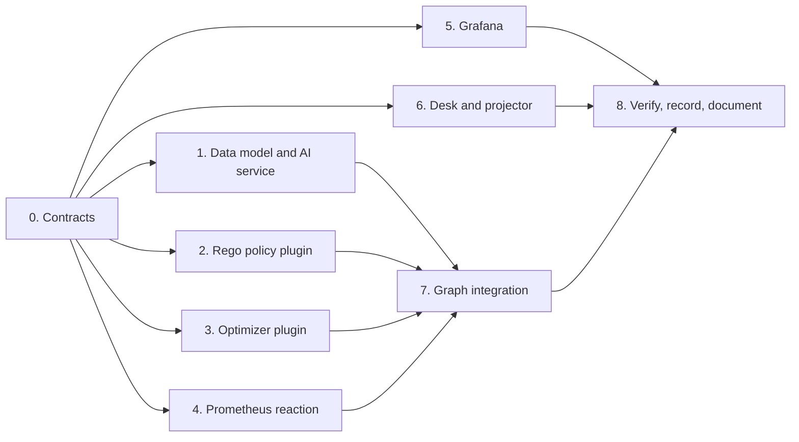

# Plan: Drasi does the real work

## Summary

**Goal.** Keep every capability the talk shows today, but make Drasi do all of
the work the talk attributes to it. The AI service becomes only what a real
company already has: the application (gateway, traffic, simulated model
deployments), its own telemetry, and the systems Drasi talks to (a change-approval
tool and a gateway configuration API). Nothing presented as Drasi is computed
anywhere else.

**What changes, in one line each:**

1. **Data model:** the scenario JSON blob becomes normal tables (workloads,
   deployments, routes, policy parameters, approvals), so Drasi queries and models
   read real rows.
2. **Policy model:** a native Rego transformer plugin whose rules are its
   configuration.
3. **Planner and what-if models:** one native optimizer plugin wrapping `good_lp`,
   configured with the items, capacities, eligibility and objective; the what-if is
   the same plugin in "lose one" mode.
4. **Prometheus reaction:** a native sink plugin that Prometheus scrapes. Every
   Drasi tile in Grafana comes from it.
5. **Tile queries:** one continuous query per tile, returning exactly the number
   Grafana shows.
6. **Approvals and outcomes:** Drasi decides whether an approval is still valid
   and its reactions apply or reject it, write recovery outcomes, and post Grafana
   annotations and Langfuse scores.
7. **AI service:** loses the dashboard projection, result subscriptions, approval
   checks, recovery confirmation, publication queue and its own Rego check.
8. **Desk and slides:** read Drasi directly; the script, docs and diagrams say
   only true things.

**Timing.** Estimated 3–4 working days with parallel agents; the talk is on
Nov 19. Build it on a separate branch and keep today's demo working and recorded
as the fallback. Decide on Nov 18 whether it is ready to present (see
[Risks and schedule](#risks-and-schedule)).

**Parallel work.** One short contract phase, then six agents in parallel on
separate folders, then one integration agent, then a shared verification phase.

## Boundary: who does what

| Job | Today | After |
|---|---|---|
| Serve requests, retry, route to the configured deployment | AI service | AI service (the application) |
| Simulate three model deployments, failures, throttling | AI service | AI service (simulated external systems) |
| Report deployment health every second | AI service polls stubs | AI service (simulated health monitor) |
| Request metrics and traces (OpenTelemetry) | AI service | AI service (the application's own telemetry) |
| Traffic generator, demo controls, reset | AI service | AI service (demo driver) |
| Record a human approval | AI service API | AI service as the change-approval tool: inserts an approval row, nothing else |
| Change routes | AI service after its own checks | AI service as the gateway configuration API, called only by a Drasi reaction; compare-and-set on revision |
| Which requests are late; deployment status | Drasi queries | Drasi queries (unchanged) |
| Where each workload may run | Drasi model (hard-coded Rego wrapper) + gateway re-checks Rego | Drasi Rego plugin only |
| Best plan; safe if one fails | Drasi models (hand-written brute force) | Drasi optimizer plugin (`good_lp`) |
| Is an approval still valid | AI service compares basis | Drasi query; reaction applies or rejects |
| Did recovery work | Drasi query, then AI service rechecks in SQL and records it | Drasi query; reaction records it |
| Every Drasi tile value | AI service projection → OTLP → Prometheus | Drasi tile queries → Prometheus reaction → Prometheus |
| Decision annotations, Langfuse scores | AI service publication queue | Drasi HTTP reactions |
| Grafana alerts into Drasi | AI service webhook → table → query | Grafana contact point → Drasi HTTP source |
| Desk and projector "Drasi's answers" | AI service `/api/decisions`, `/api/context` | Drasi Server attach API |

## 0. Contracts (one agent, first, about half a day)

Everything else builds against these. Write them to `plan/contracts.md`, add crate
skeletons and workspace members so later agents never edit the same files.

**Done:** [contracts.md](contracts.md), `demo/ports.env` (this copy: ports +1000,
project `ignite-native`), the `ignite-settings` crate and readers for every
consumer, plugin skeletons in `plugins/policy`, `plugins/optimizer` and
`plugins/prometheus`, the Prometheus scrape job, and the shared build folder.

- **Run beside today's demo:** every port, the container project name, the
  PostgreSQL publication and slot, and the browser storage key come from one
  settings file (for example `demo/ports.env`), used by `compose.yaml`, the `ops/`
  scripts, the config generator, the AI service, the web app and the tests. This
  copy uses its own values (for example every port +1000 and project
  `ignite-native`), so it never touches the running demo.

- **Schema** (`database/schema.sql`, `workload.sql`): replace `ignite_model.payload`
  with `ignite_workloads` (id, data class, region requirement, demand tpm,
  revision), `ignite_deployments` (replaces `ignite_endpoints`: id, region, model,
  capacity tpm), `ignite_routes` (workload → deployment, revision),
  `ignite_policy_destinations` (workload → allowed deployment), `ignite_approvals`
  (id, candidate id, basis, status, reason, timestamps). Keep `run_epoch` and a
  scenario revision row. Drop `ignite_publications`, `ignite_receipts`,
  `ignite_alerts`, `ignite_audit` if nothing else needs them.
- **Plugin configuration schemas** for the Rego, optimizer and Prometheus plugins
  (below), with example configurations for this graph.
- **Element contracts:** labels and properties each plugin consumes and emits
  (`PolicyDecision`, `Assignment`, `Plan`, `LossScenario`).
- **Metric contract:** for every Grafana tile, the metric name, labels, value
  encoding (including Unknown) and the query that produces it. Grafana (5) and
  integration (7) both work from this table.
- **Reaction contract:** each HTTP reaction's target, method, template and
  success codes; the gateway configuration API's request and its compare-and-set
  rule.
- **Ports:** Prometheus reaction listener `IGNITE_DRASI_METRICS_PORT` (19423 in this
  copy), reachable from the Prometheus container as
  `host.containers.internal:19423`.

## 1. Data model and AI service (agent A)

Folders: `database/`, `workloads/`, `ops/workload.py`, `ops/native-runtime.py`.

- Migrate to the new tables; `reset.sql` seeds them; desk controls write them.
- Remove `dashboard.rs`, `observer.rs`, the projection and publication parts of
  `decisions.rs`, the Langfuse score and annotation writers, and the gateway's Rego
  check and `drasi_policy_allowed` score. The gateway routes by `ignite_routes` only.
- Keep: gateway, retries, simulated deployments, health reporter, traffic, demo
  controls, reset, OpenTelemetry request metrics and traces, `/tasks/{id}`.
- New small APIs that stand in for external systems:
  - **Approval tool:** `POST /approvals` inserts a pending row with the candidate
    and basis the presenter saw. No validation.
  - **Gateway configuration:** `POST /routes/apply`, `POST /approvals/{id}/reject`
    and `POST /approvals/{id}/verified`, called only by Drasi reactions. Apply is idempotent on the delivery ID and
    succeeds only if the scenario revision still matches (normal optimistic
    concurrency, not a policy check).
- Tests: Rust unit tests for the remaining code; `tests/workload-telemetry.py`
  updated.

**Done when** the service has no code that reads Drasi results, and every write it
makes is either a simulation, a demo control, or a call it received.

## 2. Rego policy plugin (agent P)

Folder: `plugins/policy` (replaces the policy part of `plugins/decisions`).

- Native transformer, factory `ignite/rego-policy`, built on `regorus`.
- Configuration: `module` (Rego source), `rule` (for example
  `data.ignite.assessment`), and the key properties of the rows on its three
  input ports: `subjects` (workloads), `targets` (deployments) and `parameters`
  (allowed destinations).
- Inputs: multiple ports, one per mapping. Output: one `PolicyDecision` element
  per subject × target with `allowed`, `reason`, `policy_hash` and a `basis`
  hash of its inputs. Emit only changed pairs.
- A policy rule change is a component configuration update; a policy parameter
  change (the talk's policy edit) is a data change.
- Bounded evaluation time; on error or incomplete inputs emit `unknown`, never
  `allowed`.
- Describe itself (volatile transformer), snapshot bootstrap, unit tests with the
  current `placement.rego` cases.

## 3. Optimizer plugin (agent O)

Folder: `plugins/optimizer` (replaces `plugins/decisions` and `domain/src/decision.rs`).

- Native transformer, two factories from one crate: `ignite/assignment-plan` and
  `ignite/assignment-resilience`. Uses `good_lp` with the `microlp` backend, as the
  GPU lab does.
- Configuration: items (port, key, demand property, current-assignment property),
  bins (port, key, capacity property, health predicate), eligibility (port, item and
  bin keys, allowed property), constraints (assign every item exactly once,
  capacity), objective (lexicographic: fewest moves, then lowest peak use), time
  limit.
- Plan output: `Assignment` elements and one `Plan` element with `state`
  (`feasible`, `infeasible`, `unknown`), `candidate_id`, `basis` (hash of the exact
  inputs solved), `moves` and `reason`.
- Resilience output: one `LossScenario` per healthy bin removed, plus a summary
  with the first bin whose loss leaves no plan.
- Coalesce input changes (about 100 ms), solve off the async runtime on one
  bounded worker, discard results for superseded inputs.
- Unit tests reproduce today's outcomes: failure plan (support → EU-B, summaries →
  US-C), infeasible after the policy edit, "not if EU-B fails" at EU-A 50k.

## 4. Prometheus reaction (agent R)

Folder: `plugins/prometheus`.

- Native sink plugin, factory `ignite/prometheus-exporter`, many inputs.
- Configuration: `listen` address; per output alias: `metric`, `help`, `value`
  property, `labels` (property → label), optional constant labels.
- Keeps each input's current rows (insert, update, delete; snapshot on start) and
  serves the Prometheus text format on `/metrics`.
- Also exports `drasi_reaction_input_ready{output}`. An input that is not
  attached or not bootstrapped exports no series, so Grafana shows no data, which
  the tiles render as Unknown.
- Tests: text-format golden tests; insert, update and delete; restart and
  snapshot; scrape under load.
- The scrape job is already in `observability/prometheus.yaml` (phase 0).

## 5. Grafana (agent G)

Folder: `observability/grafana`.

- Re-point every Drasi tile and the "Support requests overdue (Drasi)" alert at
  the reaction's metrics from the metric contract. Keep the layout, colours and
  wording.
- Replace "valid until" staleness logic with no-data handling.
- Point the Grafana contact point at the Drasi HTTP source
  (`host.containers.internal:$IGNITE_DRASI_ALERT_PORT/alerts/grafana`) instead of
  the AI service.
- Add a Grafana service-account token to `.env` generation for the annotation
  reaction.
- Test against a fixture `/metrics` file before integration.

## 6. Desk and projector (agent U)

Folders: `presentation/`, `ui/`.

- Read Drasi's answers (plan, policy, resilience, recovery, approval outcome)
  from Server's attach API through the existing `/server` proxy, the way the query
  slide already does. Keep the AI service only for controls and `/tasks/{id}`.
- The approval buttons submit to the approval tool; the outcome comes back from
  Drasi.
- Update the fixture server and UI tests to the new data shapes.

## 7. Graph integration (agent I, starts once 1–4 have working builds)

Folders: `ops/config`, `drasi/`, `ops/native-build.sh`.

- Queries over the new tables replace the payload-based context queries.
- Wire: source → context queries → Rego plugin → policy results → optimizer
  (plan and resilience) → result queries.
- **Tile queries** (one per tile, filtered to the current run and revision):
  overdue per workload, deployment status, recovery, action needed, safe if one
  fails, running now, proposed plan, may-run-on grids, capacity, last approval.
- **Approval check query:** a pending approval joined to the current `Plan`;
  `valid` when candidate and basis match. HTTP reaction to `routes/apply` or
  `approvals/{id}/reject` with Drasi's reason.
- **Recovery:** `recovery-results` bootstrapped from its upstreams' snapshot
  outputs (removing today's workaround); a reaction records the verified outcome
  on the approval.
- **Annotations and scores:** event queries (debounced with `drasi.trueFor`) to
  HTTP reactions for Grafana's annotations API and Langfuse's scores API.
- **Remove unused branches:** the capacity plugin and `endpoint-context`, or make
  the capacity tile use them.
- Build the three new plugins and `drasi-computation-sink-http` in
  `native-build.sh`.

## 8. Verify, record, document (all, last)

- Integration tests (`decision-integration`, `recovery-integration`,
  `workload-telemetry`) rewritten against Drasi's outputs, not the AI service.
- `walkthrough.mjs capture`, then a human rehearsal; `walkthrough.mjs record` for
  new fallback clips.
- Slides and script: "reactions" become literal; "Drasi in one picture" lists the
  real components; remove any claim that is no longer needed.
- `README.md`, `SETUP.md`, `PRESENTER.md`, `DEVELOPERS.md`, `DRASI.md` and both
  diagrams updated; `DRASI.md`'s "real and demo-ware" table shrinks to the
  simulations.
- Release qualification: `ops/release.py cycles`, `soak`, `preflight`, `stamp`.

## Working rules for parallel agents

- Work only in `drasi-features/ignite-native/` (linked checkouts of community,
  drasi-core and drasi-server on `agentofreality-ignite-native`). Never touch
  `drasi-features/ignite/`: that is today's demo and the fallback, and it stays
  running.
- Each agent edits only its folders; the contract phase creates all shared files.
- **Build and test in isolation; never the whole tree.**
  - Build and test only the crate you change: `cargo build -p <crate>`,
    `cargo test -p <crate> --lib` (or a named `--test`). Never `--workspace` in
    drasi-core or drasi-server, and never their full test suites.
  - Plugins depend only on the plugin SDK and contracts crates, not on drasi-lib
    or Server, so a plugin builds in minutes.
  - Put the logic in plain Rust modules with unit tests that need no host: Rego
    evaluation, the solver, Prometheus text formatting. Add one SDK-level test per
    plugin for its factory, description and input/output handling.
  - The AI service is tested with `cargo test -p ignite-workloads` and, where it
    needs a database, the copy's own PostgreSQL container.
  - One shared Cargo build folder for the copy
    (`ignite-native/.cargo-target`), so drasi-core dependencies compile once and
    every agent reuses them. Cap `CARGO_BUILD_JOBS` at 4.
  - Only the integration agent builds Drasi Server and runs the full graph, and
    only after the plugins pass their own tests.
- Only agents I and the verification phase run the live demo. Plugin agents test
  with unit tests and their own test harness on spare ports.
- Problems found in drasi-core or drasi-server are fixed there on
  `agentofreality-ignite` and noted in `DEVELOPERS.md`.

## Risks and schedule

| Risk | Mitigation |
|---|---|
| Not ready for Nov 19 | Separate branch; today's demo stays deployable and recorded. Go/no-go on Nov 18 after a full walkthrough |
| Multi-input native transformers or sinks hit Drasi gaps | The GPU lab already uses multi-input transformers and native sinks; agents check that first and report early |
| Reaction delivery semantics (duplicates, retries) | Idempotent APIs keyed on `x-drasi-delivery-id`; compare-and-set on revision |
| Prometheus reaction loses state on restart | It rebuilds from the query snapshot; staleness shows as Unknown, as today |
| Grafana timing changes the story's pacing | Scrape every 2 s, as today; walkthrough timings checked |

| Day | Work |
|---|---|
| 1 (morning) | 0. Contracts |
| 1–2 | 1–6 in parallel |
| 2–3 | 7. Integration |
| 3–4 | 8. Verify, record, document; go/no-go |

## Decisions

1. **Timing:** start now on a separate branch. Today's demo stays the fallback;
   go/no-go on Nov 18 after a full walkthrough.
2. **Policy edit in the talk:** policy parameters change as data (the desk edits
   `ignite_policy_destinations`); the Rego rules are the plugin's configuration.
3. **Health reports:** the AI service stays the simulated health monitor, checking
   each deployment every second.
4. **Capacity branch:** removed; the capacity tile is a query.
