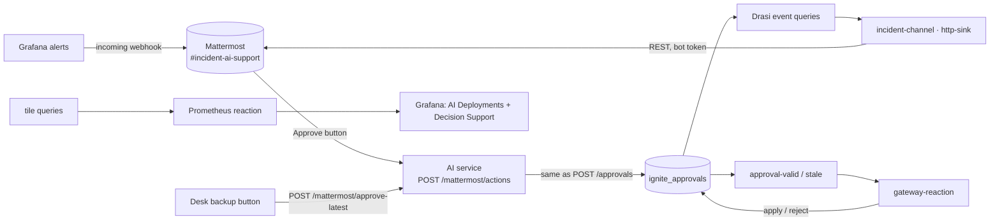

# Plan: incident channel and Decision Support

## Summary

**Goal.** Make the failure, recovery and resilience part of the talk look like
real operations. Grafana alerts raise the incident; Drasi posts the incident in a
real chat channel (a local **Mattermost**), proposes the policy-aware,
capacity-checked fix with an **Approve** button, keeps the proposal current,
applies it once approved and verifies it. One operations dashboard, with an
**AI Deployments** row (today's monitoring) and a **Decision Support** row
(Drasi), replaces the two dashboards. The presenter approves on the projected
Mattermost card; the desk keeps one backup button.

This answers items 4 (headings, (i) icons, panel menus), 5 and 7 of
`work-remaining.md` § Things to Change in the Presentation.

**What changes, in one line each:**

1. **Mattermost platform (A):** a Mattermost container in this copy's stack,
   bootstrapped by the ops scripts (admin, team, `#incident-ai-support`, the
   `drasi` bot, the `oncall` user, an incoming webhook for Grafana), secrets in
   `.env`; an action endpoint in the AI service that turns a card's button into
   the existing approval request.
2. **Drasi incident cards (B):** seven event queries and one HTTP reaction,
   `incident-channel`, that posts each card to Mattermost's REST API; approval
   outcomes reply in the approved card's thread.
3. **Grafana (C):** one dashboard (`ignite-workload`) with two rows; new tiles
   Change status, Recommended action, Failover readiness; descriptions back on
   every panel; a stable `key` per panel; the Recovery plan dashboard removed;
   Grafana alerts also post to the channel.
4. **Desk and projector (D):** a projected Mattermost view; "Select proposed
   plan" and "Approve selected plan" replaced by one backup button, "Approve the
   proposed change"; the failure, who, recovery and resilience beats rewritten
   so the presenter knows what to click and what the audience sees.

Every interface between these is fixed in [contracts.md](contracts.md),
sections 13–19.

**Order.** Step 1 is this plan and the contract (done with this commit). Then
A, B, C and D run in parallel against the contract. B can test its reactions
against Mattermost as soon as A has the container and bootstrap up (A's first
deliverable); until then B tests templates against a local capture server.
Integration and the screenshot pass come last, coordinated by the delivery
session.

## A. Mattermost platform

Owner: this session. Files: `demo/compose.yaml` (the `mattermost` service and
Grafana's one new environment line), `demo/observability/mattermost/Containerfile`,
`demo/ops/observability-stack.sh`, `demo/ops/observability-env.py`, new
`demo/ops/mattermost.py`, `demo/ports.env`, `demo/ports.default.env`, the
settings readers (`ops/settings.py` needs no change; `ui/settings.mjs` and
`ui/src/settings.ts` gain `mattermost`), `demo/ops/native-runtime.py` (exports
the bot token; stamps `.native/mattermost.json`), `demo/database/` (three
nullable columns on `ignite_approvals`, status `declined`), `demo/workloads/`
(the action endpoint and the desk's backup press), tests for the endpoint.

1. **Container.** Mattermost Team Edition 12.1.0 built for ARM64 from the official release archive, its database
   `mattermost` in the existing PostgreSQL container, plugins off, telemetry
   off, about 400 MB. Port `IGNITE_MATTERMOST_PORT` (19065 here, 18065 in the
   original's defaults).
2. **Bootstrap** (`ops/mattermost.py bootstrap`, run by `observability-stack.sh
   up`): idempotent; creates what is missing and never prints a secret.
3. **Action endpoint** `POST /mattermost/actions` and the desk's
   `POST /mattermost/approve-latest`; the card's button and the desk button go
   through the same Mattermost action, so they do exactly the same thing.
4. **Projection.** Mattermost allows framing from the web app's origin, and the
   projector's browser is signed in as `oncall` without typing a password.
5. **Reset.** The AI service's `POST /reset` (the desk's Reset) also clears the
   channel, as it clears Grafana's decision annotations.
6. **Docs.** SETUP (start, sign-in, troubleshooting), DEVELOPERS (the container,
   the endpoint, the tokens), architecture diagram (Mattermost box).

Done when the bootstrap is idempotent from an empty volume and from today's
volumes, a card posted with the contract's JSON shows its buttons, pressing
Approve creates the approval row and updates the card, and the endpoint's tests
pass.

## B. Drasi event queries and HTTP reaction

Files: `demo/drasi/incident-*.cypher` (new), `demo/drasi/approval-events.cypher`
(declined text only), `demo/ops/config/src/main.rs` (queries, the
`incident-channel` reaction, the three new tile aliases from C), contract tests
in `demo/tests/` (new `incident-channel-integration.py`) and
`tests/drasi_outputs.py`.

1. Seven event queries (contracts § 14), each debounced and bounded in time.
2. The `incident-channel` HTTP reaction to Mattermost's REST API with the bot
   token; the card JSON exactly as contracts § 14.
3. Wiring for C's tile queries `tile-change`, and the changed `tile-action` and
   `tile-resilience` (`ops/config` TILES and DESK lists).
4. Tests: each card's trigger and debounce, threading of outcomes, no repost
   after a Server restart more than 60 s after the event.
5. Docs: DRASI.md (the event queries and the reaction), DEVELOPERS.md (graph).

## C. Grafana

Files: `demo/observability/grafana/` (`dashboards.py`, `dashboards/`,
`provisioning/`), `demo/drasi/tile-*.cypher`,
`demo/plugins/prometheus/examples/ignite.json` (metric contract), contracts § 9
and § 15, the observability tests' Grafana expectations.

1. One dashboard, two rows, stable panel keys (contracts § 15); delete
   `decisions.json` and the Recovery plan links.
2. New and changed tile queries and metrics: Change status, Recommended action,
   Failover readiness.
3. Panel descriptions back; panel header (title, (i), menu) stays visible in
   kiosk view without flicker.
4. Grafana contact point to Mattermost (contracts § 16).
5. Docs: README and DRASI.md tile names; the dashboard screenshot list.

## D. Desk and projector

Files: `presentation/Presenter.tsx`, `presentation/notes.ts` (sections
`failure`, `who`, `recovery`, `resilience` and the action list only),
the Mattermost view in `presentation/Audience.tsx` and the `StageView`/
`dashboards` lines in `presentation/scenes.ts` (targeted edits; the slides
session owns the rest of both), `demo/ui/` tests and fixture, `PRESENTER.md`
(through `npm run sync-presenter`), STORY.md.

1. Projected view `incident` (contracts § 17); the `plan` view goes.
2. Desk: remove `select-plan` and `approve-plan`; add `approve-change`
   (contracts § 18).
3. Beats: failure (the failure card and the Decision Support row), who is
   affected (overdue card, then the query slide), recovery (proposal card →
   Approve on the card → Applied → Verified, with the optional stale beat:
   policy edit → Out of date → approve the stale card → Rejected → policy back →
   new proposal), resilience (at-risk card, then restored). Each beat says what
   to click and what the audience sees, and lists the Grafana panel keys to
   highlight.
4. Tests: `npm test` (fixture gains the new endpoint and view), `npm run test:live`.

## Shared rules

See [contracts.md § 19](contracts.md#19-working-rules-for-the-incident-channel-work):
one rule for restarting the live stack, no data resets without telling the
delivery session first, targeted edits in shared files, commit only your paths.

## Risks

| Risk | Mitigation |
|---|---|
| Mattermost refuses framing | A sets `ServiceSettings.FrameAncestors` to the web app origin; if a header still blocks it, A serves Mattermost through a header-stripping proxy on its port. D only uses the URL in contracts § 17 |
| Podman memory (7.45 GiB VM) | Plugins off; measured with `podman stats` after bootstrap; the stack uses about 3.5 GiB today |
| A Server restart reposts cards | Each event query emits only within 60 s of its event; documented known limit |
| Drasi Cypher can't build a card string | B may simplify a field's text; the card's title, buttons and context fields are fixed |
| Card threading | Mattermost assigns post IDs and Drasi's sink ignores responses, so only approval outcomes can reply in a thread (the approval records the card's post ID); other cards are top-level, newest at the bottom |
