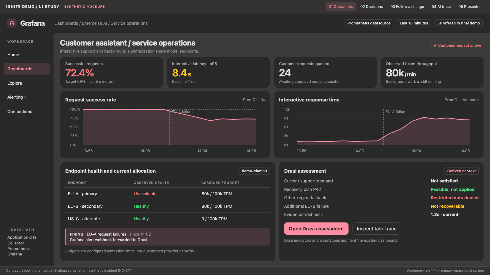
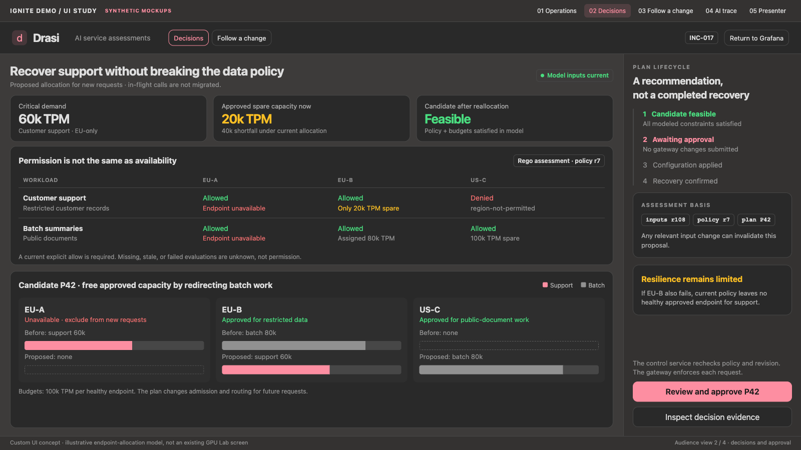
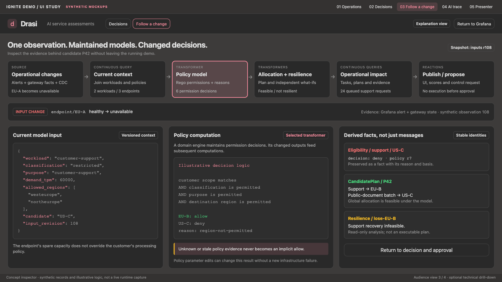
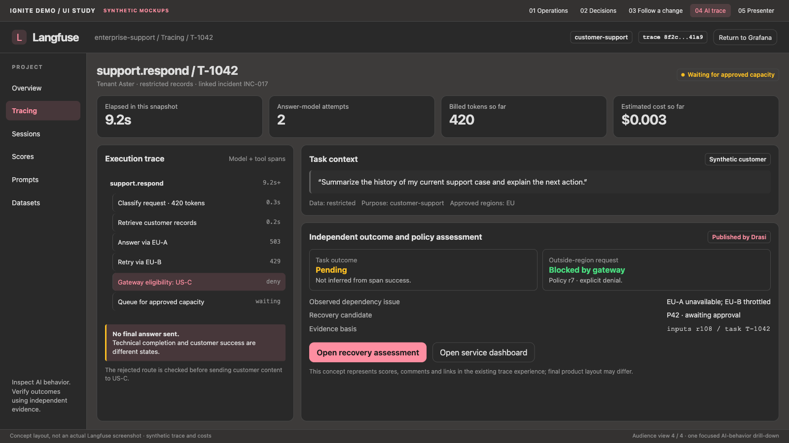
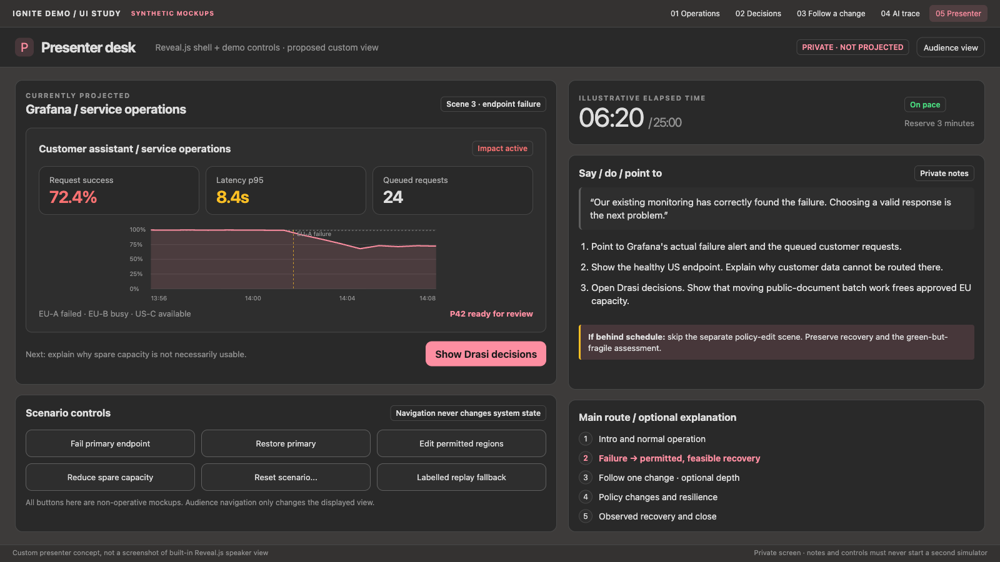

**Four audience-facing views across three tools**, plus **one private presenter screen**. Most of the presentation stays in Grafana. The two Drasi views are tabs in one application; Langfuse is a brief drill-down. **OTel and Prometheus do not need separate onstage UIs.**

These are conceptual mockups using one consistent synthetic incident—not actual product screenshots.

[Open the interactive mockup gallery](drasi-ignite-ui-mockups.html)

## 1. Grafana: the main operational screen

Recognizable metrics, infrastructure alerts, endpoint health, and a compact Drasi assessment. This is where each incident begins and recovery is demonstrated.

## 2. Drasi: decisions and approval

Shows why available capacity is not necessarily permitted capacity, the proposed reallocation, and the distinction between a feasible plan and confirmed recovery.

## 3. Drasi: follow one change

An optional technical view in the **same Drasi application**. It connects Sources, Queries, Transformers, and Reactions to concrete inputs, computations, and derived facts.

## 4. Langfuse: inspect one affected AI task

Shows model attempts, tool activity, costs, and the independent assessment supplied by Drasi. Use this briefly to connect infrastructure trouble to actual AI behavior.

## 5. Private presenter screen

Not projected. Combines your notes, timing, audience-view navigation, and explicit scenario controls. This is a proposed custom presenter desk, not Reveal.js’s built-in speaker screen.

The self-contained gallery is saved at `/Users/alljones/dev/scout/drasi-ignite-ui-mockups.html`. Navigation works; approval and scenario controls are clearly labelled non-operative mockups.